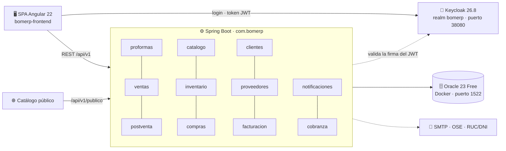

<div align="center">

# ❄️ SGE-JD · Sistema de Gestión Empresarial

**Backend modular para JD Refrigeración S.A.C.: proformas, ventas, compras, inventario, facturación y postventa en un solo sistema.**


[Inicio rápido](#-inicio-rápido) · [Funcionalidades](#-funcionalidades) · [Arquitectura](#-arquitectura) · [API](#-api) · [Documentación completa](src/main/resources/static/docs/README.md) · [Documentación publicada](https://ywagnercs.github.io/proyecto-SAC/)

</div>

---

## 📌 Sobre el proyecto

JD Refrigeración S.A.C. lleva 20 años en climatización, refrigeración y ventilación forzada, y gestionaba todo en hojas de cálculo desconectadas. **SGE-JD** centraliza el flujo comercial real del negocio:

```
Proforma  →  Venta  →  Facturación  →  Mantenimiento postventa
```

Es el **Proyecto Integrador** de ADS, BD2 y LP2 (Universidad Peruana Unión), construido sobre la base académica **BomERP**: un solo backend Spring Boot modular, una SPA Angular y una base Oracle.

---

## ✨ Funcionalidades

**12 módulos**, agrupados por tipo (*Proformas* antes se llamaba *Cotizaciones*):

| Tipo | Módulo | Qué hace |
|---|---|---|
| Maestro | 📦 **Catálogo** | Productos multimoneda (S/ y US$) con precio por margen; categorías; catálogo público sin costos internos |
| Maestro | 👥 **Clientes** | Datos maestros con autocompletado por RUC (SUNAT) y DNI (RENIEC) vía apis.net.pe |
| Maestro | 🚚 **Proveedores** | Datos maestros de proveedores con autocompletado por RUC/DNI |
| Transaccional | 📄 **Proformas** | Cálculo de IGV y totales, PDF corporativo y envío por correo; aceptar o rechazar |
| Transaccional | 🛒 **Ventas** | Venta directa cabecera-detalle o desde una proforma aceptada; contado o crédito; **anulación con restauración de stock** y aviso de devolución si el cliente ya pagó |
| Transaccional | 🏭 **Compras** | Compras a proveedor que suben el stock automáticamente |
| Soporte | 📉 **Inventario** | Alertas diarias de stock mínimo |
| Operativo | 🔧 **Postventa** | 4 mantenimientos preventivos automáticos (3/6/9/12 meses) tras vender equipos, y alertas a la oficina |
| Transaccional | 💰 **Cobranza** | Cuentas por cobrar: saldo por venta, abonos parciales o totales (un pago puede cubrir varias ventas), historial de cobros y **devoluciones** de ventas anuladas |
| Integración | 🧾 **Facturación** | Comprobante electrónico UBL 2.1 *(OSE simulado)* |
| Integración | ✉️ **Notificaciones** | Correo SMTP real y WhatsApp *(simulado)* |
| Transversal | 🔐 **Seguridad** | **Keycloak** (S10b): usuarios, roles y login fuera del backend; el backend valida el JWT (RS256) y autoriza por rol: ADMIN (Lisandro) y ASISTENTE (Lucy) |

📤 **Exportaciones e historial:** Excel de ventas y compras (con detalle línea por línea), PDF del comprobante, historial por cliente y por proveedor, y **kardex** de inventario por producto.

📊 **Reportes:** no son un módulo aparte. **Cada módulo expone sus propias consultas**: ventas (reporte filtrable por estado y fechas, resumen por periodo), cobranza (pendientes y atrasadas) y proformas (pendientes). *Hoy el resumen, la cobranza y las proformas pendientes siguen en el paquete `reportes`; falta moverlos a su módulo.*

💱 **Soles o dólares:** cada venta y proforma elige su moneda; los precios se convierten con el tipo de cambio SUNAT del día (editable), que queda guardado en la venta y en la factura.

**Reglas de negocio destacadas**
- El servidor calcula precios, IGV y totales: el cliente solo envía producto y cantidad.
- Los materiales no admiten stock negativo: si falta stock → `409` y se revierte toda la venta.
- Una venta va de `REGISTRADA` a `ANULADA` una sola vez (si se repite → `409`). Al anular se restaura el stock, se cancelan los mantenimientos pendientes, se emite una **nota de crédito** y, si el cliente ya pagó, queda una **devolución pendiente**. Una venta solo pasa a PAGADO por sus abonos.
- Cada producto pertenece a una **categoría**; una categoría con productos no se puede eliminar (`409`).

---

## 🏗️ Arquitectura

Monolito modular: **un proyecto Maven, un ejecutable**. Cada módulo es un paquete con capas `controller → service → repository`, y los módulos se comunican por servicios Java, nunca por HTTP interno.



---

## 🚀 Inicio rápido

**Requisitos:** JDK 21 · Maven · Docker Desktop · Node.js (para la SPA)

> **Uso diario (ya instalado):** doble clic en `scripts/iniciar_sgejd.bat`: enciende Docker, Oracle, Keycloak, el backend y la SPA, y abre el navegador. Para apagar, `detener_sgejd.bat`. Ver *Uso diario* en la [documentación completa](src/main/resources/static/docs/README.md#doc-tecnica).

**1. Levantar Oracle y Keycloak** (desde `bomerp-backend`, donde está `docker-compose.yml`). Antes, copiar `.env.example` como `.env` y poner las contraseñas: `docker compose` las lee de ahí.

```bash
docker volume create sge-jd-oracle-data       # solo la primera vez
docker compose up -d                          # o: docker start SGE-JD si Oracle ya existe
docker compose up -d keycloak-db keycloak     # identidad: importa keycloak/realm-bomerp.json
python keycloak/configurar_realm.py           # pone las contraseñas de .env a lisandro y lucy
```

Keycloak queda en `http://localhost:38080` (consola: usuario `admin`, contraseña `KC_ADMIN_PASSWORD` de `.env`). Detalles en [keycloak/README.md](keycloak/README.md).

**2. Configurar credenciales locales** (archivo ignorado por git)

```bash
cp src/main/resources/application-local.properties.example src/main/resources/application-local.properties
# completar: spring.datasource.password=<el mismo APP_USER_PASSWORD de .env>
```

**3. Ejecutar el backend**

```bash
mvn spring-boot:run
```

➡️ API en `http://localhost:8080` · Swagger en `http://localhost:8080/swagger-ui.html` · Documentación en `http://localhost:8080/docs/`

**4. Ejecutar la SPA** (rama `frontend`, carpeta `bomerp-frontend`)

```bash
npm install
npm start
```

➡️ `http://localhost:4200`

**Datos de demostración:** `datos_demo.sql` reinicia la base con 30 productos, 8 categorías, 7 proveedores y 8 clientes reales (verificados en SUNAT). Ver la [guía de instalación](src/main/resources/static/docs/README.md#doc-tecnica).

**Usuarios de desarrollo:** `lisandro` (ADMIN) · `lucy` (ASISTENTE) (cuentas de Keycloak; las contraseñas están en `bomerp-backend/.env` (no se versiona; plantilla en `.env.example`)). Las bases creadas antes del 15/10/2026 deben correr `migracion_auditoria_altos.sql` una vez, y las creadas antes del 25/10/2026, `migracion_devoluciones.sql`.

<details>
<summary>Variables de entorno disponibles</summary>

| Variable | Uso |
|---|---|
| `DB_URL`, `DB_USERNAME`, `DB_PASSWORD` | Conexión a Oracle |
| `MAIL_USERNAME`, `MAIL_PASSWORD` | Envío de correos (SMTP Gmail) |
| `DECOLECTA_TOKEN` | Respaldo para RUC/DNI si apis.net.pe no responde (token gratuito en decolecta.com) |
| `CONSULTA_DOCUMENTOS_SIMULADO` | `true` = RUC/DNI con datos de prueba, sin internet |
| `CORREO_OFICINA` | Destino de las alertas automáticas |
| `CORS_ALLOWED_ORIGINS` | Orígenes permitidos (por defecto `http://localhost:4200`) |

</details>

---

## 🔌 API

Base: `/api/v1/admin` (panel) · `/api/v1/publico` (sin login). Contrato completo en **Swagger UI**.

| Recurso | Endpoints principales |
|---|---|
| Ventas | `GET /ventas?estado=&desde=&hasta=` · `POST /ventas/directa` · `POST /ventas/desde-proforma/{id}` · `PATCH /ventas/{id}/anular` (solo ADMIN) |
| Proformas | `GET` `POST /proformas` · `POST /proformas/{id}/aceptar` · `/rechazar` · `/enviar` |
| Catálogo | CRUD `/productos` (con `?categoriaId=`) · CRUD `/categorias` · `GET /api/v1/publico/catalogo` |
| Compras | `GET` `POST /compras` · `GET /compras/{id}` |
| Clientes | CRUD `/clientes` · `/clientes/autocompletar/ruc/{ruc}` · `/autocompletar/dni/{dni}` |
| Proveedores | CRUD `/proveedores` · `/proveedores/autocompletar/ruc/{ruc}` · `/autocompletar/dni/{dni}` |
| Postventa | `GET /mantenimientos?vista=&dias=&clienteId=` · `GET /mantenimientos/resumen` · `PATCH /mantenimientos/{id}/realizado` · `PATCH /mantenimientos/{id}/reprogramar` |
| Cobranza | `GET /cobranza/por-cobrar` · `GET /cobranza/cobros` · `POST /cobranza/cobros` · `GET /cobranza/ventas/{id}/pagado` · `GET /cobranza/devoluciones` · `POST /cobranza/devoluciones/{id}/registrar` (solo ADMIN) |
| Consultas *(por mover a su módulo)* | `/reportes/ventas-resumen` · `/reportes/cobranza` · `/reportes/proformas-pendientes` |
| Auth | Token en Keycloak (`/realms/bomerp/protocol/openid-connect/token`) · `GET /api/v1/auth/perfil` |

Errores uniformes: `400` datos inválidos · `404` no encontrado · `409` regla de negocio o stock insuficiente.

---

## 📁 Estructura

```text
src/main/java/com/bomerp/
├── catalogo/        productos, categorías, catálogo público
├── clientes/        clientes + integración RUC/DNI
├── compras/         compras cabecera-detalle
├── config/          seguridad, CORS, manejo global de errores
├── facturacion/     comprobantes electrónicos (OSE)
├── inventario/      alertas de stock mínimo
├── notificaciones/  correo y WhatsApp
├── postventa/       mantenimientos preventivos, agenda y alertas
├── cobranza/        cobros (abonos), saldos de las ventas a crédito y devoluciones
├── proformas/       proformas (antes cotizaciones) + PDF
├── proveedores/     proveedores
├── reportes/        TRANSITORIO: consultas por repartir a ventas/, proformas/ y cobranza/
└── ventas/          ventas cabecera-detalle + anulación
```

La identidad no es un paquete: vive en **Keycloak** (`keycloak/`), y el backend solo la valida en `config/SecurityConfig`. Fuera de `src/`: `scripts/` (arranque, respaldo y limpieza), `pruebas-seguridad/` (matriz de permisos) y los `migracion_*.sql`.

---

## 🗺️ Avance (LP2)

- [x] **S1–S5** · Backend REST, CRUD, cabecera-detalle, reportes, CORS
- [x] **S7** · SPA Angular: layout, rutas, servicios HTTP
- [x] **S8** · CRUD de tablas dependientes
- [x] **S9** · Formulario transaccional de venta (FormArray), reporte filtrable y anulación
- [x] **S10** · Seguridad backend con roles (ruta **Keycloak**, S10b): Resource Server, ADMIN/ASISTENTE, perfil desde el JWT
- [x] **S11** · Seguridad frontend: login con Authorization Code + PKCE, `authGuard`/`rolGuard`, interceptor con refresco ante 401, menú por rol
- [x] **S12** · Evaluación de la Unidad II: producto [`lp2-demo.md`](https://ywagnercs.github.io/proyecto-SAC/#/lp2-demo) publicado
- [ ] **U3** · Optimización, paginación, pruebas end-to-end y despliegue

> ⚠️ **Pendientes conocidos:** las integraciones OSE y WhatsApp son simuladas y el correo no está configurado; falta repartir `reportes` entre sus módulos. Qué significa para el cliente: [LIMITACIONES.md](src/main/resources/static/docs/LIMITACIONES.md). Lista completa en **[Por verificar](src/main/resources/static/docs/README.md#por-verificar)**.

---

## 📚 Documentación

| Documento | Contenido |
|---|---|
| [Documentación completa](src/main/resources/static/docs/README.md) | Requerimientos (RF/RNF), modelo de datos, manual de usuario, trazabilidad y lista "Por verificar" |
| [Documentación publicada](https://ywagnercs.github.io/proyecto-SAC/) | La documentación completa, el producto de LP2 (`lp2-demo.md`) y la hoja para el cliente, en la web |
| [LIMITACIONES.md](src/main/resources/static/docs/LIMITACIONES.md) | Para Lisandro y Lucy: qué funciona de verdad, qué está simulado y qué decisiones faltan |
| [Contexto.md](Contexto.md) | Problema del negocio, decisiones de arquitectura, estado y equipo |
| Swagger UI | `http://localhost:8080/swagger-ui.html` (con el backend encendido) |

---

## 👥 Equipo · CherryTree

| Integrante | Módulos a cargo | Transaccional (cabecera-detalle) |
|---|---|---|
| **Yoel Wagner Chambi Sirena** | Proveedores · Proformas · Ventas | Proforma–ItemProforma · Venta–DetalleVenta |
| **Wilson Ronald Apaza Mamani** | Catálogo · Inventario · Compras · Postventa | Compra–DetalleCompra |
| **Aron Rodrigo Magaño Quispe** | Clientes · Facturación · Notificaciones · Cobranza | Cobro–DetalleCobro |

🔐 **Seguridad:** resuelta con **Keycloak** (S10b y S11), compartida por el equipo.

<div align="center">
<sub>Proyecto Integrador ADS · BD2 · LP2 — Universidad Peruana Unión · Cliente: JD Refrigeración S.A.C.</sub>
</div>
