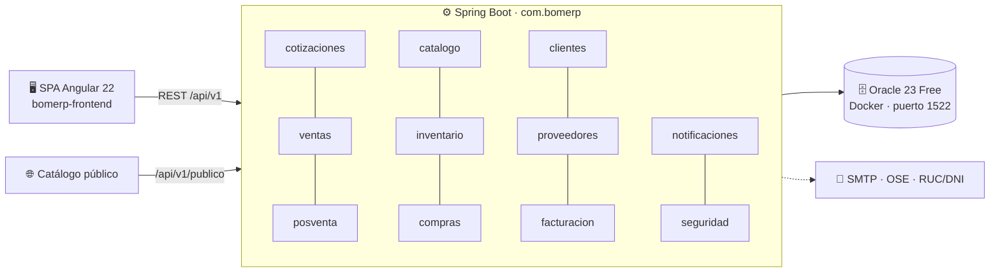

<div align="center">

# ❄️ SGE-JD · Sistema de Gestión Empresarial

**Backend modular para JD Refrigeración S.A.C.: cotizaciones, ventas, compras, inventario, facturación y postventa en un solo sistema.**


[Inicio rápido](#-inicio-rápido) · [Funcionalidades](#-funcionalidades) · [Arquitectura](#-arquitectura) · [API](#-api) · [Documentación completa](src/main/resources/static/docs/README.md)

</div>

---

## 📌 Sobre el proyecto

JD Refrigeración S.A.C. lleva 20 años en climatización, refrigeración y ventilación forzada, y gestionaba todo en hojas de cálculo desconectadas. **SGE-JD** centraliza el flujo comercial real del negocio:

```
Cotización  →  Venta  →  Facturación  →  Mantenimiento postventa
```

Es el **Proyecto Integrador** de ADS, BD2 y LP2 (Universidad Peruana Unión), construido sobre la base académica **BomERP**: un solo backend Spring Boot modular, una SPA Angular y una base Oracle.

---

## ✨ Funcionalidades

**11 módulos**, agrupados por tipo:

| Tipo | Módulo | Qué hace |
|---|---|---|
| Maestro | 📦 **Catálogo** | Productos multimoneda (S/ y US$) con precio por margen; categorías; catálogo público sin costos internos |
| Maestro | 👥 **Clientes** | Datos maestros con autocompletado por RUC/DNI *(simulado)* |
| Maestro | 🚚 **Proveedores** | Datos maestros de proveedores con autocompletado por RUC/DNI |
| Transaccional | 📄 **Cotizaciones** | Cálculo de IGV y totales, PDF corporativo y envío por correo; aceptar o rechazar |
| Transaccional | 🛒 **Ventas** | Venta directa cabecera-detalle o desde una cotización aceptada; contado o crédito; **anulación con restauración de stock** |
| Transaccional | 🏭 **Compras** | Compras a proveedor que suben el stock automáticamente |
| Soporte | 📉 **Inventario** | Alertas diarias de stock mínimo |
| Operativo | 🔧 **Posventa** | 4 mantenimientos preventivos automáticos (3/6/9/12 meses) tras vender equipos, y alertas a la oficina *(paquete `mantenimiento`)* |
| Integración | 🧾 **Facturación** | Comprobante electrónico UBL 2.1 *(OSE simulado)* |
| Integración | ✉️ **Notificaciones** | Correo SMTP real y WhatsApp *(simulado)* |
| Transversal | 🔐 **Seguridad** | Usuarios, roles `ADMIN` / `ASISTENTE`, login HTTP Basic + BCrypt *(JWT en S10)* |

📊 **Reportes:** no son un módulo aparte. **Cada módulo expone sus propias consultas**: ventas (reporte filtrable por estado y fechas, resumen por periodo, cobranza) y cotizaciones (pendientes). *Hoy el resumen, la cobranza y las cotizaciones pendientes siguen en el paquete `reportes`; falta moverlos a su módulo.*

**Reglas de negocio destacadas**
- El servidor calcula precios, IGV y totales: el cliente solo envía producto y cantidad.
- Los materiales no admiten stock negativo: si falta stock → `409` y se revierte toda la venta.
- Una venta va de `REGISTRADA` a `ANULADA` una sola vez; si se intenta anular de nuevo → `409`.

---

## 🏗️ Arquitectura

Monolito modular: **un proyecto Maven, un ejecutable**. Cada módulo es un paquete con capas `controller → service → repository`, y los módulos se comunican por servicios Java, nunca por HTTP interno.



---

## 🚀 Inicio rápido

**Requisitos:** JDK 21 · Maven · Docker Desktop · Node.js (para la SPA)

**1. Levantar Oracle** (desde la carpeta que contiene `docker-compose.yml`)

```bash
docker volume create sge-jd-oracle-data   # solo la primera vez
docker compose up -d                      # o: docker start SGE-JD si ya existe
```

**2. Configurar credenciales locales** (archivo ignorado por git)

```bash
cp src/main/resources/application-local.properties.example src/main/resources/application-local.properties
# completar: spring.datasource.password=<APP_USER_PASSWORD del docker-compose>
```

**3. Ejecutar el backend**

```bash
mvn spring-boot:run
```

➡️ API en `http://localhost:8080` · Swagger en `http://localhost:8080/swagger-ui.html` · Documentación en `http://localhost:8080/docs/`

**4. Ejecutar la SPA** (rama `frontend`, carpeta `bomerp-frontend`)

```bash
npm install
npm start
```

➡️ `http://localhost:4200`

**Usuarios de desarrollo:** `admin` / `asistente` · contraseña `123456`

<details>
<summary>Variables de entorno disponibles</summary>

| Variable | Uso |
|---|---|
| `DB_URL`, `DB_USERNAME`, `DB_PASSWORD` | Conexión a Oracle |
| `MAIL_USERNAME`, `MAIL_PASSWORD` | Envío de correos (SMTP Gmail) |
| `DECOLECTA_TOKEN` | Consulta real de RUC/DNI |
| `CORREO_OFICINA` | Destino de las alertas automáticas |
| `CORS_ALLOWED_ORIGINS` | Orígenes permitidos (por defecto `http://localhost:4200`) |

</details>

---

## 🔌 API

Base: `/api/v1/admin` (panel) · `/api/v1/publico` (sin login). Contrato completo en **Swagger UI**.

| Recurso | Endpoints principales |
|---|---|
| Ventas | `GET /ventas?estado=&desde=&hasta=` · `POST /ventas/directa` · `POST /ventas/desde-cotizacion/{id}` · `PATCH /ventas/{id}/anular` · `POST /ventas/{id}/marcar-pagada` |
| Cotizaciones | `GET` `POST /cotizaciones` · `POST /cotizaciones/{id}/aceptar` · `/rechazar` · `/enviar` |
| Catálogo | `GET /productos` · CRUD `/categorias` · `GET /api/v1/publico/catalogo` |
| Compras | `GET` `POST /compras` · `GET /compras/{id}` |
| Clientes | `GET` `POST /clientes` · `/clientes/autocompletar/ruc/{ruc}` · `/autocompletar/dni/{dni}` |
| Proveedores | CRUD `/proveedores` · `/proveedores/autocompletar/ruc/{ruc}` · `/autocompletar/dni/{dni}` |
| Posventa | `GET /mantenimientos` · `POST /mantenimientos/{id}/marcar-realizado` |
| Consultas *(por mover a su módulo)* | `/reportes/ventas-resumen` · `/reportes/cobranza` · `/reportes/cotizaciones-pendientes` |
| Auth | `GET /auth/me` |

Errores uniformes: `400` datos inválidos · `404` no encontrado · `409` regla de negocio o stock insuficiente.

---

## 📁 Estructura

```text
src/main/java/com/bomerp/
├── catalogo/        productos, categorías, catálogo público
├── clientes/        clientes + integración RUC/DNI
├── compras/         compras cabecera-detalle
├── config/          seguridad, CORS, manejo global de errores
├── cotizaciones/    cotizaciones + PDF
├── facturacion/     comprobantes electrónicos (OSE)
├── inventario/      alertas de stock mínimo
├── mantenimiento/   módulo Posventa (renombrar paquete a posventa/: pendiente)
├── notificaciones/  correo y WhatsApp
├── proveedores/     proveedores
├── reportes/        consultas por repartir a ventas/ y cotizaciones/ (pendiente)
├── seguridad/       usuarios, roles, autenticación
└── ventas/          ventas cabecera-detalle + anulación
```

---

## 🗺️ Avance (LP2)

- [x] **S1–S5** · Backend REST, CRUD, cabecera-detalle, reportes, CORS
- [x] **S7** · SPA Angular: layout, rutas, servicios HTTP
- [x] **S8** · CRUD de tablas dependientes
- [x] **S9** · Formulario transaccional de venta (FormArray), reporte filtrable y anulación
- [ ] **S10** · Seguridad backend con JWT y roles
- [ ] **S11** · Seguridad frontend (guards, interceptores, 401/403)
- [ ] **U3** · Optimización, paginación, pruebas end-to-end y despliegue

> ⚠️ **Pendientes conocidos:** la protección por login está desactivada en desarrollo, el reporte de ventas aún cuenta las anuladas, las integraciones RUC/OSE/WhatsApp son simuladas, y falta renombrar el paquete `mantenimiento` a `posventa` y repartir `reportes` entre sus módulos. Lista completa en **[Por verificar](src/main/resources/static/docs/README.md#por-verificar)**.

---

## 📚 Documentación

| Documento | Contenido |
|---|---|
| [Documentación completa](src/main/resources/static/docs/README.md) | Requerimientos (RF/RNF), modelo de datos, manual de usuario, trazabilidad y lista "Por verificar" |
| [CONTEXTO.md](CONTEXTO.md) | Problema del negocio, decisiones de arquitectura, estado y equipo |
| Swagger UI | `http://localhost:8080/swagger-ui.html` (con el backend encendido) |

---

## 👥 Equipo

| Integrante | Módulos a cargo | Enfoque |
|---|---|---|
| **Yoel Wagner Chambi Sirena** | Proveedores · Cotizaciones · Ventas · Posventa | Flujo comercial · coordinación con el cliente |
| **Wilson Ronald Apaza Mamani** | Catálogo · Inventario · Compras | Abastecimiento y stock |
| **Aron Rodrigo Magaño Quispe** | Clientes · Facturación · Notificaciones · Seguridad | Integraciones y transversales |

<div align="center">
<sub>Proyecto Integrador ADS · BD2 · LP2 — Universidad Peruana Unión · Cliente: JD Refrigeración S.A.C.</sub>
</div>
