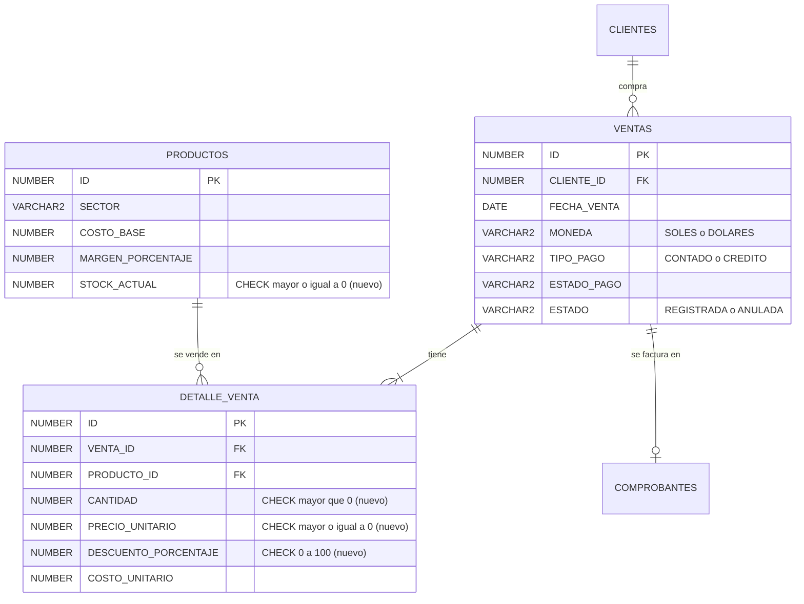

# BD2 · S1 · PL/SQL aplicado al negocio

**SGE-JD · JD Refrigeración S.A.C. · Equipo CherryTree · Yoel Wagner Chambi Sirena · 10/11/2026**

Trabajo autónomo de la sesión 1: el esquema y el primer motor transaccional PL/SQL de la entidad
transaccional del proyecto, la **venta** (`VENTAS`–`DETALLE_VENTA`).

Se ejecutó sobre la base de práctica `sge-jd-bd2`, una copia de los datos de desarrollo del 10/11/2026 con
237 ventas, 712 líneas, 39 productos y 37 clientes (ver [../README.md](../README.md)). Las salidas completas
quedan en `bd2/salidas/` al correr los scripts.

| Orden | Script | Se ejecuta como | Qué hace |
|---|---|---|---|
| 1 | [S01_01_esquema.sql](S01_01_esquema.sql) | SYSTEM (`-Dba -ClaveApp`) | Verifica el propietario `JDREFRIGERACION` y crea el usuario técnico `JD_APP` |
| 2 | [S01_02_tablas.sql](S01_02_tablas.sql) | JDREFRIGERACION | Revisa las tablas y agrega las reglas críticas como CHECK |
| 3 | [S01_03_plsql.sql](S01_03_plsql.sql) | JDREFRIGERACION | Dos funciones y el procedimiento de registro; permiso de ejecución para `JD_APP` |
| 4 | [S01_04_pruebas.sql](S01_04_pruebas.sql) | JDREFRIGERACION | Compara con Java, prueba un caso válido y tres rechazos; se puede repetir |

```powershell
cd C:\SGE-JD\bomerp-backend
.\bd2\herramientas\sql.ps1 bd2\S01\S01_01_esquema.sql -Dba -ClaveApp
.\bd2\herramientas\sql.ps1 bd2\S01\S01_02_tablas.sql
.\bd2\herramientas\sql.ps1 bd2\S01\S01_03_plsql.sql
.\bd2\herramientas\sql.ps1 bd2\S01\S01_04_pruebas.sql
```

## 1. Esquema y tablas del proyecto

| Usuario | Rol | Privilegios |
|---|---|---|
| `JDREFRIGERACION` | Propietario de las 29 tablas de SGE-JD | `CREATE SESSION, TABLE, VIEW, PROCEDURE, TRIGGER, SEQUENCE` |
| `JD_APP` (nuevo) | Usuario técnico de la aplicación | Solo `CREATE SESSION` y `EXECUTE` sobre `SP_REGISTRAR_VENTA` y `FN_TOTAL_VENTA`: no es dueño de nada ni toca las tablas directamente |

Las tablas de la operación ya existían, porque las creó LP2 con JPA. Su DDL está en
`scripts/prod/esquema_jdrefrigeracion.sql`:



Antes de agregar las reglas se comprobó que ningún dato existente las rompiera. Las seis cuentas dieron 0,
así que los cinco `ALTER TABLE` pasaron sin ORA-02293:

```
CANTIDAD_MALA PRECIO_MALO DESCUENTO_MALO      STOCK_NEGATIVO COSTO_NEGATIVO MARGEN_NEGATIVO
            0           0              0                   0              0               0
Table altered. (x5)
CK_DETALLE_VENTA_CANTIDAD · CK_DETALLE_VENTA_DESCUENTO · CK_DETALLE_VENTA_PRECIO · CK_PRODUCTO_COSTO_MARGEN · CK_PRODUCTO_STOCK
```

## 2. Operación transaccional

| Elemento | Respuesta |
|---|---|
| Proceso | Registrar una venta directa al contado de un producto |
| Entidad transaccional | `VENTAS` (cabecera) + `DETALLE_VENTA` (línea) + `PRODUCTOS.STOCK_ACTUAL` |
| Acción PL/SQL | `FN_SUBTOTAL_LINEA` y `FN_TOTAL_VENTA` (cálculo) + `SP_REGISTRAR_VENTA` (registro, IN y OUT) |
| Reglas críticas | Cliente y producto existen; descuento dentro del tope del rol (`TOPES_DESCUENTO`); stock suficiente solo para `MATERIAL_SERVICIO`; nada negativo |

Todo pasa en **una sola transacción**: la cabecera, la línea y el descuento de stock se confirman juntos o no se
confirma nada. El procedimiento no hace `COMMIT`, porque confirma quien lo llama, igual que una transacción
JPA. La fila del producto se bloquea con `SELECT … FOR UPDATE`, para que dos ventas simultáneas no usen el
mismo stock. Es la misma protección que `ProductoService.descontarStock` en Java.

Las fórmulas son las del backend, para que Oracle y Java den el mismo número:

| Cálculo | PL/SQL | Java |
|---|---|---|
| Importe de una línea | `ROUND(precio × cantidad × (1 − descuento/100), 2)` | `DetalleVenta.calcularSubtotalDetalle()` |
| IGV y total | `IGV = ROUND(subtotal × 0.18, 2)`; `total = subtotal + IGV` | `Venta.calcularIgv()`, `calcularTotal()` |
| Precio de catálogo | `costo_base × (1 + margen/100)` | `Producto.calcularPrecioVenta()` |
| Costo de la línea | `NVL(ultimo_costo_compra, costo_base)` | `Producto.costoVigente()` |

## 3. Funciones PL/SQL

- **`FN_SUBTOTAL_LINEA(p_cantidad IN, p_precio IN, p_descuento IN)`:** valida los tres valores (ORA-20001 a
  20003) y devuelve el importe de la línea sin IGV.
- **`FN_TOTAL_VENTA(p_venta_id IN)`:** suma las líneas de una venta registrada y devuelve el total con IGV
  (ORA-20004 si la venta no existe). Solo lee.

Hay una función además del procedimiento porque el cálculo se necesita en más lugares que el registro. Se
usa en consultas (`SELECT fn_total_venta(id) …`), en el propio procedimiento y, más adelante, en reportes y
triggers. Un procedimiento no se puede usar dentro de un `SELECT`.

**Prueba de que es correcta:** se comparó `FN_TOTAL_VENTA` con `COMPROBANTES.TOTAL`, el total que calculó y
guardó el backend Java, en **todas** las ventas:

```
VENTAS_COMPARADAS  COINCIDEN   DIFIEREN
              237        237          0
```

## 4. Procedimiento PL/SQL

```
SP_REGISTRAR_VENTA(p_cliente_id IN, p_producto_id IN, p_cantidad IN, p_descuento IN, p_rol IN, p_vendedor IN,
                   p_venta_id OUT, p_total OUT)
```

| Paso | Regla | Si falla |
|---|---|---|
| 1 | El cliente existe | ORA-20010 |
| 2 | El producto existe; se bloquea su fila (`FOR UPDATE`) | ORA-20015 |
| 3 | Producto en soles (S1 no maneja tipo de cambio) | ORA-20011 |
| 4 | Descuento ≤ tope del rol: `TOPES_DESCUENTO`, o 30 % ADMIN y 10 % ASISTENTE si nadie lo cambió | ORA-20012 |
| 5 | Stock suficiente si el producto es `MATERIAL_SERVICIO` | ORA-20013 |
| 6 | Total ≤ 700 soles (sobre ese monto corresponden detracción o retención, que S1 no calcula) | ORA-20014 |
| 7 | Inserta cabecera (`CONTADO`, `PAGADO`, `REGISTRADA`) y línea con precio y costo del día; descuenta el stock del material | — |

Los dos parámetros **OUT** devuelven el **ID de la venta**, que quien llama necesita para seguir su flujo
(comprobante, PDF), y el **total con IGV**. Compilación:

```
Function created. · Function created. · Procedure created. · No errors.
FN_SUBTOTAL_LINEA  FUNCTION   VALID
FN_TOTAL_VENTA     FUNCTION   VALID
SP_REGISTRAR_VENTA PROCEDURE  VALID
Grant succeeded. (x2: EXECUTE a JD_APP)
```

## 5. Evidencia de ejecución

**Caso válido.** Tres unidades de *Cinta vinílica blanca* (producto 27, precio 7.00, stock 124), con 5 % de
descuento, por la asistente:

```
Venta registrada: 1015 | total devuelto (OUT): 23.54 | total recalculado por FN_TOTAL_VENTA: 23.54

  ID FECHA_VENTA TIPO_PAGO ESTADO_PAGO ESTADO     VENDEDOR_NOMBRE PRODUCTO_ID CANTIDAD PRECIO DESC SUBTOTAL_LINEA TOTAL_CON_IGV
1015 10-NOV-26   CONTADO   PAGADO      REGISTRADA Prueba BD2 S1            27        3      7    5          19.95         23.54

  ID STOCK_DESPUES
  27           121
```

La cuenta a mano coincide: 3 × 7 × 0.95 = 19.95; IGV 3.59; total 23.54. El stock bajó de 124 a 121.

**Casos rechazados.** Cada uno hace `ROLLBACK` y no deja nada a medias:

```
Rechazado (descuento sobre el tope del asistente): ORA-20012: El descuento de 15 % supera el tope de 10 %.
Rechazado (más unidades que el stock): ORA-20013: Stock insuficiente: hay 121 y se piden 100000.
Rechazado (producto inexistente): ORA-20015: El producto -1 no existe.
```

**La regla protege incluso sin el procedimiento.** Un `UPDATE` directo, como el que haría alguien desde
SQL Developer:

```
UPDATE productos SET stock_actual = -1 WHERE id = :v_producto
ORA-02290: check constraint (JDREFRIGERACION.CK_PRODUCTO_STOCK) violated
```

Al final queda **1** venta de prueba. El script empieza deshaciendo las ventas de corridas anteriores y
devuelve su stock, así que se puede repetir sin acumular datos.

## 6. Error o hallazgo

**Hallazgo: Oracle no protegía ninguna regla de la venta.** Al revisar `USER_CONSTRAINTS`, `DETALLE_VENTA` no
tenía ninguna CHECK, y `PRODUCTOS` solo tenía las de sector y moneda. En la base se podía guardar stock
negativo, una línea con cantidad 0 o un descuento de 150 %. Esas reglas solo las cuidaba el backend Java, con `if` en
`VentaService` ("cantidad mayor que cero", tope de descuento) y en `ProductoService.descontarStock`. JPA crea las
tablas con `ddl-auto=update` a partir de las entidades, y esas validaciones escritas en el servicio no se
convierten en CHECK. Cualquier script de mantenimiento, migración o consulta manual podía
saltárselas. **Corrección:** cinco CHECK, verificando antes que los datos existentes las cumplían.

**Error encontrado al probar:** el primer `S01_04_pruebas.sql` no ejecutó la consulta final (`SP2-0734:
unknown command beginning "d.producto..."`). Causa: la línea `PROMPT --- … ---` terminaba en guion, y para
SQL*Plus un guion al final de línea significa "la línea continúa". La consulta siguiente se pegó al PROMPT y se
perdió, igual que el `UPDATE` de la CHECK. Se cambió el texto del PROMPT y se volvió a correr.

## 7. Mejora para S2 o S3

| Sesión | Mejora |
|---|---|
| S2 | Tabla de auditoría y trigger: registrar quién anula una venta y cuándo (cambio de `ESTADO` con `:OLD`/`:NEW`), y un trigger BEFORE que impida volver a REGISTRADA una venta ANULADA |
| S3 | Tabla de registro de errores y excepciones con nombre (`PRAGMA EXCEPTION_INIT`) en lugar de capturar `WHEN OTHERS`; ventas de varias líneas (colección) y en dólares con tipo de cambio |

## 8. Relación con ADS y LP2

| Objeto BD2 | Decisión ADS (S1) | Servicio LP2 |
|---|---|---|
| `SP_REGISTRAR_VENTA` | Integridad: reglas transaccionales también en Oracle (ADR-S1-02) | `POST /api/v1/admin/ventas/directa` → `VentaService.registrarVentaDirecta` |
| `FN_TOTAL_VENTA` | Una sola fórmula de total, verificada contra Java | `Venta.calcularTotal()` |
| `CK_PRODUCTO_STOCK` | Integridad del inventario | `ProductoService.descontarStock` (409 si no alcanza) |
| `JD_APP` | Seguridad de mínimo privilegio | Hoy el backend se conecta como el propietario; en S8 pasará a un usuario técnico |

## 9. Reflexión

¿Qué regla del negocio conviene proteger en Oracle y por qué no debería quedar solo en el backend?

Conviene proteger en Oracle las reglas que, si se rompen, dejan datos imposibles de explicar: stock negativo,
cantidades en cero, descuentos fuera de rango y la inmutabilidad de un comprobante aceptado por SUNAT. El backend
no es el único que escribe en la base. También escriben las migraciones, los scripts de limpieza, el respaldo que
se restaura y quien abre SQL Developer para corregir algo a mano. Si la regla vive solo en Java, cualquiera de
esos caminos la salta sin aviso. En la base se cumple venga de donde venga, como mostró el ORA-02290 del `UPDATE`
directo. El costo es mantener la regla en dos lugares. Por eso `FN_TOTAL_VENTA` se comparó con los 237 totales
de Java: si algún día difieren, la prueba lo dice.
