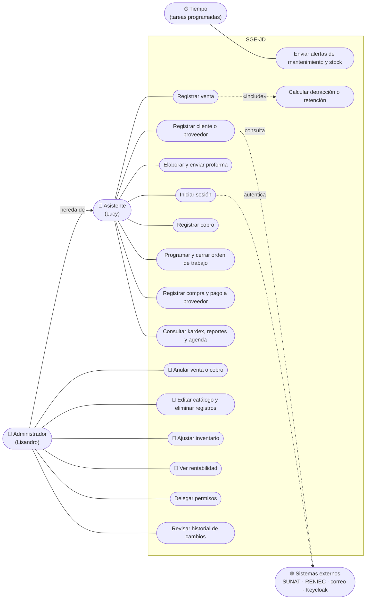
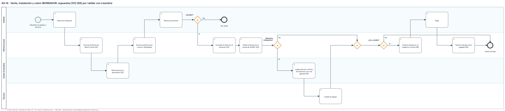
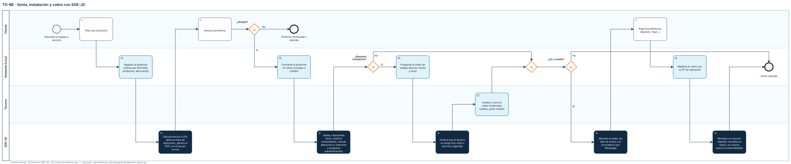
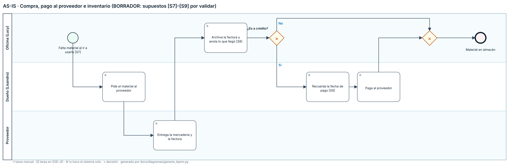
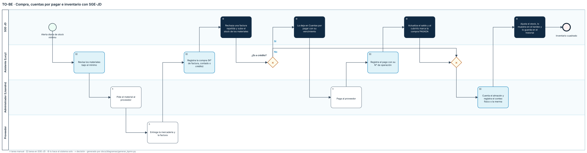
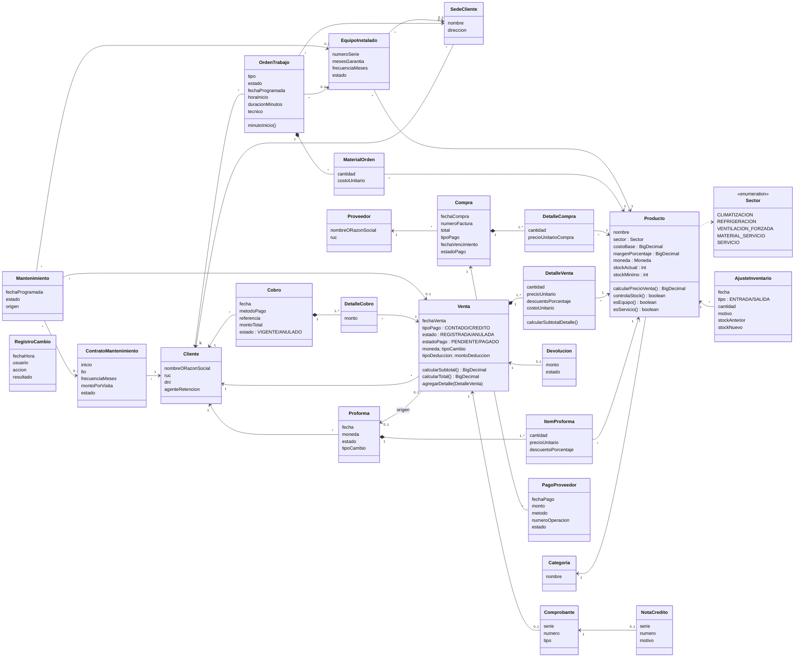
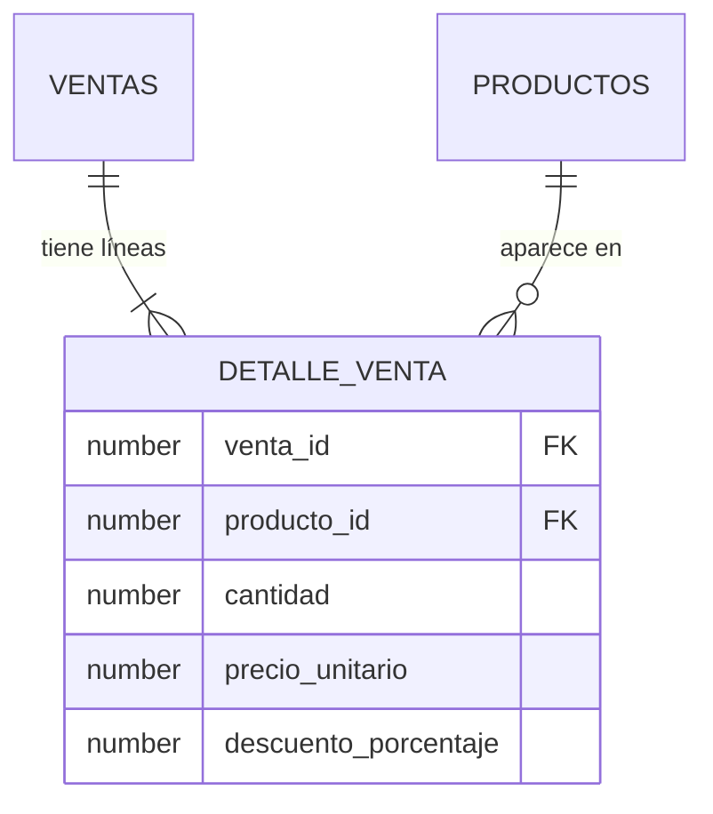

# DOCUMENTACIÓN DEL SISTEMA WEB "JD REFRIGERACIÓN" (SGE-JD / BomERP)

> Última revisión contra el código: **25/10/2026** (sesión S12 de LP2, cierre de la Unidad II). Equipo **CherryTree**.
> Repositorio: `https://github.com/YWAGNERCS/proyecto-SAC` — backend en la rama `master`, frontend en la rama `frontend`.
> Publicado en **https://ywagnercs.github.io/proyecto-SAC/** junto con el producto de LP2 (`lp2-demo.md`) y la hoja para el cliente; se actualiza solo al subir cambios de `docs/` a `master`.
> Lo que no coincide entre el código, esta documentación o la guía del curso está listado en **[5. Por verificar](#por-verificar)**.

---

## Índice
1. [Documentación funcional](#doc-funcional)
2. [Documentación técnica](#doc-tecnica)
3. [Manual de usuario](#manual-usuario)
4. [Estado y trazabilidad del proyecto](#estado-trazabilidad)
5. [Por verificar](#por-verificar)

---

<a id="doc-funcional"></a>

## 1. DOCUMENTACIÓN FUNCIONAL (¿Qué hace el sistema?)

### Objetivo general
Desarrollar e implementar un sistema integral web (ERP/CRM) para JD Refrigeración S.A.C., que centralice y automatice el catálogo de productos, el registro de clientes/proveedores, el flujo completo de proformas y ventas, y la postventa (mantenimientos preventivos), mejorando la eficiencia operativa y la atención al cliente.

### Alcance del proyecto

**Incluye:**
- Catálogo de productos con soporte multimoneda (soles/dólares) y precio de venta calculado por margen porcentual sobre el costo.
- Clientes y Proveedores con autocompletado por RUC (SUNAT) y DNI (RENIEC) vía apis.net.pe v1; Decolecta como respaldo opcional.
- Proformas con exportación a PDF y envío por correo (SMTP).
- Ventas al contado o a crédito: venta directa (cabecera-detalle) y conversión desde una proforma aceptada; anulación con restauración de stock, nota de crédito y, si el cliente ya pagó, devolución pendiente del dinero.
- Facturación electrónica con correlativo real por serie (el envío a SUNAT es simulado, a la espera de contratar un OSE).
- Postventa: mantenimientos preventivos con alertas automáticas (tarea programada diaria) y pantalla de agenda (vencidos, próximos, realizado, reprogramar).
- Inventario: descuento al vender, incremento al comprar y alertas de stock mínimo.
- Cobranza: ventas a crédito con su saldo, abonos parciales o totales (un pago puede repartirse entre varias ventas), historial de cobros y devoluciones de ventas anuladas.
- Consultas y reportes dentro de cada módulo: ventas (reporte filtrable, resumen por periodo), cobranza (pendientes y atrasadas) y proformas (pendientes).
- Panel administrativo web (SPA Angular, en `bomerp-frontend`) con inicio de sesión en Keycloak y permisos por rol.

**Queda explícitamente fuera del alcance:**
- Módulo de planillas y recursos humanos.
- Pasarelas de pago online (las ventas se registran como pagadas o a crédito, sin procesar pagos reales).
- Control de GPS de los técnicos de mantenimiento.

### Módulos (backend)

| # | Módulo | Tipo | Responsable | Estado |
|---|---|---|---|---|
| 1 | Catálogo (productos con categoría, categorías, catálogo público) | Maestro | Wilson | ✅ CRUD de productos con categoría (API y SPA) |
| 2 | Clientes (autocompletado RUC/DNI) | Maestro | Aron | ✅ CRUD con validación de RUC/DNI y duplicados; autocompletado real (apis.net.pe v1) en la SPA |
| 3 | Proveedores | Maestro | Yoel | ✅ CRUD con validación de RUC/DNI, duplicados (409) y correo; pantalla con búsqueda en SUNAT/RENIEC |
| 4 | Proformas (+ PDF, + envío por correo, descuento por línea) | Transaccional | Yoel | ✅ Estado CONVERTIDA con el N° de venta; el envío informa qué salió y qué no |
| 5 | Ventas (directa, desde proforma, crédito, anulación, descuento por línea) | Transaccional | Yoel | ✅ Al anular una venta pagada avisa el monto y deja la devolución en Cobranza |
| 6 | Compras (incrementa stock) | Transaccional | Wilson | ✅ Valida cantidades, precios y N° de factura; total calculado en el servidor; no acepta la misma factura dos veces |
| 7 | Inventario (alertas de stock mínimo) | Soporte | Wilson | ✅ |
| 8 | Postventa (cronograma preventivo automático) | Operativo | Wilson | ✅ Pantalla de agenda en la SPA |
| 9 | Facturación (Comprobante, XML UBL 2.1) | Integración | Aron | ⚠️ Correlativo real por serie; el envío a SUNAT es simulado — falta OSE real (Nubefact) |
| 10 | Notificaciones (SMTP real + WhatsApp) | Integración | Aron | ⚠️ WhatsApp simulado |
| 11 | Cobranza (abonos a ventas a crédito, saldos, historial, devoluciones) | Transaccional | Aron | ✅ `Cobro`–`DetalleCobro` (15/10/2026); "Registrar cobro" con `FormArray` y devoluciones de ventas anuladas (25/10/2026); anulación de cobros por el ADMIN, voucher duplicado y quién registró (28/10/2026) |
| 12 | Seguridad (usuarios, roles, login) | Transversal | — (Keycloak) | ✅ **Keycloak** (S10b, 18/10/2026): realm `bomerp`, roles ADMIN/ASISTENTE; el backend es Resource Server y valida el JWT (RS256, `issuer-uri`) |
| 13 | Servicios técnicos (órdenes de trabajo, sedes, equipos instalados, contratos) | Transaccional | Por asignar | ✅ (28/10/2026) `OrdenTrabajo`–`MaterialOrden`, `SedeCliente`, `EquipoInstalado` y `ContratoMantenimiento`; detracción y retención en Ventas y Cobranza |
| — | Frontend (SPA Angular 22) | — | Cada responsable en su módulo | ✅ Operativa en todos los módulos, con login, roles y diseño responsivo (`bomerp-frontend`, rama `frontend`) |

> **Reportes:** no son un módulo. Cada módulo expone sus consultas (decisión del equipo, alineada con el curso). Hoy `ventas-resumen`, `cobranza` y `proformas-pendientes` siguen en el paquete transitorio `reportes` (ver 5).

### Requerimientos Funcionales (RF)

| RF | Descripción | Estado real en el código |
|---|---|---|
| RF-01 | **Autenticación:** inicio de sesión con credenciales seguras. | ✅ La SPA redirige a la pantalla de login de Keycloak (Authorization Code + PKCE S256; sin formulario propio ni *Direct access grants*). Keycloak emite el JWT (RS256) y el backend lo valida; las contraseñas viven solo en Keycloak. |
| RF-02 | **Roles y permisos:** restringir módulos según el rol (Administrador, Asistente). | ✅ ADMIN (Lisandro) y ASISTENTE (Lucy). Catálogo: consultar cualquiera, modificar solo ADMIN; anular ventas, anular cobros, eliminar clientes/proveedores/sedes, cancelar órdenes de trabajo, crear o cancelar contratos y retirar equipos instalados: solo ADMIN; tope de descuento por rol. 401/403 en JSON. La SPA oculta lo que el rol no puede hacer. |
| RF-03 | **Catálogo de productos:** moneda dual y precio por margen porcentual. | ✅ Precio = costo base × (1 + margen %). CRUD completo de productos, cada uno con su categoría. |
| RF-04 | **Autocompletado de clientes/proveedores** por RUC/DNI vía API externa. | ✅ apis.net.pe v1 sin token (RUC → SUNAT, DNI → RENIEC), con respaldo en Decolecta si se configura `DECOLECTA_TOKEN`. Valida el formato (400), distingue "no existe" (404) de "servicio ocupado" (503) y guarda las consultas exitosas en memoria. |
| RF-05 | **Proformas** con cálculo automático de IGV y subtotales. | ✅ |
| RF-06 | **PDF** formal y corporativo de la proforma. | ✅ Se genera al **enviar** la proforma (no al guardar). |
| RF-07 | **Envío de proformas por correo** (SMTP). | ✅ `POST /proformas/{id}/enviar`; requiere credenciales SMTP configuradas. |
| RF-08 | **Conversión de proforma aceptada en venta** sin redigitar. | ✅ Valida que esté ACEPTADA (409); al convertirla pasa a **CONVERTIDA** y guarda el N° de venta, por lo que ya no se puede aceptar, rechazar, enviar ni convertir de nuevo. Respeta precios, tipo de cambio y descuentos de la proforma. |
| RF-09 | **Control de créditos** (contado/crédito, deudas pendientes y atrasadas). | ✅ Con saldo por venta (RF-20). |
| RF-10 | **Facturación electrónica** (estructura UBL 2.1). | ⚠️ Numeración real: correlativo por serie (F001, B001, FC01, BC01) sin saltos ni repetidos. El envío a SUNAT es simulado: los comprobantes no tienen validez tributaria hasta conectar un OSE. |
| RF-11 | **Descuento de stock** atómico al vender. | ✅ Solo materiales (`MATERIAL_SERVICIO`); si no alcanza → 409 y no se guarda nada. Los equipos no controlan stock. |
| RF-12 | **Incremento de stock** al registrar compras. | ✅ |
| RF-13 | **Alertas de stock mínimo** diarias. | ✅ 8:00 a. m., solo materiales, por correo a `app.notificaciones.correo-oficina` (si está vacío, no se envía). |
| RF-14 | **Postventa: programación de 4 mantenimientos** tras vender equipos. | ✅ A los 3, 6, 9 y 12 meses, para equipos de CLIMATIZACIÓN y REFRIGERACIÓN. |
| RF-15 | **Postventa: alertas de mantenimiento** (8:00 a. m., próximos 7 días, correo a la oficina). | ✅ Si el correo falla, la alerta no se marca como enviada y se reintenta al día siguiente. |
| RF-16 | **Reportes** de ingresos y cuentas por cobrar, segmentados por moneda. | ✅ Segmenta soles/dólares y excluye las ventas anuladas. |
| RF-17 | **Anulación de venta** (nuevo, S09): REGISTRADA → ANULADA. | ✅ `PATCH /ventas/{id}/anular`: restaura stock, cancela los mantenimientos pendientes y emite nota de crédito; 409 si ya estaba anulada. |
| RF-18 | **Venta en soles o dólares con tipo de cambio** (nuevo, 15/10/2026). | ✅ El vendedor elige la moneda; el tipo de cambio de venta SUNAT del día se propone automáticamente y es editable (1–10). Los precios se convierten, el tipo de cambio queda guardado en la venta (no cambia aunque varíe después), aparece en la factura PDF y en el Excel. Una proforma conserva su tipo de cambio al convertirse en venta (se respeta el monto cotizado). |
| RF-19 | **Descuento por línea** (nuevo, 15/10/2026) en proformas y ventas. | ✅ % por línea con tope según el rol (`app.descuentos.tope-admin` = 30, `tope-asistente` = 10; propuesta por confirmar con Lisandro). Queda guardado en la línea y sale en la factura y la proforma (columna "Dscto.") y en el Excel. El tope sale del rol del JWT; sin sesión la API responde 401. |
| RF-20 | **Cobranza con abonos** (nuevo, 15/10/2026). | ✅ `Cobro`–`DetalleCobro`: un pago (fecha, método, N° de operación) se reparte entre una o varias ventas del mismo cliente y moneda. Cada abono ≤ saldo (409); al llegar a 0 la venta pasa a PAGADO. El reporte de cobranza suma saldos, no totales. |
| RF-21 | **Agenda de Postventa** (nuevo, 15/10/2026). | ✅ Vencidos, próximos N días, realizados y todos, con contacto del cliente y equipos; marcar realizado (fecha y trabajo hecho) o reprogramar (fecha ≥ hoy, con motivo). |
| RF-22 | **Devolución al anular una venta pagada** (nuevo, 25/10/2026). | ✅ Antes de confirmar la anulación se muestra lo que el cliente ya pagó (al contado o con abonos). Al anular queda una devolución PENDIENTE en Cobranza › Devoluciones; el ADMIN registra fecha, método y N° de operación (DEVUELTA). Una venta solo pasa a PAGADO por sus abonos: ya no existe "marcar como pagada". |
| RF-23 | **Anulación de cobros y control de pagos duplicados** (nuevo, 28/10/2026). | ✅ Un cobro mal registrado (monto o venta equivocados, pago duplicado, cheque rechazado) lo **anula el ADMIN con un motivo**: no se borra, queda ANULADO con fecha, motivo y usuario, deja de contar en el saldo y sus ventas PAGADAS vuelven a PENDIENTE. No se anula el cobro de una venta ya anulada (ese dinero va por Devoluciones, 409). Al registrar: el mismo N° de operación con el mismo método no entra dos veces (409, sin distinguir mayúsculas ni espacios), la fecha no puede ser anterior a la venta (400) y cada cobro guarda quién lo registró (del token). |
| RF-24 | **Detracción (SPOT) y retención del IGV** (nuevo, 28/10/2026). | ✅ Sector `SERVICIO` (mano de obra) en productos y marca "agente de retención" en clientes. Al registrar la venta: si incluye servicios y supera S/ 700 → detracción del 12 % (en soles, redondeada a soles enteros); si no, y el cliente es agente de retención y supera S/ 700 → retención del 3 %. Porcentajes y umbral en `app.tributos.*`. La factura muestra la deducción, el neto y la leyenda del SPOT con la cuenta del Banco de la Nación (`app.empresa.cuenta-detracciones`, por confirmar). En Cobranza la constancia de detracción y el comprobante de retención se registran como abonos (métodos `DETRACCION` y `RETENCION`, con N° obligatorio, solo en ventas con esa deducción y hasta lo pendiente). Regla simplificada: confirmar con el contador. |
| RF-25 | **Órdenes de trabajo** (nuevo, 28/10/2026). | ✅ Instalación, mantenimiento, reparación o visita técnica con técnico, fecha, sede y dirección. PROGRAMADA → REALIZADA (lo hecho, quién lo recibió y materiales usados, que descuentan stock y salen en el kardex) o CANCELADA (solo ADMIN). Una instalación registra los equipos instalados; una de mantenimiento deja la visita REALIZADA. Se factura una vez, solo con servicios. |
| RF-26 | **Sedes y equipos instalados** (nuevo, 28/10/2026). | ✅ Sedes por cliente (nombre único por cliente). Cada equipo instalado con sede, serie (única por modelo), ubicación, fecha, garantía (0 a 120 meses) y frecuencia de mantenimiento; filtro por garantía vigente; retirarlo (solo ADMIN) cancela sus visitas pendientes. |
| RF-27 | **Mantenimiento configurable y contratos** (nuevo, 28/10/2026). | ✅ Plan por equipo cada 1, 2, 3, 4, 6 o 12 meses (se programa un año adelante y se extiende al hacer cada visita; reemplaza las 4 visitas genéricas de su venta). Contratos (solo ADMIN) con fechas (hasta 5 años), frecuencia y monto por visita: sus visitas se programan al crearlos y se cancelan al cancelarlos. |
| RF-28 | **Permisos delegables** (nuevo, 30/10/2026). | ✅ El ADMIN, desde Configuración › Usuarios y permisos, le da a un asistente operaciones que normalmente son solo suyas, sin hacerlo administrador: anular ventas, anular cobros, registrar devoluciones, editar el catálogo, eliminar clientes/proveedores/sedes, administrar servicios (contratos, cancelar órdenes, dar de baja equipos) y el tope de descuento del administrador. Se guardan en Keycloak como roles `PERM_*` (el backend usa una cuenta de servicio propia, `sgejd-backend`); `SecurityConfig` acepta `ADMIN` o el permiso. Nadie cambia sus propios permisos ni los de un ADMIN (409). El cambio llega a la sesión del asistente en 5 minutos como máximo o al volver a entrar. |
| RF-29 | **Historial de cambios y de sesiones** (nuevo, 30/10/2026). | ✅ Todo POST/PUT/PATCH/DELETE al panel queda registrado (tabla `HISTORIAL_CAMBIOS`, por un filtro dentro de la cadena de seguridad): usuario, rol y permisos, fecha y hora, IP, módulo, acción en palabras ("Anuló la venta #113", "Intentó eliminar el cliente #5") y resultado (Hecho, Sin permiso, Rechazado con el motivo, Error). Incluye los intentos sin permiso (403). Solo se agrega: la aplicación no lo edita ni lo borra. Pantalla solo ADMIN con filtros por usuario, módulo, resultado y fechas, y una pestaña de inicios de sesión, intentos fallidos y cierres que guarda Keycloak (7 días). |
| RF-30 | **Cuentas por pagar a proveedores** (nuevo, 31/10/2026). | ✅ La compra se registra al contado (queda PAGADA) o a crédito con 1 a 365 días (PENDIENTE, vence fecha + días). Inventario › Cuentas por pagar lista lo que se debe, la que vence primero arriba, con totales por moneda (por pagar, vencido, vence en 7 días). Pagos parciales con fecha, método y N° de operación (obligatorio salvo efectivo): no superan el saldo, no son anteriores a la compra ni futuros, y el mismo N° con el mismo método a un proveedor no entra dos veces (409). Al cubrir el total la compra pasa a PAGADA; un pago mal registrado se anula con motivo (ADMIN o permiso ANULAR_COBROS) y la compra vuelve a PENDIENTE. Las compras anteriores quedaron como pagadas al contado. |
| RF-31 | **Ajustes de inventario** (nuevo, 31/10/2026). | ✅ Solo materiales (los equipos no controlan stock). Conteo físico: se escribe cuántas unidades hay y el sistema registra la diferencia. Movimiento: entrada o salida con motivo (stock inicial, merma, dañado, robo o pérdida, devolución al proveedor, otro) y observación obligatoria. Una salida no deja el stock negativo. Cada ajuste guarda el stock antes y después, quién y cuándo; sale en el kardex (Ajuste +/−) y en el historial de cambios. Registrar: ADMIN o permiso AJUSTAR_INVENTARIO. No se editan ni borran: un error se corrige con otro ajuste. |
| RF-32 | **Rentabilidad** (nuevo, 31/10/2026). | ✅ Cada línea vendida guarda el costo del producto al vender, en la moneda de la venta. Comercial › Rentabilidad (ADMIN o permiso VER_RENTABILIDAD) muestra, para un periodo y en soles (lo vendido en dólares, al tipo de cambio de cada venta): vendido sin IGV, costo, ganancia y % por venta, cliente, producto, categoría y técnico (órdenes realizadas: su facturación de mano de obra menos el costo de mano de obra y los materiales usados). Marca en ámbar lo que deja menos de 10 %. Las ventas anteriores al 31/10/2026 usan el costo del producto de esa fecha (no se guardaba). |
| RF-33 | **Agenda de técnicos** (nuevo, 31/10/2026). | ✅ La orden de trabajo lleva hora de inicio (opcional) y duración estimada (15 min a 12 h, 2 h por defecto). Un técnico no puede tener dos visitas PROGRAMADAS que se crucen el mismo día (409 con la orden que choca). Servicios › Agenda: semana de lunes a domingo con una fila por técnico; cada visita con horario, cliente y tipo; las que se cruzan, en rojo; "+" en un día libre programa una orden para ese técnico y ese día. |


### Requerimientos No Funcionales (RNF)

- **RNF-01 (Arquitectura):** monolito modular en capas (controladores, servicios, repositorios), un módulo por paquete. *Hoy hay 2 módulos que usan repositorios de otros (ver 5).*
- **RNF-02 (Rendimiento):** endpoints por debajo de 1000 ms con carga estándar. *Objetivo, aún sin medición formal.*
- **RNF-03 (Interoperabilidad):** backend desacoplado del frontend, solo API REST en JSON, versionada en `/api/v1/...`.
- **RNF-04 (Mantenibilidad e IoC):** inyección de dependencias de Spring; credenciales externalizadas: el backend las lee de variables de entorno o de `application-local.properties`, y Docker y Keycloak de `.env` (ambos ignorados por git, con plantilla `.example`). ✅ Cumplido; ver 5 sobre el historial de git.
- **RNF-05 (Seguridad):** `/api/v1/admin/**` exige un JWT emitido por Keycloak (RS256, validado por `issuer-uri`); autorización por rol (ADMIN, ASISTENTE) y por permiso delegado (`PERM_*`, RF-28); cada cambio queda en el historial (RF-29). Las contraseñas viven solo en Keycloak, con protección contra fuerza bruta (5 intentos) y política de contraseñas.
- **RNF-06 (Usabilidad):** la SPA es **responsiva**: barra superior con grupos, buscador global y avisos, y riel de íconos con el nombre de cada módulo al pasar el mouse; bajo 900 px el riel pasa a un menú desplegable (☰) con texto; formularios a una columna y tablas con desplazamiento horizontal en celular (≤ 640 px); el detalle de la venta se muestra como tarjetas.
- **RNF-07 (Usabilidad):** tema **claro, oscuro o "como el sistema"** (sigue al modo de Windows sin recargar), elegido en Configuración o con el botón sol/luna de la barra; se guarda en el navegador y se aplica antes de cargar la app (sin destello claro). El tema oscuro usa una escala de grises neutros: fondo `#111827`, texto `#F3F4F6`, texto secundario `#9AA3AF`, bordes y gráficos `#D1D5DB`/`#9AA3AF`, y `#F3F4F6` como acento (botones claros con texto oscuro); rojo, verde y ámbar quedan solo para estados y alertas.
- **RNF-08 (Recuperabilidad):** respaldo **automático diario** de la base (tarea de Windows "SGE-JD respaldo diario", `programar_respaldo.bat`): Data Pump a `C:\SGE-JD\respaldos`, copia a una carpeta fuera de la PC (USB, OneDrive o red) y se conservan los últimos 14; si la PC estaba apagada a la hora, corre al encenderla. Registro en `respaldos\respaldo_automatico.log`.

### Casos de uso / Historias de usuario

- **CU-01 (Elaborar proforma):** el vendedor selecciona cliente y productos; el sistema calcula IGV y totales; luego envía el PDF de la proforma al cliente por correo.
- **CU-02 (Postventa: alertas de mantenimiento):** el sistema revisa a diario, a las 8:00 a. m., los mantenimientos de los próximos 7 días y envía un correo a la oficina con los clientes a contactar.
- **CU-03 (Vender):** el vendedor registra una venta directa con varias líneas de producto, revisa el total y confirma; el sistema descuenta stock, programa mantenimientos y emite el comprobante.
- **CU-04 (Anular venta):** el administrador anula una venta registrada; el sistema devuelve al inventario lo vendido, cancela los mantenimientos pendientes, emite la nota de crédito del comprobante y la venta deja de contar en los reportes. Si el cliente ya había pagado, queda una devolución pendiente que se registra cuando se le devuelve el dinero.
- **CU-05 (Cobrar):** la asistente registra un pago del cliente y lo reparte entre sus ventas a crédito en esa moneda; ningún abono supera el saldo y la venta pasa a PAGADO al completarse.
- **CU-06 (Anular cobro):** el administrador anula un cobro mal registrado indicando el motivo; el monto vuelve al saldo de sus ventas y el cobro queda en el historial como anulado.
- **CU-07 (Programar y cerrar una orden de trabajo):** la asistente programa la visita con técnico, fecha y hora (el sistema rechaza un cruce en la agenda del técnico); al cerrarla registra lo hecho y los materiales usados, que descuentan stock.
- **CU-08 (Comprar y pagar al proveedor):** la asistente registra la compra al contado o a crédito; las compras a crédito quedan en Cuentas por pagar hasta registrar sus pagos.
- **CU-09 (Ajustar inventario):** el administrador (o quien tenga el permiso) registra un conteo físico o una merma; el sistema ajusta el stock y lo muestra en el kardex.
- **CU-10 (Delegar permisos):** el administrador enciende o apaga, para un asistente, operaciones que normalmente son solo suyas.
- **CU-11 (Revisar el historial y la rentabilidad):** el administrador consulta quién hizo cada cambio y cuánto se ganó por venta, cliente, producto y técnico.

#### Diagrama de casos de uso (UML)

El administrador hereda todo lo que hace la asistente (generalización de actores). Los casos marcados con 🔑 son del administrador y los puede delegar a una asistente con un permiso (RF-28).



### Modelado de procesos (BPMN AS-IS y TO-BE)

Dos procesos clave del negocio, como se hacen hoy (AS-IS) y con SGE-JD (TO-BE). Cada diagrama está en BPMN 2.0
estándar en `docs/diagramas/` (`.bpmn`, se abre y edita en [Camunda Modeler](https://camunda.com/download/modeler/) o
[demo.bpmn.io](https://demo.bpmn.io)) y como imagen (`.svg`). Se generan con `python docs/diagramas/generar_bpmn.py`.

> ⚠️ **Los AS-IS son un borrador.** No hay un registro de cómo trabaja hoy la oficina: se armaron a partir de lo que
> resuelven los requerimientos, y cada paso dudoso está marcado **[S1]–[S9]** (supuesto). Hay que confirmarlos con
> Lisandro antes de presentarlos como el proceso real.

#### Proceso 1 · Venta, instalación y cobro

**AS-IS (borrador)**



**TO-BE (con SGE-JD)**



#### Proceso 2 · Compra, pago al proveedor e inventario

**AS-IS (borrador)**



**TO-BE (con SGE-JD)**



#### Supuestos del AS-IS por confirmar con Lisandro

| # | Supuesto | Pregunta para confirmar |
|---|---|---|
| S1 | La proforma se arma a mano en Word o Excel | ¿Con qué arman hoy la cotización? ¿Hay una plantilla? |
| S2 | Lisandro revisa precio y descuento de cada proforma | ¿Lucy puede cotizar sola o todo pasa por Lisandro? |
| S3 | El stock se confirma mirando el almacén | ¿Llevan algún control de stock (Excel, cuaderno)? |
| S4 | La factura se emite en el portal de SUNAT (SOL) | ¿Facturan en SUNAT SOL, con un sistema o con un contador? |
| S5 | Las visitas de los técnicos se recuerdan de memoria o en una agenda | ¿Cómo asignan hoy al técnico y la hora? ¿Han tenido cruces? |
| S6 | Las deudas de clientes se anotan en un cuaderno o Excel | ¿Cómo saben hoy quién debe y desde cuándo? |
| S7 | Se nota que falta material cuando se va a usar | ¿Hay un mínimo de stock o un pedido periódico? |
| S8 | La factura del proveedor se archiva y lo recibido se anota | ¿Dónde registran lo que entra al almacén? |
| S9 | Las fechas de pago a proveedores se recuerdan | ¿Cómo controlan lo que deben a los proveedores? |

#### Qué cambia del AS-IS al TO-BE

| Problema (AS-IS) | Con SGE-JD (TO-BE) | RF |
|---|---|---|
| Precios y descuentos calculados a mano | Precio desde costo y margen, IGV y tope de descuento por usuario | RF-01, RF-19 |
| Proforma sin seguimiento | Estados (enviada, aceptada, rechazada, vencida, convertida) y PDF por correo | RF-04 |
| Stock incierto al vender | La venta valida y descuenta el stock; alerta de stock mínimo; ajustes con motivo | RF-07, RF-31 |
| Facturación y detracción manuales | Comprobante con correlativo y cálculo de detracción o retención | RF-09, RF-24 |
| Agenda de técnicos de memoria | Órdenes con hora y duración; no deja cruzar dos visitas | RF-25, RF-33 |
| Deudas de clientes en un cuaderno | Saldo por venta, días de atraso, recordatorio y voucher único | RF-20, RF-23 |
| Deudas con proveedores sin control | Cuentas por pagar con vencimiento y pagos parciales | RF-30 |
| Sin saber cuánto se gana | Rentabilidad por venta, cliente, producto y técnico | RF-32 |

---

<a id="doc-tecnica"></a>

## 2. DOCUMENTACIÓN TÉCNICA (¿Cómo está construido?)

### Stack tecnológico (según `pom.xml` y `package.json`)

| Capa | Tecnología |
|---|---|
| Lenguaje | Java 21 |
| Framework | Spring Boot **4.0.7** · Spring Framework 7 (Web MVC, Data JPA, Validation, Security, Mail) |
| ORM | Hibernate 7.2 (`ddl-auto=update`); los `boolean` son `BOOLEAN` nativo de Oracle 23 |
| Base de datos | Oracle Database 23 Free (Docker `gvenzl/oracle-free:23-slim`, servicio `FREEPDB1`, puerto **1522**) |
| Seguridad | Spring Security como OAuth2 Resource Server (`spring-boot-starter-security-oauth2-resource-server`) + **Keycloak 26.8** con su propio Postgres 17 (Docker, puerto 38080) |
| Documentación API | springdoc-openapi 3.0.2, OpenAPI 3.1 (Swagger UI en `/swagger-ui.html`) |
| JSON | Jackson 3 (`tools.jackson`), con su configuración por defecto |
| Otras | OpenPDF 1.3.32, Lombok, driver `ojdbc11`; H2 incluido como dependencia (sin perfil configurado) |
| Frontend | Angular 22 (standalone, signals, zoneless), en `bomerp-frontend` |

### Migración a Spring Boot 4.0.7 (22/10/2026)

De 3.3.4 a 4.0.7 (Spring Framework 7, Hibernate 7.2, Jackson 3, Spring Security 7), la versión de la guía del curso (ADR-003). Qué cambió y por qué:

| Cambio | Motivo |
|---|---|
| `spring-boot-starter-web` → `-webmvc`; `-oauth2-resource-server` → `-security-oauth2-resource-server`; `-test` → `-webmvc-test` + `-data-jpa-test` | Boot 4 divide los starters por módulo |
| springdoc 2.6.0 → 3.0.2 | La línea 2.x no funciona con Boot 4; Swagger pasa a OpenAPI 3.1 |
| `SecurityConfig` y `ConsultaRucClientDecolecta` usan `tools.jackson` | Boot 4 configura Jackson 3. Jackson 2 sigue en el classpath solo porque lo trae springdoc, así que compilaba pero fallaba al ejecutar |
| `texto()` de Decolecta lee solo valores simples | En Jackson 3, `asText()`/`asString()` lanza excepción sobre un objeto (en Jackson 2 devolvía `""`) |
| Jackson 3 con su configuración por defecto | Solo cambia el orden de algunos campos del JSON (ahora alfabético); los datos son los mismos y la SPA lee los campos por nombre |
| **`migracion_boot4_booleanos.sql`**: los 4 `boolean` (`productos.visible_en_catalogo`, `mantenimientos.alerta_enviada`, `proformas.enviado_correo` y `enviado_whatsapp`) pasan de `NUMBER(1)` + CHECK a `BOOLEAN` | Es el tipo que Hibernate 7 usa en Oracle 23; sin el script, intentaba convertirlos en cada arranque y Oracle lo rechazaba. Conserva los valores; `datos_demo.sql` sigue funcionando porque Oracle acepta 1/0 en `BOOLEAN` |
| `Venta.estado`: `length = 20` en vez de `columnDefinition` | El `columnDefinition` solo servía para agregar la columna con `DEFAULT` (ya existe); en Hibernate 7 provocaba un `ALTER` en cada arranque |
| Se quitó `spring.jpa.database-platform` | Hibernate 7 detecta el dialecto solo |

**Después de la migración (23-24/10/2026):**

| Cambio | Motivo |
|---|---|
| `spring.jpa.open-in-view=false` | Con el valor por defecto, la sesión de Hibernate quedaba abierta hasta escribir el JSON y escondía cargas perezosas fuera de la transacción. Al apagarlo aparecieron 6 endpoints con `LazyInitializationException` |
| Los services devuelven DTO (`VentaService`, `ProformaService`, `FacturacionService`; nuevos `ComprobanteResponseDTO` y `NotaCreditoResponseDTO`) y se arman dentro del `@Transactional` | Regla de la S3: el controller no toca entidades. Se quitaron las anotaciones de Jackson de `Comprobante`, `NotaCredito`, `Mantenimiento`, `DetalleVenta` y `DetalleCompra` |
| Filtros y orden de `GET /ventas` y `GET /proformas` pasan del controller al service (`listar(...)`, `readOnly`) | El controller queda delgado |
| Proforma, Compra y el diálogo "Registrar cobro" de Cobranza con formularios reactivos (`FormArray` tipado), como Venta | Mismo patrón de la S9 en las cuatro pantallas transaccionales: cada línea trae su validación (en Cobranza, el abono no supera el saldo de su venta) y el total sale del formulario |
| `ProformaRequest`: `@NotEmpty` en ítems y `@Min(1)` en cantidad | Antes se podía guardar una proforma sin productos o con cantidad 0; ahora responde 400 con mensaje |

Verificado de nuevo con `open-in-view=false`: recorrido completo por API como Lisandro (90/90) y como Lucy (84/84), 0 `LazyInitializationException` y 0 `ERROR` en el registro, y los mismos estilos en la SPA a 1280 y 375 px.

Sin configuraciones que fuercen comportamiento antiguo: Hibernate arranca sin ejecutar ningún DDL. Verificado: las respuestas de los GET traen los mismos datos que con 3.3.4, los errores 400/401/403/404 tienen el mismo formato, la matriz de seguridad da 14 de 14, PKCE funciona, los 60 valores booleanos se conservaron, las pruebas de venta (contado, crédito, stock insuficiente, anulación) pasan con rollback y se recorrió la SPA como ADMIN y como ASISTENTE.

### Arquitectura de software

Monolito modular: **un solo proyecto Maven y un solo ejecutable Spring Boot**. Cada módulo es un paquete bajo `com.bomerp` con capas internas:

1. **Controllers**: endpoints REST (`/api/v1/admin/...`, `/api/v1/publico/...`).
2. **Services**: reglas de negocio y transacciones (`@Transactional`).
3. **Repositories**: interfaces Spring Data JPA.
4. **Integrations**: clientes hacia servicios externos detrás de interfaces (`ConsultaRucClient`, `OseClient`, `NotificadorCorreo`, `NotificadorWhatsApp`).

Errores: `GlobalExceptionHandler` traduce excepciones a 400 (validación), 404 (`RecursoNoEncontradoException`), 409 (`ReglaNegocioException`, `StockInsuficienteException`) y 500 sin filtrar detalles.

### Estructura del código

```text
src/main/java/com/bomerp/
├── BomerpApplication.java
├── catalogo/        categoria/, producto/, productocatalogo/ (catálogo público, DTO sin costo ni margen)
├── clientes/        cliente/, consultaruc/ (RUC/DNI), general/ (entidad Cliente)
├── cobranza/        cobro/: Cobro–DetalleCobro, saldos y abonos · devolucion/: devoluciones de ventas anuladas
├── compras/         compra/, detallecompra/
├── config/          SecurityConfig (seguridad + CORS), GlobalExceptionHandler, excepciones, descuento/ (tope por rol), empresa/ (datos de JD), tipocambio/, exportacion/
├── proformas/       proforma/, itemproforma/, proformarequest/, pdf/ (antes cotizaciones/)
├── facturacion/     comprobante/, facturacion/, nubefact/, ose/, pdf/, serie/ (correlativo por serie)
├── inventario/      alertas y tarea programada de stock mínimo
├── postventa/       mantenimiento/: programación y alertas
├── notificaciones/  correo (real) y WhatsApp (simulado)
├── proveedores/     proveedor/
├── reportes/        TRANSITORIO: consultas por repartir a ventas/ y proformas/
├── (seguridad)      RETIRADO en S10b: la identidad la maneja Keycloak; quedan config/SecurityConfig y config/PerfilController
└── ventas/          venta/ (con event/VentaAnuladaEvent), detalleventa/
```

Fuera de `src/`: `docs/` (esta documentación y `LIMITACIONES.md`), `sitio/` (el sitio MkDocs), `scripts/` (arranque, respaldo, restauración y base limpia), `keycloak/` (realm y `configurar_realm.py`), `pruebas-seguridad/` (matriz de permisos), los `migracion_*.sql` y `.github/workflows/docs.yml` (publica esta documentación).

### Modelo de datos (tablas reales, esquema `JDREFRIGERACION`)

| Tabla | Campos clave |
|---|---|
| `PRODUCTOS` | id, nombre, **categoria_id** (FK → `CATEGORIAS`), sector (incluye `SERVICIO`, mano de obra), costo_base, margen_porcentaje, moneda, stock_actual, stock_minimo, visible_en_catalogo |
| `CATEGORIAS` | id, nombre, descripcion (una categoría con productos no se puede eliminar: 409) |
| `CLIENTES` / `PROVEEDORES` | id, tipo (empresa/natural), ruc, dni, correo, teléfono; en clientes, **agente_retencion** |
| `SEDES_CLIENTE` | id, cliente_id, nombre (único por cliente), direccion, contacto, telefono |
| `PROFORMAS` / `ITEMS_PROFORMA` | cabecera-detalle de proforma; la cabecera guarda moneda, **tipo_cambio**, estado (PENDIENTE, ACEPTADA, RECHAZADA, VENCIDA, **CONVERTIDA**) y **venta_id**; cada ítem su precio ya convertido y su **descuento_porcentaje** |
| `VENTAS` | id, cliente_id, proforma_id, fecha_venta, tipo_pago, dias_credito, fecha_limite_pago, **estado** (REGISTRADA/ANULADA), fecha_anulacion, estado_pago, moneda, **tipo_cambio**, comprobante_id, **tipo_deduccion** (NINGUNA/DETRACCION/RETENCION), porcentaje_deduccion, monto_deduccion |
| `DETALLE_VENTA` | id, venta_id, producto_id, cantidad, precio_unitario, **descuento_porcentaje** |
| `COMPRAS` / `DETALLE_COMPRA` | cabecera-detalle de compra; numero_factura normalizado (`F001-00000123`), total calculado por el servidor |
| `DEVOLUCIONES` | dinero por devolver de una venta anulada que ya estaba pagada: venta_id (único), cliente_id, moneda, monto, estado (PENDIENTE/DEVUELTA), fecha_anulacion, fecha_devolucion, metodo_pago, referencia, notas (`migracion_devoluciones.sql`) |
| `COBROS` / `DETALLE_COBRO` | pago de un cliente (fecha_cobro, moneda, metodo_pago, referencia, monto_total, **estado** VIGENTE/ANULADO, **registrado_por**, fecha_anulacion, motivo_anulacion, anulado_por) y su reparto por venta (venta_id, monto); solo los VIGENTES cuentan en el saldo (`migracion_cobros_anulacion.sql`) |
| `COMPROBANTES` | comprobante electrónico simulado (factura o boleta, uno por venta); (serie, número) único |
| `NOTAS_CREDITO` | id, serie (FC01/BC01), numero (correlativo por serie), motivo, total, estado_sunat, comprobante_id (FK único → `COMPROBANTES`) |
| `SERIES_COMPROBANTE` | serie (PK: F001, B001, FC01, BC01), ultimo_numero — contador del correlativo SUNAT |
| `MANTENIMIENTOS` | id, **cliente_id**, venta_id, **equipo_id**, **contrato_id** (cada visita viene de uno de los tres: CHECK), fecha_programada, estado, alerta_enviada, fecha_realizada, **tecnico**, **orden_trabajo_id**, notas |
| `EQUIPOS_INSTALADOS` | id, cliente_id, sede_id, producto_id, numero_serie, ubicacion, fecha_instalacion, meses_garantia, frecuencia_meses, estado (ACTIVO/RETIRADO), venta_id, orden_trabajo_id, notas |
| `CONTRATOS_MANTENIMIENTO` | id, cliente_id, sede_id, fecha_inicio, fecha_fin, frecuencia_meses, monto_visita, moneda, descripcion, estado (VIGENTE/CANCELADO), registrado_por, motivo_cancelacion |
| `ORDENES_TRABAJO` / `MATERIALES_ORDEN` | orden (tipo, estado, cliente, sede, venta, mantenimiento, equipo, fecha, técnico, dirección, descripción; al cerrar: fecha_realizada, trabajo_realizado, recibido_por; venta_facturada_id) y sus materiales (producto_id, cantidad, costo_unitario, moneda) |
| `USUARIOS` | **Sin uso desde S10b** (usuarios y contraseñas viven en Keycloak). La tabla queda en las bases existentes; se puede borrar |

### Diagrama de clases del dominio (UML)

Entidades JPA principales (`@Entity`) con sus atributos y operaciones de negocio clave. Se omiten ids, getters y setters.
Cardinalidades tal como están en el código (`@ManyToOne`, `@OneToMany`).



**Patrones visibles en el diagrama:** cabecera-detalle con composición (`Venta`–`DetalleVenta`, `Compra`–`DetalleCompra`,
`Cobro`–`DetalleCobro`, `OrdenTrabajo`–`MaterialOrden`); muchos a muchos resueltos con una entidad intermedia que guarda
datos propios (ver la sección siguiente); y anulación lógica en lugar de borrado (`Venta.estado`, `Cobro.estado`,
`PagoProveedor.estado`), para que el historial no pierda nada.

### Relaciones muchos a muchos

Una venta lleva **varios productos** y un mismo producto aparece en **varias ventas**: eso es una relación muchos a muchos (N:M). En una base relacional no se guarda directo (una fila de `VENTAS` no puede tener "una lista de productos"), así que se pone una **tabla intermedia** donde **cada fila es una línea**: esta venta + este producto + sus datos propios. El N:M queda partido en dos relaciones uno a muchos.



Ejemplo (dos ventas y dos productos):

| `DETALLE_VENTA` | venta_id | producto | cantidad | precio_unitario | descuento % |
|---|---|---|---|---|---|
| línea 1 | 110 | Tubería de cobre 1/4 | 3 | 52.00 | 30 |
| línea 2 | 110 | Split inverter 12 000 BTU | 1 | 1,406.25 | 0 |
| línea 3 | 111 | Tubería de cobre 1/4 | 2 | 52.00 | 5 |

La venta 110 sale dos veces (llevó dos productos) y la tubería también (está en dos ventas).

**Por qué una entidad intermedia y no `@ManyToMany`:** la unión **tiene datos propios** (cantidad, precio, descuento, monto), que no son ni de la venta ni del producto. `@ManyToMany` solo crea una tabla con los dos ids. Además el precio se **copia** en la línea al vender: si mañana sube el producto, la venta de hoy conserva su precio. En código es una entidad con dos `@ManyToOne`, y la cabecera la lista con `@OneToMany(mappedBy = ..., cascade = ALL, orphanRemoval = true)`, de modo que cabecera y líneas se graban en una sola transacción.

| Integrante | Lado A | Tabla del medio | Lado B | Dato propio |
|---|---|---|---|---|
| Yoel | `PROFORMAS` | `ITEMS_PROFORMA` | `PRODUCTOS` | cantidad, precio, descuento |
| Yoel | `VENTAS` | `DETALLE_VENTA` | `PRODUCTOS` | cantidad, precio, descuento |
| Wilson | `COMPRAS` | `DETALLE_COMPRA` | `PRODUCTOS` | cantidad, precio de compra |
| Aron | `COBROS` | `DETALLE_COBRO` | **`VENTAS`** | monto abonado |
| Servicios | `ORDENES_TRABAJO` | `MATERIALES_ORDEN` | `PRODUCTOS` | cantidad, costo del material |

`DETALLE_COBRO` une **cobros con ventas**: un cobro puede pagar varias ventas (una transferencia por dos facturas) y una venta puede recibir varios cobros (paga en partes). El saldo de una venta es su total menos la suma de sus filas en `DETALLE_COBRO`.

En la SPA cada fila de la tabla intermedia es una fila del `FormArray`: "Agregar línea" en Proforma, Venta y Compra, y las filas de abono del diálogo "Registrar cobro".

### Sectores del producto

Cada producto tiene uno de **5 sectores fijos**. A diferencia de la **categoría** (libre, solo para ordenar el catálogo), el sector decide qué reglas le aplica el sistema:

| Sector | Ejemplos | ¿Controla stock? | ¿Programa mantenimientos al venderse? |
|---|---|---|---|
| `CLIMATIZACION` | aires split, cassette, piso-techo | No | Sí: 4 (a los 3, 6, 9 y 12 meses) |
| `REFRIGERACION` | cámaras frigoríficas, condensadoras | No | Sí: 4 |
| `VENTILACION_FORZADA` | extractores, inyectores | No | No |
| `MATERIAL_SERVICIO` | tubería de cobre, gas, manómetros | **Sí** | No |
| `SERVICIO` | instalación, mantenimiento, reparación (mano de obra) | No | No (la venta lleva detracción si supera S/ 700) |

Los equipos se compran por proyecto y no se almacenan (acuerdo con el cliente), por eso no llevan stock: en la lista de productos su stock se ve como "—", una compra no lo sube y una venta no lo exige; en el kardex figuran sin saldo. Solo los materiales suben con las compras, bajan con las ventas, vuelven al anular y generan alertas de stock mínimo (`Producto.controlaStock()`). Los mantenimientos se programan si la venta incluye al menos un equipo de climatización o refrigeración (`MantenimientoService`).

El precio de venta que muestra el catálogo (sin IGV) es `costo_base × (1 + margen_porcentaje / 100)`, en la moneda del producto. El precio de compra de cada factura (lo que se le pagó al proveedor) se guarda aparte, en `DETALLE_COMPRA`, y es el que aparece como "c/u" en el historial del proveedor.

### API REST (v1)

| Recurso | Endpoints |
|---|---|
| Autenticación | Token: `POST http://localhost:38080/realms/bomerp/protocol/openid-connect/token` (Keycloak) · `GET /api/v1/auth/perfil` (sub, usuario, correo y roles leídos del JWT) · Swagger: botón *Authorize* con el access_token |
| Tipo de cambio | `GET /api/v1/admin/tipo-cambio?fecha=` (SUNAT vía apis.net.pe; compra y venta, S/ por US$) |
| Catálogo público | `GET /api/v1/publico/catalogo` (sin login, sin costo ni margen) |
| Categorías | `GET`, `POST /categorias` · `GET`, `PUT`, `DELETE /categorias/{id}` |
| Productos | `GET /productos?categoriaId=` · `GET /productos/{id}` · `POST /productos` · `PUT /productos/{id}` · `DELETE /productos/{id}` (409 si ya se usó en ventas, proformas o compras) |
| Clientes | CRUD `/clientes` (`GET`, `GET /{id}`, `POST`, `PUT`, `DELETE` → 409 si tiene proformas o ventas) · `GET /clientes/autocompletar/ruc/{ruc}` · `GET /clientes/autocompletar/dni/{dni}` |
| Proveedores | `GET`, `POST /proveedores` · `GET`, `PUT`, `DELETE /proveedores/{id}` · autocompletar RUC/DNI |
| Proformas | `GET /proformas?estado=&clienteId=` · `POST /proformas` (ítems con `descuentoPorcentaje`) · `POST /proformas/{id}/aceptar` · `/rechazar` · `/enviar` (devuelve qué canal salió) · `POST /proformas/marcar-vencidas` (vencimiento manual; corre solo cada día) |
| Ventas | `GET /ventas?estado=&desde=&hasta=&clienteId=` · `GET /ventas/exportar` (Excel, mismos filtros) · `GET /ventas/historial-cliente/{clienteId}` · `POST /ventas/directa` · `POST /ventas/desde-proforma/{id}` · `GET /ventas/pagos-atrasados` · `PATCH /ventas/{id}/anular` |
| Compras | `GET /compras?desde=&hasta=&proveedorId=` · `GET /compras/exportar` (Excel) · `GET /compras/historial-proveedor/{proveedorId}` · `GET /compras/{id}` · `POST /compras` (sube el stock solo de materiales; 400 si cantidad < 1, precio ≤ 0, fecha futura o N° de factura sin formato SERIE-NÚMERO; 409 si esa factura del proveedor ya existe) |
| Cobranza | `GET /cobranza/por-cobrar?clienteId=` (saldo por venta) · `GET /cobranza/cobros?clienteId=&ventaId=` · `POST /cobranza/cobros` · `POST /cobranza/cobros/{id}/anular` (solo ADMIN; body `{motivo}`) · `GET /cobranza/ventas/{ventaId}/pagado` (lo que se devolvería al anular) · `GET /cobranza/devoluciones?estado=&clienteId=` · `POST /cobranza/devoluciones/{id}/registrar` (solo ADMIN) |
| Descuentos | `GET /descuentos/tope` (tope % del usuario actual) |
| Inventario | `GET /inventario/alertas` · `GET /inventario/kardex/{productoId}?desde=&hasta=` · `GET /inventario/kardex/{productoId}/exportar` (Excel) |
| Servicios | `GET/POST /clientes/{id}/sedes` · `PUT/DELETE /clientes/{id}/sedes/{sedeId}` (eliminar: ADMIN) · `GET /equipos?clienteId=&sedeId=&estado=&enGarantia=` · `POST /equipos` · `PUT /equipos/{id}` · `POST /equipos/{id}/retirar` (ADMIN) · `GET /contratos?clienteId=&estado=` · `POST /contratos` (ADMIN) · `POST /contratos/{id}/cancelar` (ADMIN) · `GET /ordenes?estado=&clienteId=&tecnico=&desde=&hasta=` · `GET /ordenes/tecnicos` · `POST /ordenes` · `PUT /ordenes/{id}` · `POST /ordenes/{id}/cerrar` · `POST /ordenes/{id}/cancelar` (ADMIN) · `POST /ordenes/{id}/facturar` |
| Postventa | `GET /mantenimientos?vista=VENCIDOS\|PROXIMOS\|REALIZADOS\|TODOS&dias=&clienteId=` · `GET /mantenimientos/resumen` · `PATCH /mantenimientos/{id}/realizado` · `PATCH /mantenimientos/{id}/reprogramar` · `POST /mantenimientos/simular-alerta` |
| Facturación | `POST /facturacion/emitir/{ventaId}` · `POST /facturacion/{id}/enviar` · `GET /facturacion/ventas/{ventaId}/pdf` (descarga el comprobante) · `GET /facturacion/notas-credito` |
| Consultas *(transitorio, por mover a ventas, cobranza y proformas)* | `GET /reportes/ventas-resumen?desde=&hasta=` · `GET /reportes/cobranza` · `GET /reportes/proformas-pendientes` |

*(Todas las rutas sin prefijo van bajo `/api/v1/admin`.)*

### Pruebas automáticas (JUnit 5 + Mockito)

`mvn test` corre **64 pruebas** (31/10/2026). Las de reglas de negocio son unitarias: usan repositorios simulados
(Mockito) y no necesitan Oracle, Keycloak ni Docker, así que tardan segundos. `ProductoCrudTest` es de integración y
sí necesita Oracle encendido (revierte lo que guarda).

| Clase de prueba | Qué protege | Pruebas |
|---|---|---|
| `CobranzaServiceTest` | Abono parcial y total, saldo, voucher duplicado, fechas, venta anulada; anular un cobro (motivo, dos veces, devoluciones) | 9 |
| `CuentasPorPagarServiceTest` | Pagos a proveedores: saldo, contado, fechas, N° de operación, duplicado, compra PAGADA, anulación | 8 |
| `AjusteInventarioServiceTest` | Conteo físico, merma, stock negativo, equipos, observación obligatoria | 7 |
| `AuditoriaServiceTest` | Acción en palabras, "Intentó…" en lo denegado, módulo, resultado; nunca tumba la operación | 6 |
| `PermisosServiceTest` | Permisos delegables: diferencia de roles, no a uno mismo ni a un ADMIN, permiso desconocido | 6 |
| `AgendaHorarioTest` | Cruces de horario del técnico, bordes exactos, sin hora, medianoche, rango de la agenda | 6 |
| `CompraServiceTest` | N° de factura, factura duplicada, stock solo de materiales, contado/crédito y vencimiento | 5 |
| `DeduccionTributariaServiceTest` | Detracción 12 % (soles enteros), retención 3 %, umbral S/ 700, dólares con tipo de cambio | 5 |
| `VentaCostoTest` | Costo guardado en cada línea y su conversión de moneda; subtotal, IGV y total | 5 |
| `RentabilidadServiceTest` | Ganancia en soles, líneas sin costo, rentabilidad por técnico | 4 |
| `ProductoCrudTest` (integración, Oracle) | Guardar, buscar y actualizar un producto | 3 |

La seguridad por rol y permiso se prueba además de punta a punta con `pruebas-seguridad/05_matriz.ps1` (14 casos,
con Keycloak y el backend encendidos).

### Guía de instalación

1. Instalar **JDK 21**, Maven y Docker Desktop.
2. Base de datos Oracle en Docker (desde la carpeta que contiene `docker-compose.yml`):
   - Primera vez: `docker volume create sge-jd-oracle-data` y luego `docker compose up -d`.
   - Si el contenedor ya existe: `docker start SGE-JD`.
   - Esperar a que `docker logs SGE-JD` muestre `DATABASE IS READY TO USE!`.
3. Credenciales locales: copiar `src/main/resources/application-local.properties.example` como `application-local.properties` (está en `.gitignore`) y completar al menos:
   ```properties
   spring.datasource.password=<APP_USER_PASSWORD del docker-compose>
   ```
   También se aceptan variables de entorno: `DB_URL`, `DB_USERNAME`, `DB_PASSWORD`, `MAIL_USERNAME`, `MAIL_PASSWORD`, `DECOLECTA_TOKEN`, `CORREO_OFICINA`, `CORS_ALLOWED_ORIGINS`.
4. Ejecutar `mvn spring-boot:run` (puerto 8080). Swagger: `http://localhost:8080/swagger-ui.html`.
   - **Identidad (Keycloak):** `docker compose up -d keycloak-db keycloak` (desde `bomerp-backend`). Antes, copiar `.env.example` como `.env` (no se versiona) y poner las contraseñas: las usan `docker compose`, `configurar_realm.py` y `pruebas-seguridad/`. La primera vez Keycloak importa `keycloak/realm-bomerp.json` (realm, roles, clientes y usuarios, sin contraseñas); después ejecutar `python keycloak/configurar_realm.py`, que pone las contraseñas de `.env` (y crea el realm si no existe), los roles de permiso `PERM_*` y el cliente confidencial `sgejd-backend` (cuenta de servicio con `view-users`, `manage-users`, `view-realm` y `view-events`, secreto `KC_BACKEND_SECRET` de `.env`, que el backend lee como `app.keycloak.admin.client-secret`): con él el backend cambia los permisos delegados y lee los eventos de sesión. Historial de cambios: tabla `HISTORIAL_CAMBIOS` (`migracion_historial_cambios.sql`), escrita por `AuditoriaFilter` dentro de la cadena de seguridad, después de leer el token y antes de autorizar, para registrar también los 403. Consola: `http://localhost:38080` (usuario `admin`, contraseña `KC_ADMIN_PASSWORD` de `.env`). Usuarios: `lisandro` (ADMIN) y `lucy` (ASISTENTE). Pruebas: `pruebas-seguridad/05_matriz.ps1`.
   - **Bases creadas antes del 28/10/2026 (servicios):** ejecutar una vez `migracion_servicios.sql`, después de `migracion_cobros_anulacion.sql` (sector SERVICIO, agente de retención, deducción de las ventas, métodos DETRACCION/RETENCION, sedes, órdenes de trabajo, equipos instalados, contratos y las columnas nuevas de `MANTENIMIENTOS`; se puede ejecutar varias veces).
   - **Bases creadas antes del 28/10/2026:** ejecutar una vez `migracion_cobros_anulacion.sql` (columnas de anulación y `registrado_por` en `COBROS`; los cobros existentes quedan VIGENTES; se puede ejecutar varias veces).
   - **Bases creadas antes del 25/10/2026:** ejecutar una vez `migracion_devoluciones.sql` (crea la tabla `DEVOLUCIONES`; se puede ejecutar varias veces).
   - **Bases creadas antes del 15/10/2026:** después de arrancar el backend nuevo una vez, ejecutar `migracion_auditoria_altos.sql` (permite el estado CONVERTIDA de las proformas; sin él, convertir una proforma falla con ORA-02290). Se puede ejecutar varias veces.
   - **Datos de demostración (opcional):** `datos_demo.sql` borra los datos de negocio, reinicia los ID y carga 8 categorías, 30 productos, 7 proveedores y 8 clientes (empresas reales verificadas en SUNAT; relación comercial ficticia). No toca los usuarios. Con el backend ya iniciado al menos una vez (para que existan las tablas):
     ```powershell
     Get-Content -Encoding UTF8 datos_demo.sql | docker exec -i -e NLS_LANG=AMERICAN_AMERICA.AL32UTF8 SGE-JD sqlplus -s jdrefrigeracion/<password>@FREEPDB1
     ```
5. Frontend: en `bomerp-frontend`, `npm install` y `npm start` (puerto 4200).

### Uso diario: encender, apagar, respaldar y limpiar (`scripts/`)

Ya instalado (pasos 1 a 5 hechos una vez), todo se maneja con doble clic en `bomerp-backend/scripts/`. Suponen que `bomerp-backend` y `bomerp-frontend` están en la misma carpeta (si no, `-Frontend <ruta>`).

| Archivo | Qué hace |
|---|---|
| `iniciar_sgejd.bat` | Enciende Docker Desktop si hace falta, Oracle (`SGE-JD`), Keycloak (`keycloak-db keycloak`), el backend y el frontend en dos ventanas propias; espera a que cada uno responda y abre `http://localhost:4200`. Lo que ya está encendido lo deja como está. Desde cero tarda unos 85 s |
| `detener_sgejd.bat` | Apaga frontend, backend, Keycloak y Oracle; los datos quedan. `-Simular` muestra qué apagaría; `-DejarBaseDatos` deja Oracle y Keycloak |
| `respaldar_sgejd.bat` | Respaldo completo del esquema con Data Pump (`expdp`) en `C:\SGE-JD\respaldos\sgejd_AAAAMMDD_HHMM.dmp` (fuera de los repositorios) |
| `programar_respaldo.bat [-Destino <carpeta>] [-Hora 18:30] [-Conservar 14]` | Crea la tarea de Windows "SGE-JD respaldo diario" que ejecuta `respaldo_automatico.ps1`: respaldo, copia a `-Destino` (fuera de la PC) y borra los más antiguos. `-Quitar` la elimina. Registro en `respaldos\respaldo_automatico.log` |
| `base_limpia.bat` | Borra los datos marcados `[Prueba]` y todo lo que cuelga de ellos (proformas, ventas, comprobantes, cobros, compras, mantenimientos) y devuelve al stock lo que movieron. Primero hace un **ensayo con ROLLBACK** que muestra cuántas filas borraría, pide escribir `BORRAR` y saca un respaldo; si algo falla, Oracle deshace todo |
| `base_limpia.bat -Entrega` | Deja la base para el cliente: borra **todos** los movimientos y lo marcado `[Prueba]`, reinicia las series de comprobantes y los contadores de id de los movimientos. Conserva catálogo, clientes y proveedores reales; el stock se ajusta después con el inventario físico |
| `base_limpia.bat -SoloEnsayo` | Solo el ensayo, sin cambiar nada (también con `-Entrega`) |
| `restaurar_sgejd.bat <archivo.dmp>` | Vuelve la base al estado de un respaldo: reemplaza las tablas de `JDREFRIGERACION` por las del archivo (pide escribir `RESTAURAR` y antes saca un respaldo de lo actual). Apagar antes el backend |

Probado (25/10/2026): un respaldo restaurado en un esquema aparte (`-Esquema`) trajo las 17 tablas con los mismos conteos.

---

<a id="manual-usuario"></a>

## 3. MANUAL DE USUARIO (¿Cómo se opera?)

> 📄 **Antes de usarlo con clientes reales, leer [Qué hace hoy y qué todavía no](LIMITACIONES.md)**: facturación, WhatsApp y correo simulados o sin configurar, respaldos y decisiones pendientes.

### Requisitos de entorno
- Encender con `iniciar_sgejd.bat` y apagar con `detener_sgejd.bat` (ver *Uso diario* en la sección 2).
- Navegador actualizado (Chrome, Firefox o Edge).
- Internet para la consulta de RUC/DNI, el envío de correos y la facturación electrónica real (hoy simulada). Sin internet se puede activar `CONSULTA_DOCUMENTOS_SIMULADO=true`.

### Acceso al sistema

> ⚠️ Credenciales solo de desarrollo. No deben usarse ni documentarse así en un ambiente real.

- Usuarios de Keycloak (realm `bomerp`): `lisandro` (ADMIN) y `lucy` (ASISTENTE) (contraseñas en `bomerp-backend/.env`). Se crean al importar `keycloak/realm-bomerp.json` o con `python keycloak/configurar_realm.py`.
- Consola de Keycloak: `http://localhost:38080` (usuario `admin`, contraseña `KC_ADMIN_PASSWORD` de `.env`). Los usuarios `admin`/`asistente` de la tabla `USUARIOS` ya no se usan.

### Flujos de operación

- **Iniciar sesión:** en la SPA (`http://localhost:4200`) pulsar "Iniciar sesión" (o abrir cualquier pantalla): se abre la pantalla de Keycloak, se entra con `lisandro` o `lucy` y se vuelve a la pantalla pedida. La sesión sobrevive un F5 en la misma pestaña y el token se renueva solo; "Salir" la cierra también en Keycloak. Junto al nombre se muestra el rol, y el ADMIN ve además "+ Producto" en el menú.
- **Acceso denegado:** si un usuario abre una pantalla de su rol no permitido (por ejemplo, Lucy en *Nuevo producto*), la SPA muestra "Acceso denegado"; aunque la saltara, el backend respondería 403.
- **Registrar proveedor:** Proveedores → "+ Nuevo Proveedor" → elegir empresa o persona natural → escribir el RUC o DNI → "Buscar en SUNAT/RENIEC" (llena nombre y dirección; avisa si ya está registrado) → completar teléfono, correo y contacto → Guardar.
- **Registrar cliente:** Clientes → "+ Nuevo Cliente" → empresa (RUC) o persona natural (DNI) → "Buscar en SUNAT/RENIEC" (llena nombre y dirección; avisa si ya está registrado) → completar teléfono y correo → Guardar. Si aparece "servicio ocupado", esperar unos segundos (apis.net.pe limita las consultas seguidas).
- **Venta directa:** Ventas → Nueva venta → elegir cliente y forma de pago → agregar líneas buscando el producto por nombre (muestra precio y stock) → si se negoció, escribir el descuento % de la línea (hasta el tope del usuario) → revisar subtotal, IGV y total → Registrar y confirmar el resumen.
- **Proformas:** "+ Nueva Proforma" → cliente, moneda y líneas (con descuento % opcional) → Guardar. En la lista: "📤 Enviar" muestra si salió el correo y si el cliente no tiene teléfono o correo; ✓ acepta; ✗ rechaza (pide confirmación). Una proforma convertida muestra "Venta #N".
- **Convertir proforma en venta:** la proforma debe estar ACEPTADA. Un diálogo muestra el resumen (cliente, subtotal, IGV, total, tipo de cambio de la proforma) y pide la forma de pago: contado (queda PAGADA) o crédito con días entre 1 y 365 (queda PENDIENTE con fecha límite). Al confirmar, el sistema descuenta stock, programa mantenimientos y genera el comprobante; si algo falla (falta stock, ya convertida, no aceptada) se muestra el motivo en el mismo diálogo.
- **Reporte de ventas:** Ventas → filtros por estado y rango de fechas (botón "Buscar"); muestra totales por moneda, ticket promedio y el detalle de cada venta.
- **Anular una venta:** en el reporte, botón "Anular" (solo en ventas REGISTRADAS) → confirmar; el stock de los materiales se restaura. Si el cliente ya había pagado (al contado o con abonos), el aviso muestra cuánto: ese monto queda como devolución pendiente en Cobranza › Devoluciones.
- **Reportes financieros (API):** `/api/v1/admin/reportes/ventas-resumen`, `/cobranza` y `/proformas-pendientes`.
- **Moneda y tipo de cambio:** al vender o cotizar se elige soles o dólares; el tipo de cambio de SUNAT del día se carga solo y se puede cambiar si se negoció otro. Los productos en la otra moneda se convierten; el tipo de cambio queda guardado en la venta y sale en la factura.
- **Exportar a Excel:** Ventas y Compras tienen "⬇ Exportar a Excel": descarga un .xlsx con los filtros de la pantalla, con una hoja de cabeceras (cliente/proveedor con RUC, pago, estado, comprobante, totales por moneda) y otra con el detalle línea por línea.
- **Descargar comprobante:** en el reporte de ventas, el botón "PDF" descarga la factura o boleta de esa venta.
- **Historial:** en Clientes y Proveedores, el botón "Historial" muestra todas sus ventas o compras, los totales por moneda y lo pendiente de pago, exportable a Excel.
- **Kardex:** en Productos, el botón "Kardex" lista las entradas (compras), salidas (ventas) y devoluciones (anulaciones) con el saldo de stock después de cada movimiento, con filtro por fechas y exportable a Excel.
- **Órdenes de trabajo:** menú Servicios › Órdenes de trabajo → "+ Nueva orden": tipo (instalación, mantenimiento, reparación o visita), cliente, sede, venta de origen, equipo, fecha, técnico y trabajo a realizar (la dirección sale de la sede o del cliente). En la orden: "Cerrar orden" registra la fecha, lo hecho, quién lo recibió y los materiales usados (descuentan stock); si es una instalación, también los equipos instalados con su serie, garantía y frecuencia de mantenimiento. Ya realizada, "Facturar servicio" crea la venta con la mano de obra. Cancelar una orden es solo del administrador.
- **Sedes:** en la ficha del cliente (Editar), tarjeta "Sedes" → "+ Agregar sede" con nombre, dirección, contacto y teléfono. En la misma ficha, una empresa se marca como "Agente de retención del IGV".
- **Equipos instalados:** menú Servicios › Equipos instalados → filtros por cliente, estado y garantía; "+ Registrar equipo" para los instalados antes del sistema; "Editar" cambia sede, serie, ubicación, garantía o frecuencia (las visitas pendientes se reprograman); "Retirar" (administrador) lo da de baja y cancela sus visitas.
- **Contratos:** menú Servicios › Contratos → "+ Nuevo contrato" (administrador): cliente, sede, inicio y fin, cada cuánto se visita y monto por visita; muestra cuántas visitas tendrá antes de guardarlo. Sus visitas aparecen en Postventa.
- **Postventa:** menú Servicios › Postventa → pestañas Vencidos / Próximos (7 a 90 días) / Realizados / Todos, con filtro por cliente. Cada visita dice si viene de una venta, del plan de un equipo o de un contrato; "Orden" programa la visita con técnico (al cerrar la orden queda realizada). Cada fila muestra cuántos días faltan, el teléfono (con enlace de WhatsApp para coordinar), la dirección y los equipos. "✓ Realizado" registra la fecha de la visita y el trabajo hecho; "Reprogramar" mueve la fecha a pedido del cliente. Además, el sistema envía a diario, a las 8:00 a. m., un correo con los clientes de los próximos 7 días (requiere `CORREO_OFICINA`).
- **Detracción y retención:** si una venta tiene detracción o retención, la lista de ventas y Cobranza muestran el monto y el neto que paga el cliente. En Cobranza, el botón "Detracción" (o "Retención") abre el cobro con la constancia de depósito (o el comprobante de retención) por lo pendiente: se escribe su N° y se registra; el resto se cobra como siempre.
- **Cobranza:** menú Cobranza (o "Cobrar" en una venta pendiente) → arriba, cuatro indicadores que llevan a su pestaña (por cobrar, ya vencido, cobrado este mes y por devolver) y la **antigüedad de saldos** (al día, 1–30, 31–60 y más de 60 días de atraso) → lista de ventas a crédito con buscador (cliente, N° de venta o comprobante), filtro "Solo vencidas", barra de lo ya cobrado, saldo y días de atraso → "Recordar" abre WhatsApp con el recordatorio de pago ya escrito (lo revisa y lo envía la persona; el sistema no manda nada solo; se desactiva si el cliente no tiene teléfono) → "Registrar cobro": se abonan uno o varios montos (botón "todo" para el saldo completo) a las ventas del cliente en esa moneda, con fecha, método (transferencia, depósito, efectivo, Yape/Plin, cheque) y N° de operación. Al cubrir el saldo, la venta pasa a PAGADO. La pestaña "Historial de cobros" lista los pagos recibidos (con quién los registró), con filtro por fechas y método y el total del periodo. Si un cobro se registró mal, el administrador pulsa "Anular", escribe el motivo y confirma: el cobro queda tachado como anulado y su monto vuelve al saldo de la venta. Si al registrar un cobro sale "ese N° de operación ya se registró", el pago ya estaba ingresado: revise el historial antes de volver a cobrarlo. La pestaña "Devoluciones" lista el dinero por devolver de ventas anuladas; el administrador pulsa "Registrar devolución" e indica fecha, método y N° de operación.
- **Compras:** el N° de factura del proveedor es obligatorio (formato SERIE-NÚMERO, p. ej. F001-123). Si esa factura del mismo proveedor ya se ingresó, el sistema lo avisa y no vuelve a subir el stock.
- **Tema claro u oscuro:** el botón sol/luna de la barra superior cambia entre claro y oscuro. En Configuración › Preferencias › Tema se elige también "Como el sistema" (sigue al modo de Windows). Se recuerda en esa computadora.
- **Dar permisos a un asistente (administrador):** menú del avatar o Configuración › "Usuarios y permisos" → en la tarjeta del asistente, encender lo que se le permite (anular ventas, anular cobros, registrar devoluciones, editar el catálogo, eliminar clientes y proveedores, administrar servicios, descuento del administrador) → "Guardar permisos". El asistente lo ve en 5 minutos como máximo o al volver a entrar; para quitarlo, apagar y guardar. En Configuración, cada asistente ve sus "Permisos adicionales".
- **Historial de cambios (administrador):** menú del avatar o Configuración › "Historial de cambios". Pestaña *Cambios*: quién hizo qué y cuándo (registrar, modificar, anular, eliminar), con filtros por usuario, módulo, resultado y fechas; las filas marcadas en rojo son intentos sin permiso. Al pulsar una fila se ve el detalle (motivo de un rechazo, permisos que quedaron, IP). Pestaña *Inicios de sesión*: entradas, contraseñas erradas y salidas de los últimos 7 días.
- **Compra a crédito:** en Nueva compra, "Pago al proveedor" → "A crédito" y los días. La lista de Compras muestra "Debe …" y la fecha de vencimiento.
- **Cuentas por pagar:** menú Inventario › Cuentas por pagar → arriba, lo que se debe por moneda (vencido y lo que vence en 7 días) → "Pagar" en la compra: fecha, monto (por defecto el saldo), método y N° de operación → Registrar. Pestaña "Pagos realizados": historial con filtros; "Anular" (administrador) pide el motivo y devuelve el monto al saldo.
- **Ajustes de inventario:** menú Inventario › Ajustes de inventario. "+ Conteo físico": elegir el material y escribir cuántas unidades hay; el sistema muestra cómo queda el stock y registra la diferencia. "Merma, dañado u otro": entrada o salida, cantidad, motivo y una observación que explique qué pasó. Los ajustes salen en el kardex del producto.
- **Rentabilidad (administrador):** menú Comercial › Rentabilidad → periodo (este mes, trimestre, año o fechas) → pestañas por venta, cliente, producto, categoría y técnico, con lo vendido sin IGV, el costo y la ganancia. En ámbar, lo que deja menos de 10 %.
- **Agenda de técnicos:** menú Servicios › Agenda → semana actual con una fila por técnico; flechas para otras semanas. Clic en una visita abre la orden; "+" en un día libre programa una orden para ese técnico. Al programar una orden, escribir la hora y la duración: si el técnico ya tiene otra visita que se cruza, el sistema lo avisa y no la guarda.
- **Respaldo automático:** una sola vez, `programar_respaldo.bat -Destino "<carpeta fuera de la PC>"` (por ejemplo un USB o la carpeta de OneDrive). Desde entonces Windows respalda todos los días a las 18:30 y deja los últimos 14. Revisar de vez en cuando `C:\SGE-JD\respaldos\respaldo_automatico.log`.

### Preguntas frecuentes

- **"El cliente no recibió el correo":** verificar el correo del cliente (errores como `.con`), las credenciales SMTP (`MAIL_USERNAME`/`MAIL_PASSWORD`) y la salida al puerto 587.
- **"No me deja vender por stock":** los materiales no admiten stock negativo (409 "Stock insuficiente"); registre una compra o ajuste la cantidad. Los equipos no controlan stock.
- **"El backend no arranca: Network Adapter could not establish the connection":** Oracle no está encendido; use `iniciar_sgejd.bat` (enciende Docker y Oracle antes que el backend).
- **"Le di un permiso a Lucy y todavía no le aparece":** la sesión se renueva cada 5 minutos; que espere o cierre sesión y vuelva a entrar.
- **"Usuarios y permisos dice que no se pudo consultar Keycloak":** Keycloak está apagado o falta `KC_BACKEND_SECRET` en `.env`/`application-local.properties`; ejecutar `python keycloak/configurar_realm.py` con Keycloak encendido.
- **"¿Cómo guardo una copia de la información?":** `respaldar_sgejd.bat`, al menos una vez por semana, y copiar el archivo de `C:\SGE-JD\respaldos` fuera de la PC.
- **Soporte técnico:** equipo de desarrollo estudiantil (ver 4. Equipo y responsables).

---

<a id="estado-trazabilidad"></a>

## 4. ESTADO Y TRAZABILIDAD DEL PROYECTO

### Fases de ingeniería de software

| # | Fase | Estado |
|---|---|---|
| 1 | Inicio y planificación | ✅ Completo |
| 2 | Levantamiento de información | ✅ Completo (pendiente confirmar con Lucy el formato exacto de envío a SUNAT) |
| 3 | Análisis de requisitos | ✅ 16 RF originales + RF-17 a RF-33 (anulación, moneda, descuentos, cobranza, postventa, devoluciones, anulación de cobros, detracción y retención, órdenes de trabajo, equipos instalados, contratos, permisos delegables, historial de cambios, cuentas por pagar, ajustes de inventario, rentabilidad y agenda de técnicos) |
| 4 | Modelado de procesos (BPMN AS-IS/TO-BE) | ✅ 2 procesos en BPMN 2.0 (`docs/diagramas/`); los AS-IS son borrador con supuestos S1–S9 por confirmar con el cliente |
| 5 | Análisis del sistema (casos de uso UML) | ✅ CU-01 a CU-11 y diagrama de casos de uso |
| 6 | Diseño del sistema (C1–C4, SOLID, BD) | ✅ Completo, con diagrama de clases del dominio (UML) |
| 7 | Desarrollo | 🔄 Backend y SPA operativos en todos los módulos (S1–S11), con Spring Boot 4.0.7 y Keycloak. Simulados: OSE y WhatsApp; correo real por Gmail (configurado en la laptop de desarrollo el 26/10/2026). Pendiente repartir `reportes` entre sus módulos |
| 8 | Pruebas y validación | 🔄 Recorridos completos por API como Lisandro y Lucy, matriz de seguridad 14/14 y pruebas de cada corrección de la auditoría; pruebas automatizadas mínimas (ver 5) |
| 9 | Implementación/despliegue | 🔄 Instalación local en una PC, con arranque, apagado, respaldo y limpieza de un clic (`scripts/`, 25/10/2026). Pendiente un ambiente accesible desde otras PC |
| 10 | Documentación técnica | ✅ Este documento, `CONTEXTO.md`, los `README.md` y `lp2-demo.md`, publicados en https://ywagnercs.github.io/proyecto-SAC/ |
| 11 | Manual de usuario | 🔄 Sección 3 y hoja para el cliente [`LIMITACIONES.md`](LIMITACIONES.md) (25/10/2026); falta un manual con capturas por pantalla |
| 12 | Trazabilidad (RTM) | ⏳ **Pendiente — siguiente entregable prioritario** |
| 13 | Mantenimiento y evolución | ✅ Git/GitHub (`YWAGNERCS/proyecto-SAC`, con topics) y publicación automática de la documentación |

### Pendientes (al 31/10/2026)

Resumen de lo que falta, según de quién depende. El detalle de cada punto está en [5. Por verificar](#por-verificar) (n.º entre paréntesis).

**Depende del cliente (decisiones o contrataciones de Lisandro)**

| Pendiente | Qué hace falta | Ref. |
|---|---|---|
| Facturación electrónica real | Elegir y contratar un OSE (por ejemplo Nubefact) y conectar su cuenta; hoy los comprobantes no tienen validez tributaria | (13b) |
| Acceso desde otra PC o desde el celular | Contratar un servidor o VPS con HTTPS; al instalarlo, eliminar el cliente `sgejd-pruebas` de Keycloak | — |
| Respaldo automático diario | Elegir la carpeta fuera de la PC (USB, OneDrive o Google Drive de la empresa, red) y ejecutar `programar_respaldo.bat -Destino` | (36) |
| AS-IS de los procesos | Confirmar los supuestos [S1]–[S9] de los diagramas BPMN | *Modelado de procesos* |
| Correo de la empresa | Cuenta para enviar proformas y facturas (hoy sale con la Gmail de prueba de Aron) y correo de la oficina para el resumen diario | — |
| WhatsApp real | Cuenta de WhatsApp Business API (pagada); hoy el envío de proformas por WhatsApp es simulado | (13) |
| Topes de descuento | Confirmar 30 % (Lisandro) y 10 % (Lucy) | (25b) |
| Costos visibles para Lucy | Decidir si Lucy debe ver costo y margen en la lista de productos | — |
| Mantenimiento de ventilación forzada | Confirmar si también lleva mantenimiento preventivo | (14) |
| Datos impresos | Teléfono y correo de la empresa para facturas y proformas | — |

**Depende del equipo (se puede hacer sin esperar al cliente)**

| Pendiente | Qué hace falta | Ref. |
|---|---|---|
| ⚠️ Credenciales en el historial de git | Cambiar la contraseña de aplicación de Gmail y regenerar el token de Decolecta (siguen en commits antiguos) | (2) |
| Spring Modulith y límites entre módulos | Implementar `ModularityTests` (ADR-002) y que Facturación y Reportes no usen repositorios de Ventas y Proformas | (20), (21) |
| Pruebas de seguridad en JUnit | `@WebMvcTest` por rol y permiso (hoy solo `pruebas-seguridad/05_matriz.ps1`) | (28) |
| DTO en todos los controladores | Categoría, Cliente y Proveedor todavía responden la entidad | (34) |
| Logger en vez de `System.out` | 5 clases | (33) |
| Perfil de pruebas con H2 | Configurarlo o quitar la dependencia del `pom.xml` | (29) |
| Tabla `USUARIOS` | Borrarla (sin uso desde Keycloak) | (38) |
| Dependencias del frontend | Revisar los 2 avisos de `npm audit` | (34c) |
| Esquemas Oracle por módulo | Decidir si se separa `JDREFRIGERACION` en esquemas como propone el curso | (22) |

**Antes de entregar el sistema al cliente**

1. Respaldo y luego `base_limpia.bat -Entrega`: borra lo marcado `[Prueba]` y todos los movimientos de prueba (35).
2. Stock inicial con un conteo físico: Inventario › Ajustes de inventario › "+ Conteo físico".
3. Lisandro y Lucy cambian su contraseña (Configuración › "Cambiar mi contraseña").
4. Activar el respaldo automático (cuando esté elegida la carpeta).
5. Configurar el correo de la empresa en `application-local.properties`.

### Equipo y responsables

Equipo **CherryTree**.

| Integrante | Módulos a cargo | Transaccional (muchos a muchos, con su tabla intermedia) |
|---|---|---|
| Yoel Wagner Chambi Sirena | Proveedores, Proformas, Ventas | Proforma ↔ Producto (`ItemProforma`) · Venta ↔ Producto (`DetalleVenta`) |
| Wilson Ronald Apaza Mamani | Catálogo, Inventario, Compras, Postventa | Compra ↔ Producto (`DetalleCompra`) |
| Aron Rodrigo Magaño Quispe | Clientes, Facturación, Notificaciones, Cobranza | Cobro ↔ Venta (`DetalleCobro`) |

Cómo funcionan estas relaciones: ver [Relaciones muchos a muchos](#relaciones-muchos-a-muchos).

Seguridad: Keycloak, integrado en S10b (backend como Resource Server y login de la SPA).

### Avance según las sesiones de LP2

| Sesión | Tema | Estado en el proyecto |
|---|---|---|
| S1–S5 | Backend REST, CRUD, relaciones, cabecera-detalle, reportes, CORS | ✅ CRUD de producto y relación Categoría–Producto completos (13/10/2026) |
| S7 | SPA Angular: layout, rutas, servicios HTTP | ✅ |
| S8 | CRUD de tablas dependientes | ✅ Productos con categoría, categorías, clientes y proveedores (con búsqueda RUC/DNI) y compras |
| S9 | Formulario transaccional cabecera-detalle | ✅ Venta directa con FormArray, reporte filtrable y anulación; el mismo patrón en Proforma, Compra y "Registrar cobro" |
| S10 | Seguridad backend con roles | ✅ Ruta **Keycloak** (S10b, 18/10/2026): Resource Server, reglas por rol, `GET /api/v1/auth/perfil`, matriz de 14 casos (`pruebas-seguridad/`) |
| S11 | Seguridad frontend (guards, interceptores, 401/403) | ✅ 19/10/2026: login Authorization Code + PKCE, `/auth/callback`, `authGuard` (lleva a Keycloak) y `rolGuard('ADMIN')` (lleva a `/sin-permiso`), interceptor que refresca una vez ante 401 y no ante 403, menú por rol. Token en memoria con copia en `sessionStorage` |
| S12 | Evaluación de la Unidad II | ✅ 25/10/2026: `lp2-demo.md` publicado, presentación del PI (alcance, arquitectura y asignación), guion y demo preparados |
| — | Diseño responsivo | ✅ 19/10/2026: celular, tablet y escritorio |

---

<a id="por-verificar"></a>

## 5. Por verificar

Diferencias encontradas al comparar esta documentación, `CONTEXTO.md`, el código y la guía del curso. Ordenadas por importancia.

### Seguridad
1. ~~**La API está abierta sin login.**~~ ✅ **Resuelto (18/10/2026, S10b):** toda `/api/v1/admin/**` exige un JWT válido de Keycloak; se retiró `app.security.admin-requiere-login`. Solo quedan abiertos el catálogo público y Swagger.
2. **Credenciales en el historial de git (⏳ pendiente, prioridad alta).** La contraseña de aplicación de Gmail y el token de Decolecta ya no están en `application.properties`, pero siguen en commits anteriores y el repositorio se publica en GitHub. Borrarlos del historial no basta: hay que **revocar la contraseña de aplicación en Google y regenerar el token de Decolecta**, y poner los nuevos solo en `application-local.properties`.
3. ~~**Roles sin efecto (RF-02).**~~ ✅ **Resuelto (18/10/2026):** ver RF-02. **Por confirmar con Lisandro:** si Lucy debe ver costo y margen de los productos (hoy los ve).
4. ~~**Usuarios de prueba.**~~ ✅ **Resuelto en parte (18/10/2026):** cuentas `lisandro` y `lucy` en Keycloak (correos `.test`; contraseñas en `.env`, ver 6b). Cada venta guarda quién la registró (`vendedor_id` = `sub`, `vendedor_nombre`). Falta registrar el autor en compras, cobros y anulaciones.
5. ~~**La SPA guarda el token Basic en `localStorage`**~~ ✅ **Resuelto (18-19/10/2026):** login Authorization Code + PKCE (S256); el access token (5 min) y el refresh token viven en memoria con una copia en `sessionStorage` (sobrevive un F5, se borra al cerrar la pestaña) y se renuevan solos. *Direct access grants* desactivado en `bomerp-frontend`; los scripts de prueba usan su propio cliente, `sgejd-pruebas`. Nota: Spring acepta 60 s de tolerancia de reloj sobre el `exp`.
6. ~~**`/docs` quedará bloqueado al activar el login.**~~ ✅ **Ya no aplica (25/10/2026):** el backend dejó de servir la documentación en `/docs`; ahora vive en la carpeta `docs/` del repositorio y se publica en https://ywagnercs.github.io/proyecto-SAC/. `SecurityConfig` solo deja abierto `/images/**` (el logo de la factura y del correo).
6b. ~~**Contraseñas de desarrollo en el repositorio.**~~ ✅ **Resuelto (25/10/2026, auditoría A9):** todas las contraseñas salen de `bomerp-backend/.env` (en `.gitignore`; plantilla `.env.example`): `docker-compose.yml`, `configurar_realm.py` y `pruebas-seguridad/` las leen de ahí, y `realm-bomerp.json` ya no trae hashes. Se cambiaron las de `lisandro`, `lucy` y la consola de Keycloak; el realm tiene protección contra fuerza bruta (5 intentos, espera de 1 a 15 min) y política de contraseñas (10 caracteres, distinta del usuario y del correo), y los puertos de Docker (Oracle 1522, Postgres 35432, Keycloak 38080) solo escuchan en `127.0.0.1`. También se cambiaron las contraseñas de Oracle (SYS, SYSTEM, PDBADMIN y JDREFRIGERACION) y del Postgres de Keycloak; las viejas quedan en el historial de git, pero ya no sirven. Al instalar en el cliente, poner contraseñas propias en su `.env`.

### Funcionalidad
7. ~~**El reporte `ventas-resumen` cuenta ventas anuladas.**~~ ✅ **Resuelto (13/10/2026):** `ventas-resumen`, `cobranza` y `/ventas/pagos-atrasados` solo consideran ventas REGISTRADAS.
8. ~~**Al anular una venta no se cancelan sus mantenimientos ni se genera nota de crédito.**~~ ✅ **Resuelto (13/10/2026):** Postventa cancela los mantenimientos PENDIENTES y Facturación emite la nota de crédito (serie FC01/BC01, correlativo por serie) si el comprobante fue aceptado.
9. ~~**Producto sin categoría.**~~ ✅ **Resuelto (13/10/2026):** `Producto` tiene `@ManyToOne Categoria`; la API exige la categoría al crear/editar (404 si no existe) y no deja borrar una categoría con productos (409). Verificado el 25/10/2026: ningún producto queda sin categoría.
10. ~~**Pantalla de productos en la SPA.**~~ ✅ **Resuelto (13/10/2026):** productos con filtro por categoría, y clientes y proveedores con formulario y búsqueda RUC/DNI en la SPA.
11. ~~**Autocompletado RUC/DNI simulado.**~~ ✅ **Resuelto (13/10/2026):** proveedor principal apis.net.pe v1 (sin token), respaldo Decolecta con `DECOLECTA_TOKEN` (RUC por SUNAT, DNI por RENIEC) y modo simulado solo con `CONSULTA_DOCUMENTOS_SIMULADO=true`. ⚠️ La v1 limita las consultas seguidas (429): se responde 503 "intente en unos segundos" y se recomienda registrar un token gratuito de Decolecta como respaldo. La API oficial de RENIEC (PIDE) requiere convenio institucional y no está disponible para el proyecto.
12. ~~**Correlativo de comprobantes aleatorio.**~~ ✅ **Resuelto (15/10/2026):** cada serie (F001, B001, FC01, BC01) numera 00000001, 00000002… sin saltos ni repetidos, con un contador por serie (`SERIES_COMPROBANTE`) bloqueado durante la venta y la restricción única (serie, número). Probado con 5 ventas simultáneas: números consecutivos, 0 repetidos. Las bases existentes deben correr `migracion_correlativos.sql` una vez (renumera los comprobantes ya emitidos).
13. **WhatsApp simulado:** `NotificadorSimulado` solo escribe en el log.
13b. **Facturación electrónica simulada:** `NubefactClientSimulado` numera y genera el PDF, pero no envía a SUNAT; los comprobantes no tienen validez tributaria. Falta contratar una OSE y conectar su cuenta.
13c. ~~**Correo sin configurar.**~~ ✅ **Resuelto en desarrollo (26/10/2026):** sale por Gmail con una contraseña de aplicación puesta en `application-local.properties` (ignorado por git), con el correo de Aron como remitente y como `correo-oficina`; probado con una boleta enviada con su PDF adjunto. Cada máquina que corra el backend debe poner sus propias credenciales, y para producción falta la cuenta de correo de la empresa. Corregido el 28/10/2026: las alertas diarias de stock y de mantenimientos tenían el correo de oficina escrito en el código (`yoelwagnercs@gmail.com`); ahora usan `app.notificaciones.correo-oficina`. Al emitir una factura: si el cliente no tiene correo queda en INFO, si el envío falla queda en WARN y solo un fallo de emisión es ERROR.
14. **Mantenimientos solo para CLIMATIZACIÓN y REFRIGERACIÓN.** Confirmar con el cliente si VENTILACIÓN FORZADA también los requiere.
15. ~~**Alerta de stock mínimo sobre todos los productos.**~~ ✅ **Resuelto (15/10/2026):** las alertas (pantalla y correo diario) consideran solo materiales (`MATERIAL_SERVICIO`); los equipos no controlan stock y ya no generan alertas falsas.
16. ~~**Proformas vencidas sin programar.**~~ ✅ **Resuelto (15/10/2026):** `ProformaScheduledService` vence las proformas PENDIENTES todos los días a las 00:05 y también al iniciar el backend (por si estuvo apagado). Ejecución manual: `POST /proformas/marcar-vencidas`.
17. ~~**Moneda mixta.**~~ ✅ **Resuelto y ampliado (15/10/2026):** cada venta y proforma elige su moneda (soles o dólares) y los productos en la otra moneda se **convierten con el tipo de cambio**, que queda guardado en la venta/proforma. Ver RF-18.
18. ~~**`ProductoController` usa el repositorio directamente.**~~ ✅ **Resuelto (13/10/2026):** ahora pasa por `ProductoService` y responde con `ProductoResponseDTO`.

### Arquitectura y alineamiento con el curso
19. **Versión de Spring Boot.** ✅ Migrado de 3.3.4 a **4.0.7** (22/10/2026), la versión que fija la guía del curso (ADR-003). Ver *Migración a Spring Boot 4.0.7* en la sección 2.
20. **Spring Modulith no está implementado** (ADR-002) ni hay `ModularityTests`. La regla de módulos solo está documentada.
21. **Límites entre módulos incumplidos:** `FacturacionService` usa `VentaRepository`, y `ReportesService` usa `VentaRepository` y `ProformaRepository`. Se resuelve en parte con la decisión de **reportes por módulo**: mover `ventas-resumen` y `cobranza` a `ventas`, y `proformas-pendientes` a `proformas`.
22. **Esquemas Oracle por módulo.** El curso propone esquemas `BOM_CATALOGO`, `BOM_VENTAS`, etc.; aquí todo está en un solo esquema (`JDREFRIGERACION`), y `CONTEXTO.md` mencionaba un prefijo `JD_<MODULO>` que no se usa.
23. **Paquete raíz.** Documentaciones anteriores decían `com.jdrefrigeracion` o `pe.edu.upeu.sgejd`; el real es `com.bomerp`.
24. ~~**Seguridad con Keycloak sin responsable.**~~ ✅ **Hecho (18/10/2026):** Keycloak 26.8 + Postgres en `docker-compose.yml`, backend como Resource Server y SPA adaptada. **Confirmar con el docente** que la ruta S10b es válida para la evaluación de S10 (la guía S10b dice que no se evalúa). S11 hecho (19/10/2026): login con redirección y PKCE, y *Direct access grants* desactivado (ver punto 5).
25. ~~**Cobranza por separar.**~~ ✅ **Resuelto (15/10/2026):** paquete `cobranza` con `Cobro`–`DetalleCobro`, abonos parciales y saldos; usa Ventas solo por su fachada (`listarPendientesDeCobro`, `obtenerPorIdPublico`, `marcarComoPagada`). (a) ✅ **Resuelto (25/10/2026, A8):** anular una venta que el cliente ya pagó (al contado o con abonos) avisa el monto antes de confirmar y deja una **devolución PENDIENTE** en Cobranza › Devoluciones; el ADMIN registra cuándo y cómo se devolvió. Ventas publica `VentaAnuladaEvent` y Cobranza lo escucha en la misma transacción, así Ventas no depende de Cobranza. (b) ✅ **Resuelto (25/10/2026, A7):** se retiró `POST /ventas/{id}/marcar-pagada`, que también podía llamar ASISTENTE y marcaba PAGADA sin cobro; una venta solo pasa a PAGADO por sus abonos. Pendiente: (c) `/reportes/cobranza` sigue en `reportes`.
25b. **Topes de descuento por confirmar.** 30 % para Lisandro (ADMIN) y 10 % para Lucy (ASISTENTE) son una propuesta: confirmarlos con el cliente (`app.descuentos.*`). El tope sale del rol del JWT; sin sesión la API responde 401.
26. **Migración de base de datos para Proformas.** Cada integrante debe ejecutar `migracion_proforma.sql` en su Oracle local antes de arrancar el backend nuevo; si no, Hibernate crea tablas `PROFORMAS` vacías.
27. **Herramienta de modernización:** `C:\SGE-JD\.github\modernize\` (fuera de los repositorios) registra un intento de migrar a Java 25 / Boot 3.5.16 que no se aplicó. Se puede borrar.

- ~~**Datos de JD en el PDF del comprobante.**~~ ✅ **Resuelto (15/10/2026):** la factura/boleta y la proforma imprimen la razón social, el RUC (20521632268) y la dirección reales de JD, configurados en `application.properties` (`app.empresa.*`, clase `EmpresaProperties`). Se quitó el teléfono de ejemplo. **Pendiente:** teléfono y correo de la empresa, en espera de que Lisandro los confirme.
- **Compras y stock de equipos (corregido 13/10/2026).** Las compras subían el stock de todos los productos, incluidos los equipos, mientras las ventas solo descontaban materiales. Ahora las compras también suben solo el stock de materiales.

### Pruebas y configuración
28. ~~**Pruebas automatizadas casi inexistentes.**~~ ✅ **Resuelto (31/10/2026):** 61 pruebas unitarias de reglas de negocio (cobranza, cuentas por pagar, ajustes, detracción, agenda, permisos, historial, rentabilidad, compras) más `ProductoCrudTest`; ver "Pruebas automáticas" en la documentación técnica. **Pendiente:** pruebas de controladores (`@WebMvcTest`) para la seguridad por rol, hoy cubierta por `05_matriz.ps1`.
29. **H2 incluido pero sin perfil.** La dependencia está en el `pom.xml`, pero no hay configuración H2 activa (se eliminó `application-test.properties`, que solo cambiaba el puerto).
30. ~~**Paquete de arreglos 2 sin aplicar.**~~ Ya no existe la carpeta `Claude/arreglos2`. De lo que traía, el correlativo secuencial se hizo aparte (punto 12); siguen pendientes las pruebas de ventas (punto 28) y los límites entre módulos (punto 21).
31. **Contenedor Docker:** la documentación anterior lo llamaba `SGE-DJ`; el real es **`SGE-JD`**. El volumen `sge-jd-oracle-data` está marcado como `external` en `docker-compose.yml`, así que debe existir antes de `docker compose up`.
32. **Requisitos "16 RF consolidados en 8":** la documentación anterior lo decía, pero no existe esa versión consolidada. Confirmar si hay otro documento con los 8 RF.
33. **`System.out` en vez de logger** en 5 clases (`NubefactClientSimulado`, `NotificadorSimulado`, `NotificadorCorreoReal`, `InventarioScheduledService`, `MantenimientoScheduledService`). Pasarlas a SLF4J como el resto.
34. **Algunos controllers todavía responden entidades:** Categoría, Cliente y Proveedor (el resto ya usa DTO).
34b. ~~**La SPA todavía dice "BomERP".**~~ ✅ **Resuelto (25/10/2026):** pestaña, títulos de las 25 rutas, menú (ícono "JD") e Inicio dicen SGE-JD, y el Inicio tiene accesos a Ventas, Proformas, Cobranza y Postventa. (`bomerp` sigue siendo el nombre técnico del realm y del cliente de Keycloak.) Pendiente: indicadores en el Inicio (ventas del mes, por cobrar, stock en alerta).
34c. **Dependencias:** (el `console.log` que `categoria-form.ts` arrastraba del ejemplo de ciclo de vida de la S07 se quitó el 26/10/2026) `npm audit` marca 2 avisos altos en `@angular/router` (solo afecta a SSR, que no se usa) y `zod`, ambos con actualización menor.

### Operación
35. **Datos de prueba en la base.** Los recorridos como Lisandro y Lucy dejaron registros marcados `[Prueba]` (15 clientes, 6 productos, 6 proveedores, 3 categorías y los movimientos que cuelgan de ellos). Se dejaron a propósito; antes de entregar, `base_limpia.bat` (o `-Entrega`).
36. **Respaldo automático sin activar (⏳ pendiente).** Los scripts están listos desde el 31/10/2026 (`programar_respaldo.bat`, RNF-08), pero la tarea diaria **no está programada**: falta que Lisandro elija la carpeta fuera de la PC para la copia (USB, OneDrive o Google Drive de la empresa, o una carpeta de red). Mientras tanto, respaldo manual con `respaldar_sgejd.bat` al menos una vez por semana. Al decidir: `programar_respaldo.bat -Destino "<carpeta>"`.
37. **Un error 500 sin explicar (25/10/2026).** Crear una venta falló una vez, sin guardar nada, en un backend que se había encendido justo después de cambiar las contraseñas de la base; no se pudo reproducir. Si vuelve a pasar, revisar la ventana "SGE-JD · Backend".
38. **Tabla `USUARIOS` sin uso** (ver modelo de datos): conserva 2 filas con contraseñas cifradas de antes de Keycloak; se puede borrar.
