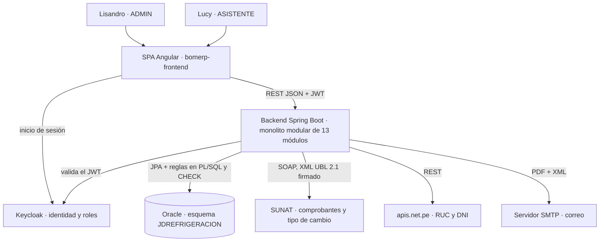

# ADS · S1 · Visión arquitectónica inicial de SGE-JD

**SGE-JD · JD Refrigeración S.A.C. · Equipo CherryTree · Yoel Wagner Chambi Sirena · 10/11/2026**

Trabajo autónomo de la sesión 1 (*Fundamentos de arquitectura de software*). Es la primera visión del sistema
completo, no solo del backend. Cada decisión tiene su justificación y la evidencia que la comprueba.

Contenido:

1. Dominio y proceso principal.
2. Stakeholders.
3. Atributos de calidad priorizados.
4. Estilo arquitectónico inicial.
5. Diagrama arquitectónico inicial.
6. Decisiones arquitectónicas iniciales.
7. Matriz de integración ADS-BD2-LP2.
8. Hallazgo.
9. Reflexión.

## 1. Dominio y proceso principal

| Elemento | SGE-JD |
|---|---|
| Dominio del proyecto | Gestión comercial y técnica de una empresa de climatización, refrigeración y ventilación forzada (JD Refrigeración S.A.C., Lima): catálogo, proformas, ventas, facturación electrónica, cobranza, compras e inventario, y servicio técnico postventa |
| Proceso principal | **Venta con comprobante electrónico:** proforma → venta (contado o crédito) → factura o boleta aceptada por SUNAT → cobro → mantenimiento preventivo del equipo instalado |
| Entidad transaccional principal | `Venta`–`DetalleVenta` (tablas `VENTAS` y `DETALLE_VENTA`); de ella dependen `Comprobante`, `Cobro`–`DetalleCobro` y `Mantenimiento` |
| Usuarios principales | Lisandro, gerente y dueño (rol ADMIN), y Lucy, asistente administrativa (rol ASISTENTE, con permisos que Lisandro le delega) |
| Sistemas externos reales | SUNAT (envío del comprobante y CDR; tipo de cambio), apis.net.pe (RUC y DNI), servidor SMTP (comprobantes y proformas por correo) y Keycloak (identidad) |

Diferencia con BomERP: en BomERP el proceso es "venta con control de stock". En JD el stock es solo una
parte, porque la mayoría de lo que se vende no tiene stock (ver el hallazgo, sección 8). Lo que no puede
fallar es el **comprobante ante SUNAT**: una venta sin comprobante válido es un problema tributario.

## 2. Stakeholders

| Stakeholder | Interés | Atributo de calidad asociado |
|---|---|---|
| Lisandro (gerente, ADMIN) | Ver ventas, márgenes y cobranza reales; decidir quién puede hacer qué (descuentos, precios, fechas pasadas) | Seguridad (autorización) · Auditabilidad |
| Lucy (asistente, ASISTENTE) | Registrar proformas, ventas y cobros rápido, sin errores ni pasos de más | Usabilidad · Integridad |
| Clientes de JD | Recibir su factura o boleta válida, con el monto correcto y a tiempo | Integridad · Confiabilidad de integraciones |
| SUNAT (regulador) | Comprobantes con formato UBL 2.1 firmado, enviados en plazo (3 días) y sin duplicados | Interoperabilidad · Integridad |
| Contador externo | Totales, IGV, detracciones y anulaciones que cuadren con los comprobantes | Integridad · Auditabilidad |
| DBA (BD2) | Esquema Oracle con reglas protegidas en la base, permisos mínimos, respaldos y auditoría | Seguridad · Recuperabilidad |
| Equipo de desarrollo (LP2) | Módulos con límites claros para trabajar en paralelo (3 integrantes, 13 módulos) | Mantenibilidad |

El que más condiciona las decisiones es **SUNAT**. Fija el formato, la firma, el plazo y la inmutabilidad
del comprobante. Ningún otro stakeholder puede negociar esas reglas.

## 3. Atributos de calidad priorizados

| # | Atributo | Por qué importa en JD | Cómo se verifica (evidencia en el proyecto) |
|---|---|---|---|
| 1 | **Integridad** | Total, IGV y stock no pueden quedar inconsistentes, y un comprobante aceptado no puede cambiar | Transacción única en `VentaService` con bloqueo del producto (`descontarStock`); trigger `TRG_COMPROBANTE_AMBIENTE` (ORA-20031); BD2 S1: `FN_TOTAL_VENTA` reproduce los 237 totales de Java y las CHECK nuevas (`CK_PRODUCTO_STOCK`…) |
| 2 | **Seguridad** | Los costos, márgenes y anulaciones son información del dueño; Lucy no debe superar sus topes | Keycloak con JWT RS256, roles ADMIN/ASISTENTE y 11 permisos delegables (`PERM_*`); matriz de seguridad 14/14 |
| 3 | **Auditabilidad** | Quién anuló, quién editó un precio y por qué; qué se envió a SUNAT y con qué resultado | `HISTORIAL_CAMBIOS`, `VENTAS.ANULADO_POR`/`MOTIVO_ANULACION`, `DETALLE_VENTA.MOTIVO_PRECIO`, `ENVIOS_SUNAT`, `INTENTOS_CORREO` |
| 4 | **Confiabilidad de las integraciones** | SUNAT y el correo pueden fallar; la venta no debe perderse ni duplicarse | Reintentos del envío a SUNAT y del correo; estado INCIERTO sin reenvío automático; prueba de integración real del 08/11/2026 |
| 5 | **Mantenibilidad** | Tres desarrolladores en 13 módulos durante 16 semanas | Spring Modulith: `ModularityTests` falla si un módulo usa el repositorio de otro o forma ciclos |

La prioridad sigue al costo de equivocarse. Un error de integridad se convierte en una multa o en dinero mal
cobrado. Uno de rendimiento (RNF-02, 185 ms medidos) solo hace esperar a Lucy, y por eso queda fuera de los
cinco primeros.

## 4. Estilo arquitectónico inicial

| Opción | ¿Aplica a SGE-JD? | Justificación |
|---|---|---|
| Monolito modular | **Sí** | Un solo ejecutable para una empresa con 2 usuarios y una PC; los módulos por dominio dan los límites que un equipo de 3 necesita, verificados con Spring Modulith |
| Arquitectura en capas | Sí, dentro de cada módulo | Controller → Service → Repository → Entity, con DTO en el borde |
| Hexagonal (puertos y adaptadores) | **Solo en las integraciones** | SUNAT, RUC/DNI, correo y WhatsApp están detrás de interfaces (`OseClient`, `ConsultaRucClient`, `NotificadorCorreo`) con implementación real y simulada; el resto del dominio no lo necesita |
| Microservicios | No | Dos usuarios y una sola base no justifican red, despliegue y consistencia distribuida; los eventos internos dejan la puerta abierta |
| Clean Architecture | Parcialmente | Se respeta la regla de dependencia (el dominio no conoce a Spring MVC), sin la estructura formal completa |

## 5. Diagrama arquitectónico inicial

Es intencionalmente simple. Las vistas C4 completas (contexto, contenedores, componentes y código) son el
trabajo de S2. Este diagrama fija que hay una SPA, un backend único, una base Oracle y cuatro sistemas externos,
uno de ellos regulador.

## 6. Decisiones arquitectónicas iniciales

| Código | Decisión | Alternativas consideradas | Justificación | Consecuencia |
|---|---|---|---|---|
| ADR-001 | Un solo proyecto Spring Boot con módulos por paquete (monolito modular) | Microservicios; proyecto Maven multimódulo | Un despliegue en una PC; equipo de 3; el curso pide capas, no distribución | Un único `.jar`; los límites no los da Maven, hay que verificarlos (ADR-002) |
| ADR-002 | Límites verificados con Spring Modulith: los módulos se hablan por fachadas y eventos | Solo convención documentada | Una regla documentada se rompe en silencio; un test que falla, no | `ModularityTests` en cada `mvn test`; Ventas avisa a Postventa por `VentaRegistradaEvent` |
| ADR-005 | Identidad en Keycloak (no JWT propio) | JWT propio con tabla `USUARIOS` | Contraseñas, bloqueo por intentos y política fuera de la aplicación | La tabla `USUARIOS` se retiró (07/11/2026); depende de un contenedor más |
| ADR-S1-01 | Envío **directo** a SUNAT (SEE - Del Contribuyente), sin OSE ni intermediario | OSE de pago; proveedor tipo Gosocket | Sin costo mensual para JD; control del XML y del CDR | El sistema firma y guarda el XML; `SUNAT_AMBIENTE` obligatorio y solo direcciones oficiales |
| ADR-S1-02 | Reglas críticas también en Oracle (CHECK y PL/SQL), no solo en Java | Solo validaciones del backend | Cualquier cliente SQL o script puede saltarse Java (hallazgo de BD2 S1) | Las reglas viven en dos lugares y hay que mantenerlas iguales; `FN_TOTAL_VENTA` lo comprueba contra los totales de Java |

ADR-001, 002 y 005 vienen del curso (BomERP) y el equipo los adoptó y verificó. ADR-S1-01 y ADR-S1-02 son
propios de JD. El ADR completo de una decisión propia está en
[S14_ADS_decisiones_trazabilidad.md](../S14_ADS_decisiones_trazabilidad.md) (ADR-006).

## 7. Matriz de integración ADS-BD2-LP2

| Decisión ADS | Evidencia en BD2 | Evidencia en LP2 |
|---|---|---|
| Integridad de la venta | `SP_REGISTRAR_VENTA`, `FN_TOTAL_VENTA` y CHECK de stock, cantidad y descuento (BD2 S1) | `VentaService.registrarVentaDirecta`, transacción y bloqueo del producto |
| Inmutabilidad del comprobante | Trigger `TRG_COMPROBANTE_AMBIENTE` (ORA-20031) | `EnvioSunatService` fija el ambiente una sola vez |
| Auditabilidad | Tabla de auditoría con trigger (se construye en BD2 S2) | `HISTORIAL_CAMBIOS`, anulación con motivo |
| Seguridad de mínimo privilegio | `JD_APP`: solo `CREATE SESSION` y `EXECUTE` (BD2 S1; se completa en S8) | Keycloak, roles y `PERM_*` |
| Mantenibilidad | Un esquema propietario (`JDREFRIGERACION`) por sistema | `ModularityTests` en verde |

## 8. Hallazgo: la decisión "obvia" de copiar el dominio de BomERP

**Qué parecía obvio.** Tomar el proceso de BomERP, "venta de productos con control de stock", y poner el
stock como la regla central del sistema.

**Qué mostraron los datos.** En la copia de la base del 10/11/2026, solo **16 de los 39 productos**
controlan stock: los de `MATERIAL_SERVICIO`. Los otros 23 no lo controlan: servicios, equipos de
climatización, refrigeración y ventilación que se venden por pedido. En cambio, **las 237 ventas** tienen
comprobante, y cada uno pasa por SUNAT.

| Consulta (BD2, base de práctica) | Resultado |
|---|---|
| Productos por sector | MATERIAL_SERVICIO 16 (con 864 unidades); CLIMATIZACION 8; SERVICIO 7; REFRIGERACION 4; VENTILACION_FORZADA 4 |
| Ventas con comprobante | 237 de 237 |

**Riesgo técnico detectado.** Con el stock como centro, la arquitectura habría tratado a SUNAT como un
"servicio de notificación" opcional, como en BomERP. Pero si SUNAT no responde, la venta queda sin validez
tributaria. El riesgo real es la integración, no el inventario.

**Ajuste.** El proceso principal se definió como *venta con comprobante electrónico* (sección 1). SUNAT pasó a
ser el stakeholder que más condiciona (sección 2). La confiabilidad de las integraciones entró como atributo 4.
La regla de stock quedó acotada al material (ADR-006, `Producto.controlaStock()`).

**Qué aprendí.** El dominio no se copia de un ejemplo: se mide. Una consulta sobre los datos reales cambió la
prioridad de dos atributos de calidad.

## 9. Reflexión

¿Por qué una arquitectura debe justificar decisiones y no solo mostrar componentes?

Un diagrama de componentes dice qué existe, pero no por qué ni qué pasa si se cambia. Dos sistemas pueden tener
el mismo dibujo, una SPA, un backend y una base, y necesitar arquitecturas opuestas. En SGE-JD, ese dibujo no
muestra que SUNAT obliga a no modificar un comprobante aceptado. Tampoco que el stock solo importa para el
material. Una decisión justificada, con sus alternativas y su consecuencia, permite que quien llegue después sepa
qué puede tocar y qué no. Y una decisión con evidencia, como un test o una consulta, se puede comprobar. Sin la
justificación, la arquitectura es una opinión que se pierde en el primer cambio.
