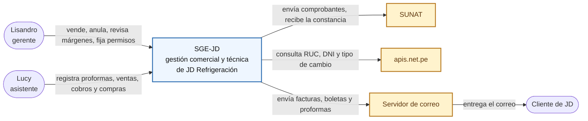
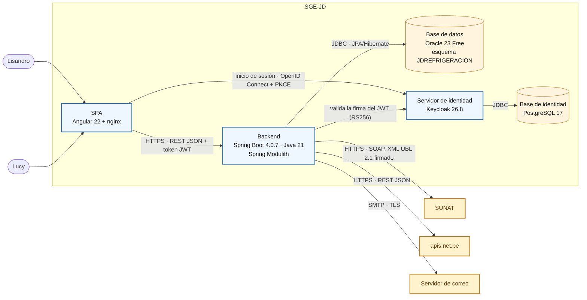
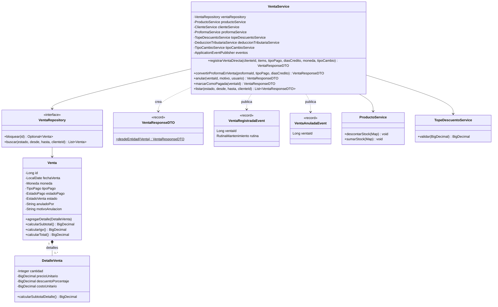

# ADS · S2 · Modelo C4 de SGE-JD

**SGE-JD · JD Refrigeración S.A.C. · Equipo CherryTree · Yoel Wagner Chambi Sirena · 10/11/2026**

Trabajo autónomo de la sesión 2 (*Modelo C4 y vistas arquitectónicas*). Son las cuatro vistas del sistema
**tal como existe hoy**, sin piezas hipotéticas. Cada vista parte de la anterior y de la visión de
[S1](S01_vision_arquitectonica.md).

| Vista | Pregunta que responde | Alcance en SGE-JD |
|---|---|---|
| C1 · Contexto | ¿Quién usa el sistema y con qué sistemas externos habla? | SGE-JD como una sola caja |
| C2 · Contenedores | ¿Qué piezas desplegables lo forman y con qué tecnología? | 5 contenedores (los de `compose-prod.yml`) |
| C3 · Componentes | ¿Qué hay dentro del contenedor con más lógica? | Backend: módulo `ventas` y los módulos con los que colabora |
| C4 · Código | ¿Qué clases forman un componente puntual? | `VentaService` |

## 1. Vista de contexto (C1)

| Elemento | Tipo | Descripción |
|---|---|---|
| Lisandro | Persona | Gerente y dueño: vende, anula, revisa márgenes y cobranza, fija topes y permisos |
| Lucy | Persona | Asistente administrativa: proformas, ventas, cobros y compras dentro de lo que Lisandro le permite |
| Cliente de JD | Persona | Empresa o persona que compra; no entra al sistema, pero recibe su factura o boleta y sus proformas por correo |
| **SGE-JD** | Sistema (el propio) | Sistema de gestión comercial y técnica de JD Refrigeración |
| SUNAT | Sistema externo | Recibe cada factura, boleta y nota de crédito, y devuelve la constancia (CDR) o el rechazo |
| apis.net.pe | Sistema externo | Datos de un RUC o DNI y tipo de cambio publicado por SUNAT |
| Servidor de correo | Sistema externo | Entrega los correos a los clientes y a la oficina |

En C1 no aparece ninguna tecnología: ni Oracle, ni Angular, ni SOAP, ni Keycloak. El cliente de JD no usa
el sistema directamente. Su relación es con el correo, y por eso la flecha sale del servidor de correo y no de
SGE-JD.

## 2. Vista de contenedores (C2)

| Contenedor | Tecnología | Responsabilidad | Despliegue (producción) |
|---|---|---|---|
| SPA | Angular 22, servida por nginx 1.27 | Pantallas de Lisandro y Lucy; inicio de sesión con Keycloak | `sge-jd-frontend`, puerto 4300 |
| Backend | Spring Boot 4.0.7, Java 21, Spring Modulith 2.0.7 | API REST `/api/v1`, reglas de negocio, integraciones y tareas programadas | `sge-jd-backend-prod`, puerto 48088 |
| Base de datos | Oracle Database 23 Free | Datos del negocio (esquema `JDREFRIGERACION`, 29 tablas) y reglas en la base (CHECK, PL/SQL, triggers de BD2) | `sge-jd-oracle-prod`, puerto 41521 |
| Servidor de identidad | Keycloak 26.8 | Usuarios, contraseñas, roles ADMIN/ASISTENTE y permisos `PERM_*` (realm `bomerp`) | `sge-jd-keycloak-prod`, puerto 48080 |
| Base de identidad | PostgreSQL 17 | Datos de Keycloak (no del negocio) | `sge-jd-keycloak-db-prod`, puerto 45432 |

El backend es **un solo contenedor**. Sus 13 módulos de negocio (`ventas`, `facturacion`, `catalogo`…) son
componentes de C3, no contenedores. Esa es la diferencia con los microservicios (ADR-001 de S1). La SPA nunca
habla con Oracle ni con SUNAT: todo pasa por el backend.

## 3. Vista de componentes (C3), primera versión: backend

El contenedor con más lógica es el backend. La vista abre el módulo **`ventas`**, el del proceso principal de
S1, y los componentes de otros módulos con los que colabora. Dibujar los 13 módulos en una sola vista la haría
ilegible. Cada módulo es un grupo de componentes, no un componente.

| Componente | Módulo | Tipo | Responsabilidad |
|---|---|---|---|
| `VentaController` | ventas | Controller | `/api/v1/admin/ventas`: registrar (directa o desde proforma), listar, exportar, anular |
| `VentaService` | ventas | Service | Reglas de la venta: stock, descuentos, precio editado, forma de pago, anulación; publica los eventos |
| `VentaReporteService` | ventas | Service | Reportes y resumen de ventas |
| `DeduccionTributariaService` | ventas | Service | Decide si corresponde detracción o retención y la calcula |
| `VentaRepository` | ventas | Repository | Acceso a `VENTAS` y `DETALLE_VENTA`; `bloquear()` con bloqueo pesimista |
| `ProductoService` | catalogo | Service (fachada) | Precio de catálogo, `descontarStock` y `sumarStock` con bloqueo |
| `ClienteService` | clientes | Service (fachada) | Datos del cliente de la venta |
| `ProformaService` | proformas | Service (fachada) | Proforma aceptada que se convierte en venta |
| `TopeDescuentoService` | seguridad | Service (fachada) | Tope de descuento según el rol |
| `TipoCambioService` | config | Service | Tipo de cambio del día (apis.net.pe) |
| `VentasFacturacionListener` | facturacion | Listener de eventos | Emite el comprobante al registrar y la nota de crédito al anular |
| `VentasPostventaListener` | postventa | Listener de eventos | Programa las visitas de mantenimiento al registrar y cancela las pendientes al anular; para leer la venta llama a la fachada `VentaService.obtenerPorIdPublico` |

```mermaid
flowchart TB
    SPA["SPA (fuera de este contenedor)"]
    subgraph API["Contenedor: Backend Spring Boot"]
        subgraph VEN["Módulo ventas"]
            VC["VentaController"]
            VS["VentaService"]
            VRS["VentaReporteService"]
            DTS["DeduccionTributariaService"]
            VR["VentaRepository"]
            VDTO["DTO: VentaResponseDTO · ItemVentaDTO"]
            VENT["Entity: Venta · DetalleVenta"]
            EV["Eventos: VentaRegistradaEvent · VentaAnuladaEvent"]
        end
        subgraph OTROS["Fachadas de otros módulos"]
            PS["catalogo · ProductoService"]
            CS["clientes · ClienteService"]
            PFS["proformas · ProformaService"]
            TDS["seguridad · TopeDescuentoService"]
            TCS["config · TipoCambioService"]
        end
        subgraph OYENTES["Módulos que reaccionan a la venta"]
            FL["facturacion · VentasFacturacionListener"]
            PL["postventa · VentasPostventaListener"]
        end
    end
    ORA[("Oracle (contenedor aparte)")]

    SPA -->|"REST JSON"| VC
    VC --> VS
    VC --> VRS
    VC -.->|"usa"| VDTO
    VS --> DTS
    VS --> VR
    VS --> PS
    VS --> CS
    VS --> PFS
    VS --> TDS
    VS --> TCS
    VR -.->|"usa"| VENT
    VR -->|"JDBC"| ORA
    VS -.->|"publica"| EV
    EV -.->|"escucha"| FL
    EV -.->|"escucha"| PL

    classDef comp fill:#eef6ff,stroke:#2b6cb0,stroke-width:2px,color:#111;
    classDef data fill:#fff4de,stroke:#b7791f,stroke-width:1px,color:#111;
    class VC,VS,VRS,DTS,VR,PS,CS,PFS,TDS,TCS,FL,PL comp;
    class VDTO,VENT,EV data;
```

Hay dos formas de colaborar, y las dos las hace cumplir Spring Modulith (ADR-002):

- **Llamada directa a una fachada** (línea sólida), cuando la venta necesita la respuesta para seguir: el
  stock, el precio, el tope. Ventas nunca toca el repositorio de otro módulo; `ModularityTests` lo verifica.
- **Evento** (línea punteada), cuando la venta no necesita esperar: el comprobante y el mantenimiento.
  `ventas` no conoce a `facturacion` ni a `postventa`. Publica el evento y ellos lo escuchan.

Es una primera versión. Faltan los otros 10 módulos, que tendrán su propia vista C3 a medida que se diseñen
(S8 elige otro módulo para el diseño por capas). También falta el componente que envía a SUNAT
(`EnvioSunatService`, `SunatDirectoClient`), que se abre en S11, integración.

## 4. Vista de código (C4), primera versión: `VentaService`

| Clase / interfaz | Tipo | Responsabilidad |
|---|---|---|
| `VentaService` | Clase `@Service` | Reglas y transacciones de la venta; no tiene interfaz propia (ver hallazgo 2) |
| `VentaRepository` | Interfaz (Spring Data JPA) | Consultas de ventas; `bloquear(id)` con `PESSIMISTIC_WRITE` y espera máxima de 10 s |
| `Venta` | Entidad JPA | Cabecera: cliente, fecha, moneda, forma y estado de pago, estado, anulación; calcula subtotal, IGV y total |
| `DetalleVenta` | Entidad JPA | Línea: producto, cantidad, precio, descuento, costo, precio de catálogo y motivo si se editó |
| `VentaResponseDTO` | Record | Lo que la API devuelve; se arma con `desdeEntidad()` (sin clase Mapper) |
| `VentaRegistradaEvent`, `VentaAnuladaEvent` | Records | Avisos a otros módulos; la rutina de mantenimiento viaja con el primero |
| `ProductoService`, `TopeDescuentoService`, `DeduccionTributariaService` | Clases `@Service` | Colaboradores que se inyectan por constructor |
| `ApplicationEventPublisher` | Interfaz de Spring | Publica los eventos |

Es primera versión porque solo muestra las operaciones que usan las vistas y las pruebas de BD2. Faltan
`ClienteService`, `ProformaService` y `TipoCambioService` como clases, y los métodos de consulta para Cobranza.
Va a cambiar en S8, cuando el diseño por capas pida una interfaz para el servicio y quizá un mapper.

## 5. Coherencia con S1

| Decisión o elemento de S1 | Dónde se ve en C1–C4 |
|---|---|
| Proceso principal: venta con comprobante | C3 abre `ventas`, y su evento llega a `facturacion` |
| SUNAT, el stakeholder que más condiciona | Sistema externo en C1; en C2, la única conexión SOAP con XML firmado |
| ADR-001, monolito modular | C2: el backend es un solo contenedor; los módulos aparecen recién en C3 |
| ADR-002, límites con Spring Modulith | C3: fachadas (líneas sólidas) y eventos (punteadas); ningún repositorio ajeno |
| ADR-005, identidad en Keycloak | C2: Keycloak y su PostgreSQL como contenedores propios |
| ADR-S1-02, reglas también en Oracle | C2: la base guarda las CHECK y los triggers de BD2 S1 y S2 |
| Atributo 1, integridad | C4: `bloquear()` con `PESSIMISTIC_WRITE`, `descontarStock` y `Venta` que calcula su propio total |

## 6. Integración con BD2 y LP2

| Contenedor | Relación con BD2 | Relación con LP2 |
|---|---|---|
| SPA | Ninguna directa | `bomerp-frontend` (S7–S12): pantallas, guardas por rol, interceptor del token |
| Backend | Se conecta como `JDREFRIGERACION`; en S8 pasará a un usuario técnico (`JD_APP`, creado en BD2 S1) | Proyecto Spring Boot de LP2 (S1–S14), `ModularityTests` |
| Base de datos Oracle | Todo BD2: PL/SQL (S1), triggers y auditoría (S2), índices, seguridad, respaldo y monitoreo | Entidades JPA; `ddl-auto=validate` en producción |
| Servidor de identidad | Ninguna (no usa Oracle) | Keycloak (S10b–S11): realm, roles, permisos |
| Base de identidad | Ninguna: es PostgreSQL y la administra Keycloak | Solo despliegue (`compose-prod.yml`) |

## 7. Error o hallazgo: Keycloak estaba en el nivel equivocado

**Qué pasó.** En el bosquejo de S1, Keycloak aparecía como una caja más al lado de SUNAT y del correo, con
flechas desde la SPA y el backend. Al pasarlo a C1, lo primero fue ponerlo como **sistema externo**, porque "es
un producto de terceros que no programamos".

**Por qué está mal.** C1 no separa por quién escribió el código, sino por **quién lo opera y es responsable
de él**. Keycloak lo desplegamos nosotros, en nuestro `compose-prod.yml`, con nuestra base PostgreSQL. Su
configuración está en el repositorio (`keycloak/realm-bomerp.json`, `configurar_realm.py`), y si se cae, se
cae SGE-JD. SUNAT es lo contrario: no la controlamos y solo hablamos con ella. Con Keycloak como sistema
externo, C1 habría mostrado tecnología (un producto concreto) y habría sacado del sistema algo que hay que
respaldar y actualizar.

**Corrección.** Keycloak no aparece en C1, porque queda dentro de la caja "SGE-JD". En C2 aparece como
contenedor, junto con su PostgreSQL, que antes no figuraba en ningún diagrama aunque es un contenedor más que
operar.

**Hallazgo 2 (C4).** El curso usa una interfaz más su implementación (`ProductoService` y
`ProductoServiceImpl`). En SGE-JD, `VentaService` es una clase sin interfaz, y el DTO se arma con un método
estático en lugar de una clase Mapper. Funciona y está probado, pero los otros módulos dependen de la clase
concreta. Se evalúa con SOLID (inversión de dependencias) en S3.

**Error corregido de S1.** El documento de S1 decía que el tipo de cambio venía de SUNAT. En el código
(`TipoCambioService`) viene de `api.apis.net.pe/v1/tipo-cambio-sunat`: el dato es de SUNAT, pero el sistema
con el que hablamos es apis.net.pe. Se corrigió S1 y C1 lo muestra así.

## 8. Reflexión

¿Por qué separar C1 y C2 en dos diagramas distintos, en vez de mostrar todo en uno solo?

Porque responden a preguntas distintas y las leen personas distintas. C1 es para Lisandro o para el docente:
quién usa el sistema y de qué depende afuera. Ahí se ve que sin SUNAT no hay factura, y no hace falta saber
qué es Oracle. C2 es para quien despliega y mantiene: cinco contenedores, con qué protocolo habla cada uno y
qué hay que respaldar. Si se juntan, el diagrama se llena de puertos y tecnologías que esconden lo importante,
y se cometen errores como el de Keycloak: con todo mezclado, no hay una línea clara entre "nuestro" y
"externo". Separar los niveles obliga a decidir esa línea antes de dibujar el detalle.
