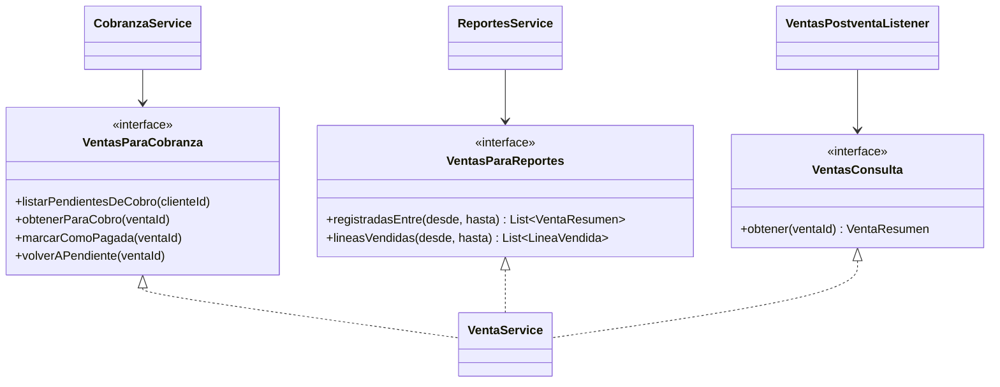

# ADS · S3 · SOLID, cohesión y acoplamiento del módulo `ventas`

**SGE-JD · JD Refrigeración S.A.C. · Equipo CherryTree · Yoel Wagner Chambi Sirena · 10/11/2026**

Trabajo autónomo de la sesión 3 (*Diseño estructural y principios SOLID*). Se evalúa el módulo **`ventas`**,
el del proceso principal ([S1](S01_vision_arquitectonica.md)), que ya se abrió en C3 y C4
([S2](S02_modelo_c4.md)). Todo lo que se afirma sale del código del 10/11/2026: tamaños con `wc -l` y usos con
`grep`.

El módulo tiene cuatro paquetes:

| Paquete | Clases | Líneas |
|---|---|---|
| `ventas.venta` | `VentaController`, `VentaService`, `VentaRepository`, `Venta`, `VentaResponseDTO`, `ComprobantesDeVenta`, 3 eventos | 1 172 |
| `ventas.detalleventa` | `DetalleVenta` | 126 |
| `ventas.reporte` | `VentaReporteService` | 132 |
| `ventas.tributos` | `DeduccionTributariaService`, `TributosProperties` | 86 |

## 1. Responsabilidad única (S)

| Clase | Líneas | Responsabilidad | ¿Cumple? |
|---|---|---|---|
| `VentaController` | 140 | Traducir HTTP a llamadas al servicio: `@Valid`, sacar del JWT quién vende o anula | **Sí**: ninguna regla de negocio; el usuario sale del token y nunca del cuerpo del request |
| `VentaService` | **631** | Registrar y anular ventas… y también listar, paginar y ordenar, armar el reporte por moneda, y servir de fachada a Cobranza (5 métodos), Facturación (2) y Reportes (5) | **No.** Tiene al menos cuatro razones distintas para cambiar (sección 6) |
| `VentaRepository` | 74 | Consultas de `VENTAS` y `DETALLE_VENTA`; `bloquear()` con bloqueo pesimista | Sí: interfaz sin lógica |
| `Venta` | 188 | Datos de la cabecera **y** su cálculo: subtotal, IGV, total, neto a cobrar | Sí: el cálculo es responsabilidad de quien tiene los datos (entidad rica, no anémica) |
| `DetalleVenta` | 126 | Datos de la línea y su importe con descuento | Sí |
| `VentaResponseDTO` | 86 | Forma de la venta en la API; `desdeEntidad()` la arma | Sí: la conversión vive con el DTO, sin clase Mapper |
| `VentaReporteService` | 132 | Excel de ventas e historial de un cliente | Sí, con matiz: comparte con `VentaService` la responsabilidad de "consultar ventas" |
| `DeduccionTributariaService` | 65 | Decidir si una venta lleva detracción o retención y calcularla | **Sí**: una sola regla, una sola razón de cambio (la ley) |
| `TributosProperties` | 21 | Porcentajes y umbrales de `app.tributos` | Sí: solo configuración |

`DeduccionTributariaService` muestra lo que se busca. Cuando SUNAT cambie el umbral o el porcentaje, se toca
esa clase o sus propiedades, y nada más. Con `VentaService` no pasa lo mismo: un cambio en cómo se ordena una
lista, en lo que necesita Cobranza o en el formato del reporte cae siempre en el mismo archivo de 631 líneas.

## 2. Abierto/cerrado, Liskov e interfaces (O, L, I)

**El módulo tiene una sola interfaz de servicio: `ComprobantesDeVenta`.** Es la que está bien diseñada:

```java
// ventas/venta/service/ComprobantesDeVenta.java: la DEFINE ventas
public interface ComprobantesDeVenta {
    Optional<String> numeroComprobanteDeVenta(Long ventaId);
    Optional<String> numeroNotaCreditoDeVenta(Long ventaId);
}
// facturacion/facturacion/service/FacturacionService.java: la IMPLEMENTA facturacion
public class FacturacionService implements ComprobantesDeVenta { … }
```

| Principio | `ComprobantesDeVenta` | `VentaService` (sin interfaz) |
|---|---|---|
| **O**, abierto/cerrado | Abierta: un `ComprobantesDeVentaSimulado` para pruebas o un proveedor externo se suma sin tocar `VentaReporteService` | Cerrada a extensión: no hay contrato que implementar. Además, `registrarVentaDirecta` tiene **5 sobrecargas** (4, 6, 8, 9 y 10 parámetros). Cada dato nuevo (moneda, vendedor, rutina, fecha) agregó una sobrecarga, o sea, se *modificó* la clase para *extenderla* |
| **L**, Liskov | Cualquier implementación debe devolver `Optional.empty()` si la venta no tiene comprobante, nunca `null` ni una excepción; `VentaReporteService` depende de eso para imprimir "—" | No aplica: hay una sola clase y no hay sustitución posible |
| **I**, segregación | **2 métodos, y su único cliente usa los 2** | **25 métodos públicos** (19 operaciones distintas). El controlador usa 6 y ningún otro módulo más de 5 (tabla de abajo) |

Qué usa cada cliente de `VentaService`, contado con `grep "ventaService\.<método>("` en todo `src/main`:

| Cliente | Módulo | Métodos que usa | de 25 |
|---|---|---|---|
| `VentaController` | ventas | `listar`, `reportePagina`, `registrarVentaDirecta`, `convertirProformaEnVenta`, `anular`, `listarVentasConPagoAtrasado` | 6 |
| `CobranzaService`, `DevolucionService` | cobranza | `listarPendientesDeCobro`, `obtenerParaCobro`, `marcarComoPagada`, `volverAPendiente`, `obtenerPorIdPublico` | 5 |
| `VentaReporteService` | ventas | `buscar` | 1 |
| `ReportesService`, `RentabilidadService` | reportes | `registradasEntre`, `pendientesVencidasAl`, `listarPendientesDeCobro`, `lineasVendidas`, `lineasDeVentas` | 5 |
| `FacturacionService` | facturacion | `obtenerPorIdPublico`, `asignarComprobante` | 2 |
| `OrdenTrabajoService` | servicios | `registrarVentaDirecta`, `obtenerPorIdPublico` | 2 |
| `VentasPostventaListener`, `EquipoInstaladoService` | postventa | `obtenerPorIdPublico` | 1 |
| `KardexService` | inventario | `detallesDeProducto` | 1 |
| *(nadie)* | — | **`listarTodas`**: código muerto | 0 |

Es una violación real de **I**. Postventa depende de una clase de 25 métodos para usar uno. Cualquier
cambio en la firma de `anular` obliga a recompilar Postventa, Inventario y Reportes, que no anulan nada.

## 3. Inversión de dependencias (D)

```java
@Service
public class VentaService {
    private final VentaRepository ventaRepository;                       // interfaz (Spring Data JPA)
    private final ProformaService proformaService;                       // clase concreta (proformas)
    private final ClienteService clienteService;                         // clase concreta (clientes)
    private final ProductoService productoService;                       // clase concreta (catalogo)
    private final TipoCambioService tipoCambioService;                   // clase concreta (config)
    private final TopeDescuentoService topeDescuentoService;             // clase concreta (seguridad)
    private final DeduccionTributariaService deduccionTributariaService; // clase concreta (ventas.tributos)
    private final ApplicationEventPublisher eventos;                     // interfaz (Spring)
    private final AccesoUsuario acceso;                                  // clase concreta (seguridad)
    // todas llegan por el constructor; ninguna se crea con new
}
```

| Verificación | Resultado |
|---|---|
| ¿Inyección por constructor? | **Sí**, las 9 dependencias, todas `final` |
| ¿Algún `new` de un servicio o repositorio? | **No**: `grep " new [A-Z]*Service\| new [A-Z]*Repository"` en `ventas` no encuentra nada |
| ¿Depende de abstracciones? | **En parte.** 2 de 9 son interfaces (`VentaRepository`, `ApplicationEventPublisher`); las otras 7 son clases concretas de otros módulos |
| ¿Hay inversión real en algún punto? | **Sí, una**: `ComprobantesDeVenta`. Ventas *define* lo que necesita y Facturación lo *implementa*, así que la dependencia de código va de `facturacion` hacia `ventas`, aunque en ejecución sea ventas la que consulta a facturación. Por eso `ventas` puede leer el número de comprobante sin conocer el módulo `facturacion` |

Que las 7 dependencias sean clases concretas **no es todavía un problema práctico**. Spring Modulith obliga a
que cada una sea la fachada pública de su módulo, nunca su repositorio, y cada una tiene una sola implementación.
Sería un problema si alguna necesitara una segunda versión, por ejemplo un `TipoCambioService` simulado para
pruebas sin internet. Hoy las pruebas simulan clases concretas con Mockito (`@Mock VentaService`, `@Mock ClienteService`), y las interfaces reales (`OseClient`, `NotificadorCorreo`) con `@MockitoBean`.

## 4. Cohesión y acoplamiento entre dos paquetes: `venta` y `tributos`, y `venta` y `reporte`

| | `venta` → `tributos` | `reporte` → `venta` |
|---|---|---|
| Dependencia | `VentaService` llama a `DeduccionTributariaService.aplicar(venta)` | `VentaReporteService` usa `VentaService` (consultas) y `ComprobantesDeVenta` |
| Dirección | Una sola: `tributos` no conoce a `VentaService` (solo recibe la entidad `Venta`) | Una sola: `venta` no conoce el reporte… salvo `VentaController`, que inyecta los dos servicios |
| Cohesión interna | **Alta**: `tributos` hace una cosa (la deducción) con sus propiedades | **Media**: el reporte arma Excel e historial; la paginación y el resumen por moneda, que también son reporte, quedaron en `VentaService` |
| Acoplamiento | **Bajo**: un método, `aplicar(Venta)` | **Medio**: depende de la clase completa de 25 métodos, aunque usa 1 (`buscar`) |
| ¿Violación? | No | **No es violación arquitectónica** (mismo módulo; `ModularityTests` no lo controla), pero sí una tensión: el límite entre "operar ventas" y "consultar ventas" pasa por el medio de `VentaService` |

Dentro de un mismo módulo, que `reporte` use `VentaService` es una decisión interna y aceptable. La tensión
está en que `VentaService.reportePagina()` y `VentaReporteService.exportarExcel()` hacen el mismo tipo de
trabajo en dos paquetes distintos. Quien busque "cómo se arma el reporte de ventas" tiene que mirar los dos.

## 5. Modularidad y abstracción

**Modularidad.** `ModularityTests` (`ApplicationModules.of(BomerpApplication.class).verify()`) pasa en cada
`mvn test`. Ningún módulo usa `VentaRepository` y no hay ciclos. Se verifica de forma automática, no por
revisión.

**Abstracción, DTO frente a entidad, en dos fronteras distintas:**

| Frontera | Qué cruza | Evaluación |
|---|---|---|
| API REST → SPA | `VentaResponseDTO` | **Correcto.** La SPA nunca recibe la entidad: ni `costoUnitario` (margen interno) ni las relaciones JPA salen sin decidirlo |
| `ventas` → otros módulos | **La entidad `Venta`** (`obtenerPorIdPublico`, `obtenerParaCobro`, `buscar`, `registradasEntre`…) y `DetalleVenta` (`lineasVendidas`) | **Fuga de abstracción.** Hay 90 líneas de código (sin imports ni comentarios) que usan `Venta` o `DetalleVenta` en `cobranza`, `facturacion` y `reportes`. Un campo nuevo en la tabla o un cambio en una relación JPA se propaga a otros módulos. Y un módulo podría llamar a `venta.setEstado(…)` y saltarse `anular()`, con su stock y su motivo |

Spring Modulith permite esto, porque la entidad está en un paquete público del módulo. Pero es justo lo que la
abstracción debería evitar.

## 6. Hallazgo real: `VentaService` es una "fachada de todo"

**Qué se encontró.** `VentaService` creó **dos responsabilidades opuestas en la misma clase**:

1. Es el **servicio de aplicación** de la venta: registrar, convertir proforma, anular, con transacciones,
   bloqueos y eventos.
2. Es la **fachada pública del módulo** para otros 6 módulos, que lo usan para leer ventas y a veces para
   cambiarlas (`marcarComoPagada`, `asignarComprobante`).

Cada vez que un módulo necesitó algo de ventas, se agregó un método aquí. El resultado son 631 líneas, 25
métodos públicos, 5 sobrecargas y un método que nadie usa (`listarTodas`).

**Por qué importa (riesgo concreto).** Las operaciones que cambian dinero y stock (`anular`,
`marcarComoPagada`) están en la misma clase pública que las consultas para reportes. Un desarrollador de
Reportes que abre `VentaService` para buscar `registradasEntre` tiene a mano `volverAPendiente`, que cambia el
estado de cobro de una venta.

**Corrección propuesta.** Es un refactor que todavía no se aplicó: se diseña aquí y se aplica en S10, con
GRASP. Se aplicaría el mismo patrón que ya funciona en `ComprobantesDeVenta`:



| Paso | Efecto | Riesgo |
|---|---|---|
| 1. Interfaces por cliente (`VentasParaCobranza`, `VentasParaReportes`, `VentasConsulta`), implementadas por la misma `VentaService` | **I**: cada módulo ve solo lo suyo; **D**: dependen de una interfaz | Bajo: no cambia ninguna lógica, solo el tipo que se inyecta |
| 2. Que las de lectura devuelvan records (`VentaResumen`, `LineaVendida`) y no la entidad | Cierra la fuga de abstracción de la sección 5 | Medio: cobranza y reportes usan hoy campos de la entidad |
| 3. Reemplazar las 5 sobrecargas por un `RegistroVentaCommand` (record) | **O**: un dato nuevo es un campo más, no otra sobrecarga | Bajo |
| 4. Borrar `listarTodas` | Código muerto | Ninguno |

Las 215 pruebas existentes (`VentaDirectaValidacionTest`, `VentaFechaPasadaIntegracionTest`, `PrecioEditadoIntegracionTest`,
`ModularityTests`, la matriz de seguridad) son la red para hacerlo sin romper nada.

**Por qué no es solo "una clase grande".** Si fuera grande pero con una sola responsabilidad, sería
aceptable. El problema es que mezcla quién la necesita: la SPA que vende, Cobranza que cobra y Reportes que
lee. Esa mezcla es lo que **S** e **I** señalan, no el tamaño.

## 7. Integración con LP2 y BD2

| Criterio | Evidencia en LP2 | Relación con BD2 |
|---|---|---|
| S en `DeduccionTributariaService` | `ventas.tributos` (detracción y retención) | — |
| S/I en `VentaService` (hallazgo) | 631 líneas, 25 métodos, 6 módulos que lo usan además de `ventas` | `SP_REGISTRAR_VENTA` (BD2 S1–S3) tiene **una** operación, con IN/OUT claros: la misma regla con una sola responsabilidad |
| D con `ComprobantesDeVenta` | Ventas define, Facturación implementa | — |
| Abstracción: la entidad cruza módulos | `obtenerPorIdPublico` devuelve `Venta` | `VENTA_AUDITORIA` (BD2 S2) registra el cambio de estado aunque otro módulo modifique la entidad saltándose `anular()` |
| Modularidad | `ModularityTests` en verde | Un solo esquema propietario (`JDREFRIGERACION`) |

## 8. Reflexión

¿Por qué el acoplamiento entre dos paquetes del mismo módulo no es automáticamente una violación, y qué lo
diferencia del acoplamiento entre dos módulos distintos?

Dentro de un módulo, los paquetes los mantiene el mismo responsable y cambian por las mismas razones. Que
`reporte` use `VentaService` es como dos clases del mismo equipo que se conocen: si una cambia, quien la cambió
sabe arreglar la otra en el mismo commit. Entre módulos es distinto. `cobranza` es de Aron y `ventas` es mío, y
cada módulo debería poder cambiar por dentro sin avisar al otro. Por eso entre módulos solo se permite la
fachada pública, y `ModularityTests` lo verifica. El hallazgo de esta sesión está justo en ese borde.
`VentaService` es a la vez la clase interna de ventas y la fachada para otros 6 módulos, así que un cambio
interno se convierte en un cambio de contrato para todos. La diferencia no está en cuántas dependencias hay,
sino en si cruzan el límite de quién es responsable de qué.
