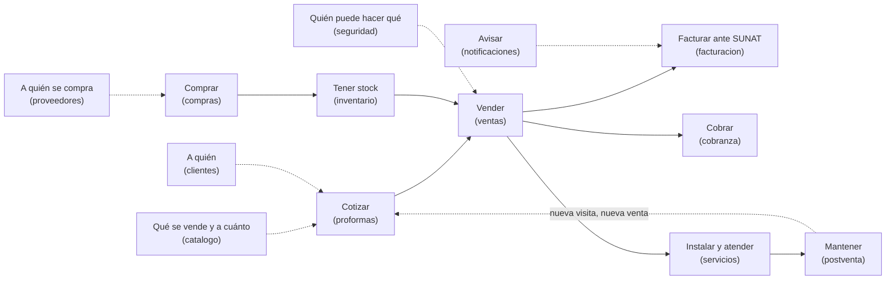
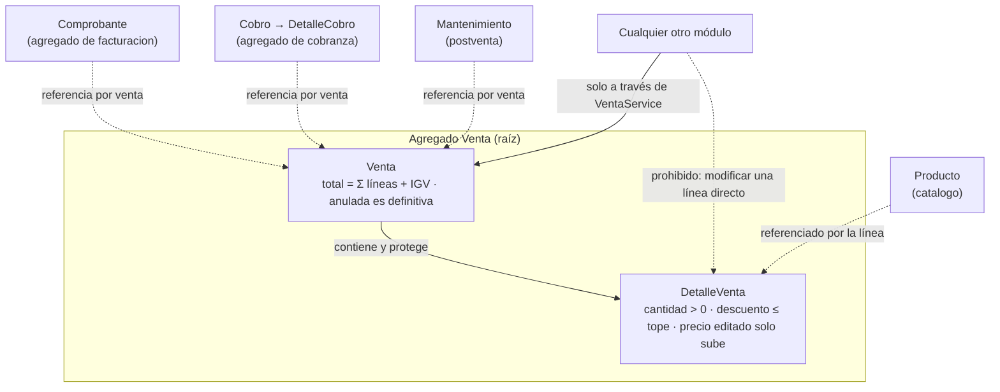
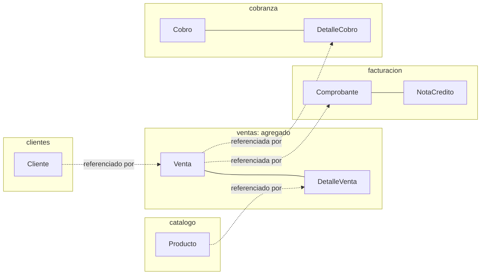

# ADS · S6 · Descubrimiento y modelado del dominio de SGE-JD

**SGE-JD · JD Refrigeración S.A.C. · Equipo CherryTree · Yoel Wagner Chambi Sirena · 10/11/2026**

Trabajo autónomo de la sesión 6 (*Descubrimiento y modelado del dominio*), primera de la Unidad II. El orden es
el de un proyecto nuevo: **primero el negocio completo, después las entidades**. Los datos que se citan salen de
la copia de desarrollo (base de práctica de BD2, consultas del 10/11/2026), sin las cargas de prueba de BD2 S4 y S5.

## 1. Panorama holístico del negocio (sin entidades)

JD Refrigeración vende, instala y mantiene equipos de climatización, refrigeración y ventilación forzada, y
vende el material y el servicio técnico que eso requiere. El recorrido de un cliente es este:

| Módulo candidato | Qué hace, en una frase |
|---|---|
| proformas | Le dice al cliente cuánto le costaría, antes de que decida |
| ventas | Concreta lo que el cliente compró |
| facturacion | Da validez tributaria a esa venta ante SUNAT |
| cobranza | Cobra lo vendido a crédito y devuelve lo cobrado de más |
| servicios | Instala y atiende en el local del cliente (órdenes de trabajo, técnicos, sedes) |
| postventa | Programa y hace el mantenimiento preventivo de lo instalado |
| catalogo | Define qué se vende y a qué precio |
| clientes | Registra a quién se le vende, y dónde están sus locales |
| compras | Consigue el material y los equipos, y paga a los proveedores |
| inventario | Sostiene y corrige la disponibilidad física del material |
| proveedores | Registra a quién se le compra |
| seguridad | Quién entra y qué puede hacer cada uno |
| notificaciones | Hace llegar correos y avisos |

## 2. Subdominios

| Módulo | Subdominio | Por qué |
|---|---|---|
| **ventas** | **Core** | Es donde se gana el dinero: precio con margen, descuento con tope, precio editado con motivo, detracción y retención |
| **servicios** y **postventa** | **Core** | Es lo que distingue a JD de una tienda: la instalación y el mantenimiento recurrente. 448 de los 483 mantenimientos salen de una venta, y un cliente con mantenimiento vuelve a comprar |
| proformas | Supporting | Necesaria y propia del negocio, pero simple: es una venta que todavía no ocurrió |
| facturacion | Supporting | Compleja (UBL 2.1, firma, plazos, reemplazos), pero **no diferencia** a JD: cualquier empresa peruana la necesita y se puede comprar a un OSE. Se construyó porque el envío directo no tiene costo mensual (ADR-S1-01) |
| cobranza | Supporting | Necesaria; sus reglas (saldo, abonos, devoluciones) son las de cualquier empresa |
| catalogo, clientes, proveedores, compras, inventario | Supporting | Necesarios y no diferenciadores |
| seguridad | **Generic** | Problema resuelto en la industria: se delegó a Keycloak (ADR-005) y el sistema solo guarda topes y permisos |
| notificaciones | **Generic** | Enviar un correo es un problema resuelto (SMTP) |

## 3. Entidades y reglas de negocio, por módulo

**Se modelan en profundidad en esta unidad: `ventas`, `facturacion` y `cobranza`.** Son el proceso principal
definido en S1, "venta con comprobante electrónico", y sus dos consecuencias directas: la validez tributaria y el
dinero. Los otros módulos quedan como candidatos para después:

- **servicios y postventa:** son Core, pero su regla depende de que la venta esté bien modelada primero. Son el
  candidato natural de S8.
- **catalogo y clientes:** aparecen aquí solo como lo que la venta referencia.
- **los demás:** no participan en el proceso principal.

| Módulo | Entidad | Identificador | Regla de negocio | Dónde se cumple hoy |
|---|---|---|---|---|
| ventas | **Venta** | `id` | Total = suma de líneas + 18 % IGV. Una venta anulada es definitiva y se anula con motivo y quién. Solo con permiso se registra con fecha de hasta 30 días atrás | `Venta.calcularTotal()`; `VentaService.anular()`; trigger `TRG_VENTA_ESTADO_BU` (BD2 S2) |
| ventas | **DetalleVenta** | `id` | Cantidad mayor que 0. El descuento no supera el tope del rol. El precio editado solo sube y lleva motivo. El material necesita stock suficiente | `VentaService`, `PrecioDeLinea`; `CK_DETALLE_VENTA_*` (BD2 S1) |
| facturacion | **Comprobante** | `serie` + `numero` (y `id`) | Una venta tiene **un solo** comprobante vigente. Se envía a SUNAT dentro de los 3 días. Aceptado, su ambiente ya no cambia. Rechazado con CDR, se reemplaza por otro, no se corrige | `UX_COMPROBANTE_VIGENTE_VENTA`, `TRG_COMPROBANTE_AMBIENTE`, `Comprobante.fueraDePlazo()` |
| facturacion | **NotaCredito** | `serie` + `numero` | Anular una venta con comprobante aceptado exige su nota de crédito | `VentasFacturacionListener.alAnularVenta` |
| cobranza | **Cobro** | `id` | El mismo voucher (método + N° de operación) no entra dos veces. Se anula con motivo, no se borra | `CobroRepository.vigentesConReferencia` (índice de BD2 S5); `CK_COBRO_ANULADO` |
| cobranza | **DetalleCobro** | `id` | El abono a una venta no supera su saldo; cuando el saldo llega a 0, la venta pasa a PAGADO | `CobranzaService` y `VentaService.marcarComoPagada` |
| catalogo | Producto | `id` | Precio = costo × (1 + margen); solo el material controla stock (ADR-006); stock nunca negativo | `Producto.calcularPrecioVenta()`, `controlaStock()`; `CK_PRODUCTO_STOCK` |
| clientes | Cliente | `id` (y RUC o DNI) | RUC de 11 y DNI de 8, sin duplicados; si es agente de retención, sus ventas grandes llevan retención | `ClienteService`; `DeduccionTributariaService` |

## 4. Casos de uso relevantes

No son operaciones CRUD: cada uno cruza reglas y a veces módulos.

| Módulo | Caso de uso | Valor para el negocio |
|---|---|---|
| ventas | **Convertir una proforma aceptada en venta** | La cotización se cumple con los precios y descuentos que se negociaron, no con los de hoy (118 de 228 proformas se convirtieron) |
| ventas | **Registrar una venta directa** | Venta con stock, tope de descuento, IGV, detracción o retención, comprobante y mantenimientos en una sola operación |
| ventas | **Anular una venta** | Devuelve el stock, emite la nota de crédito, cancela los mantenimientos pendientes y, si ya se cobró, deja la devolución pendiente |
| facturacion | **Emitir un comprobante de reemplazo** | Un comprobante rechazado por SUNAT no se corrige: se emite otro para la misma venta y el rechazado queda en el historial |
| cobranza | **Registrar un cobro repartido** | Una transferencia del cliente puede pagar varias facturas, y una factura puede pagarse en varias cuotas (82 de 99 ventas cobradas tienen más de un cobro) |
| postventa | **Programar la rutina de mantenimiento al vender un equipo** | Las visitas preventivas quedan agendadas desde la venta |

## 5. Objetos de valor

| Objeto de valor | Reemplaza a | Por qué es objeto de valor | ¿Existe hoy? |
|---|---|---|---|
| **Dinero** (monto + moneda + tipo de cambio) | `BigDecimal` sueltos más `Venta.moneda` y `Venta.tipoCambio` en campos separados | Dos montos se comparan por contenido. Sumar soles con dólares es un error que hoy solo evita la disciplina del programador, y la conversión con el tipo de cambio hoy se llama desde cuatro lugares (`VentaService`, `ProformaService`, `CompraService` y la entidad `Venta`) | **No**: es el candidato principal |
| **RutinaMantenimiento** (frecuencia, visitas, primera visita) | Tres parámetros sueltos | No tiene identidad y calcula `fechaVisita(i)`. Define sus límites (`MAX_FRECUENCIA_MESES = 12`, `MAX_VISITAS = 24`), pero **no los valida él mismo**: lo hace quien lo usa. Un objeto de valor completo se validaría en su constructor | **Sí**: `record RutinaMantenimiento` |
| **PrecioDeLinea** (precio, precio de catálogo, quién lo editó, motivo) | Cuatro campos que tienen que ir juntos | La regla "el precio editado solo sube y lleva motivo" vive en `PrecioDeLinea.resolver()` | **Sí**: `record PrecioDeLinea` |
| **RangoFecha** (desde, hasta) | `desde`/`hasta` repetidos en `buscar`, `lineasVendidas` y `registradasEntre` | Valida `desde ≤ hasta` en un solo lugar. Es justo el filtro que BD2 S4 tuvo que reescribir | No |

Un matiz: `EnvioSunat` está marcado `@Embeddable`, como un objeto de valor, pero **no lo es**. Se modifica en el
tiempo (`registrarIntento`) y su historia importa. Es el estado de una entidad (`Comprobante`) guardado en su
misma tabla. Que algo sea `@Embeddable` dice dónde se guarda, no qué es en el dominio.

## 6. Prueba de tres partes

La prueba hace tres preguntas: (1) **¿ciclo de vida?** ¿B puede existir sin A?; (2) **¿cardinalidad?** ¿B
pertenece a un solo A?; (3) **¿invariante compartido?** ¿Tienen que cambiar juntos, atómicamente? Solo si las tres
dicen "sí", B se compone dentro de A.

| Relación | Ciclo de vida | Cardinalidad | Invariante compartido | Resultado |
|---|---|---|---|---|
| Venta – DetalleVenta (mismo módulo) | Una línea no existe sin su venta | Pertenece a una sola | El total cuadra con las líneas, atómicamente | **Compone** |
| **Venta – Comprobante** (ventas / facturacion) | El comprobante no existe sin venta… | …pero una venta puede tener **varios** a lo largo del tiempo (el rechazado y su reemplazo) | Se crean en la misma transacción, pero después cada uno cambia solo: SUNAT acepta el comprobante sin tocar la venta, y anular la venta no modifica el comprobante, emite una nota | **No compone, se referencia.** Es su propio agregado en `facturacion` |
| **Venta – Cobro** (ventas / cobranza) | El cobro existe aunque se anule una de las ventas que pagó | **Muchos a muchos**: un cobro puede repartirse entre varias ventas (`DetalleCobro`) y una venta se paga con varios cobros (82 de 99) | "Un abono no supera el saldo" se valida contra la venta, pero el cobro se registra y se anula solo | **No compone, se referencia.** Cobranza es módulo propio |
| DetalleVenta – Producto (ventas / catalogo) | El producto existe sin esa línea | Un producto aparece en muchas líneas | El stock sí cambia en la misma transacción, pero por la fachada `descontarStock`, con bloqueo; no forma parte del agregado | **No compone, se referencia** |
| Venta – Mantenimiento (ventas / postventa) | El mantenimiento sigue aunque la venta se anule (se cancela, no se borra) | Una venta genera varios (448 de 483 vienen de una venta) | No: se programan por evento y se atienden meses después | **No compone, se referencia por evento** |

## 7. Lenguaje ubicuo y agregado

| Término de JD | Significado compartido | En el código |
|---|---|---|
| Proforma | Cotización con precios y descuentos que se respetan si el cliente acepta | `Proforma`, `convertirProformaEnVenta` |
| Venta directa | Venta sin proforma previa | `registrarVentaDirecta` |
| Anular | Dejar sin efecto una venta sin borrarla; es definitivo | `VentaService.anular`, `EstadoVenta.ANULADA` |
| Comprobante | Factura (a RUC) o boleta (a DNI) electrónica | `Comprobante`, series F001 y B001 |
| Por emitir | Venta guardada que todavía no tiene comprobante porque falta un dato de JD | `ventasPorEmitir`, `EstadoSunatVentaDTO.porEmitir` |
| Comprobante de reemplazo | El que se emite cuando SUNAT rechazó el anterior; el rechazado no se corrige | `Comprobante.reemplazaA` |
| CDR | Constancia de recepción de SUNAT: dice si aceptó o rechazó | `EnvioSunat` |
| Nota de crédito | El comprobante que anula a otro ya aceptado | `NotaCredito` |
| Detracción / retención | Parte del total que el cliente no le paga a JD, sino a SUNAT o a su cuenta | `TipoDeduccion`, `DeduccionTributariaService` |
| Tope de descuento | Máximo que puede dar cada rol; lo fija Lisandro | `TopesDescuento` |
| Precio editado | Precio de línea mayor al de catálogo, con motivo | `PrecioDeLinea` |
| Abono / cobro | Dinero recibido que se reparte entre ventas | `Cobro`, `DetalleCobro` |
| Material de servicio | El único tipo de producto que controla stock | `Sector.MATERIAL_SERVICIO`, `controlaStock()` |
| Rutina de mantenimiento | Frecuencia y número de visitas que se programan al vender un equipo | `RutinaMantenimiento` |

**Agregado del proceso transaccional: `Venta` (raíz) con `DetalleVenta`.**

## 8. Esquema inicial del modelo de dominio

Sin atributos ni operaciones todavía; eso es S7.

Son los mismos módulos que la vista C3 de [S2](S02_modelo_c4.md). No son contenedores: siguen dentro de un solo
backend (ADR-S4-01).

## 9. Integración con BD2 y LP2

| Decisión de dominio | Evidencia en BD2 | Evidencia en LP2 |
|---|---|---|
| Agregado Venta–DetalleVenta | FK `DETALLE_VENTA.VENTA_ID` (sin índice hasta BD2 S5); `SP_REGISTRAR_VENTA` en una transacción (S1) | `@Transactional` en `VentaService`; `Venta.detalles` con cascada |
| Una venta anulada es definitiva | `TRG_VENTA_ESTADO_BU` (S2) | `VentaService.anular` (409 si ya está anulada) |
| Un comprobante vigente por venta | `UX_COMPROBANTE_VIGENTE_VENTA`, que evitó 2 621 duplicados en la prueba de ADS S4 | `FacturacionService.emitirAlRegistrar` |
| Stock nunca negativo | `CK_PRODUCTO_STOCK` (S1) | `ProductoService.descontarStock` con bloqueo |
| Voucher único | `IX_COBROS_REFERENCIA_NORM` (S5) | `CobroRepository.vigentesConReferencia` |
| Objeto de valor Dinero | `NUMBER(12,2)` y `MONEDA` con CHECK | No existe todavía: `BigDecimal` y `Moneda` sueltos |

## 10. Error o hallazgo

**Hallazgo 1: un módulo Core apareció tarde.** La primera tabla de módulos del proyecto tenía 12 módulos. El de
**servicios técnicos** (órdenes de trabajo, sedes, equipos instalados, contratos) se agregó recién el
**28/10/2026**, como módulo 13. Todavía figura en el README con "Responsable: **Por asignar**". Pasó porque el
equipo empezó por las entidades (Producto, Venta, Cliente, heredadas de BomERP) y no por el recorrido del
cliente. En el recorrido (sección 1), "instalar y atender" está entre vender y mantener, y es imposible saltárselo.
Ese módulo trajo consigo reglas que tocaron módulos ya cerrados: detracción y retención en Ventas y en Cobranza,
y ventas que facturan órdenes de trabajo (13 de 58). Con el panorama primero, habría estado en el diseño desde
el inicio.

**Hallazgo 2: la conclusión de BomERP sobre los pagos no vale para JD.** En la guía, *Pago* se compone dentro de
*Venta*: no existe sin ella, pertenece a una sola y cambia con ella. En JD falla la cardinalidad. Un cobro se puede
repartir entre varias ventas (`DetalleCobro`), y 82 de 99 ventas cobradas se pagaron en varios cobros. Si se
compusiera dentro de Venta, el caso real "el cliente paga tres facturas con una transferencia" sería imposible
de registrar. Por eso Cobranza es un módulo propio. Un matiz: en los datos de prueba ningún cobro reparte entre
varias ventas (0 de 222). La regla sale del requisito (RF de cobranza), no de los datos, y conviene que el
próximo juego de datos lo incluya.

**Hallazgo 3: los límites del agregado son solo una convención en el código.** `DetalleCobro`, `Comprobante`
y `EquipoInstalado` referencian a la venta con `@ManyToOne Venta`, es decir, con la entidad completa, no con su
identificador. El modelo de dominio dice "se referencia", pero el código permite que Cobranza tenga la venta
cargada y llame `venta.setEstado(…)` sin pasar por la raíz. Es la misma fuga de abstracción que encontró S3. En
DDD, entre agregados se referencia por identidad (`ventaId`). Queda para S8, el diseño por capas.

## 11. Reflexión

¿Por qué empezar por el panorama holístico, en vez de por las entidades, reduce el riesgo de descubrir tarde
un módulo completo?

Porque las entidades se descubren desde lo que ya se conoce, y lo que no se conoce no tiene entidad todavía. El
equipo empezó por Producto, Venta y Cliente, porque eran las de BomERP, y desde ahí no había forma de "ver" las
órdenes de trabajo: no salen de ninguna tabla existente. El panorama, en cambio, recorre lo que hace el negocio de
punta a punta, y en JD nadie puede contar cómo funciona sin decir "y después vamos a instalarlo al local del
cliente". Recorrer el negocio obliga a nombrar cada paso, aunque todavía no se sepa qué datos tiene. En SGE-JD,
saltarse ese paso costó agregar un módulo Core a mitad del proyecto, con cambios en ventas y cobranza que ya
estaban cerrados.
