# ADS · S7 · Diagrama de clases del dominio de SGE-JD

**SGE-JD · JD Refrigeración S.A.C. · Equipo CherryTree · Yoel Wagner Chambi Sirena · 10/11/2026**

Trabajo autónomo de la sesión 7 (*Diseño de clases del dominio*). Se completa el esquema inicial de
[S6](S06_modelo_dominio.md) con atributos, operaciones, multiplicidades, agregación o composición, herencia y
restricciones. Los módulos modelados en profundidad siguen siendo **ventas, facturación y cobranza**, con Producto
y Cliente como lo que referencian.

Este es un **modelo de dominio** (UML/DDD): cruza varios módulos a la vez, cosa que una vista C4-código no hace
(S2). Donde el modelo difiere del código actual, la tabla lo dice. Eso alimenta el diseño de S8.

## 1. Punto de partida (S6)

Agregados y referencias de S6: **Venta** (raíz) con DetalleVenta; **Comprobante** y NotaCredito en facturación;
**Cobro** con DetalleCobro en cobranza; Producto y Cliente se referencian.

## 2. Atributos y operaciones

Los montos usan **`Dinero`** (monto + moneda), el objeto de valor propuesto en S6. En el código siguen como
`BigDecimal` con `Moneda` aparte. Las operaciones son reglas, no getters ni setters. La última columna dice dónde
viven hoy.

| Entidad | Atributos (con tipo) | Operaciones reales | Hoy en el código |
|---|---|---|---|
| **Producto** (abstracta) | `id: Long`, `nombre: String`, `costoBase: Dinero`, `margenPorcentaje: BigDecimal`, `ultimoCostoCompra: Dinero`, `fechaUltimaCompra: LocalDate` | `calcularPrecioVenta(): Dinero`, `costoVigente(): Dinero`, `registrarCostoDeCompra(costo, fecha)` | En `Producto` ✓ |
| **Categoria** | `id: Long`, `nombre: String`, `descripcion: String` | — (solo clasifica) | ✓ |
| **Cliente** | `id: Long`, `tipo: TipoCliente`, `nombreORazonSocial: String`, `ruc: String`, `dni: String`, `agenteRetencion: boolean` | `tipoDeComprobante(): TipoComprobante` (empresa → factura; persona → boleta) | Esa decisión está hoy en `FacturacionService` |
| **Venta** | `id: Long`, `fechaVenta: LocalDate`, `moneda: Moneda`, `tipoCambio: BigDecimal`, `tipoPago: TipoPago`, `diasCredito: Integer`, `estadoPago: EstadoPago`, `estado: EstadoVenta`, `tipoDeduccion: TipoDeduccion`, `montoDeduccion: Dinero`, `anuladoPor: String`, `motivoAnulacion: String` | `agregarDetalle(d)`, `calcularSubtotal()`, `calcularIgv()`, `calcularTotal(): Dinero`, `calcularNetoACobrar(): Dinero`, `anular(motivo, usuario)`, `marcarPagada()` | Los cálculos en `Venta` ✓; `anular` y `marcarPagada` están en `VentaService` |
| **DetalleVenta** | `id: Long`, `cantidad: Integer`, `precioUnitario: Dinero`, `precioCatalogo: Dinero`, `descuentoPorcentaje: BigDecimal`, `costoUnitario: Dinero`, `motivoPrecio: String` | `calcularSubtotalDetalle(): Dinero` | ✓ |
| **DocumentoElectronico** (abstracta, nueva) | `id: Long`, `serie: String`, `numero: String`, `fechaEmision: LocalDate`, `total: Dinero`, `estadoSunat: EstadoSunat`, `ambienteEmision: AmbienteEmision` | `registrarAmbiente(a)` (solo la primera vez), `fechaLimiteEnvio(): LocalDate`, `fueraDePlazo(hoy): boolean` | Duplicado hoy entre `Comprobante` y `NotaCredito` (sección 4) |
| **Comprobante** | (hereda) + `tipo: TipoComprobante`, `reemplazado: boolean`, datos fijos del receptor | `fijarReceptor(cliente)`, `rechazoDefinitivo(): boolean`, `necesitaOtroTipo(): boolean` | ✓ |
| **NotaCredito** | (hereda) + `motivo: String` | `anula(): Comprobante` (el comprobante al que deja sin efecto) | Solo la referencia `comprobanteReferencia` |
| **EnvioSunat** (estado embebido) | `codigo: Integer`, `mensaje: String`, `intentos: int`, `ultimoIntento: LocalDateTime`, `xmlFirmado: byte[]`, `cdr: byte[]` | `registrarIntento(codigo, mensaje, xml, cdr)` | `@Embeddable` dentro de cada documento ✓ |
| **Cobro** | `id: Long`, `fecha: LocalDate`, `metodoPago: MetodoPago`, `referencia: String`, `montoTotal: Dinero`, `estado: Estado`, `registradoPor: String`, `motivoAnulacion: String` | `agregarDetalle(d)`, `anular(motivo, usuario)` | `agregarDetalle` ✓; `anular` en `CobranzaService` |
| **DetalleCobro** | `id: Long`, `monto: Dinero` | — (el abono de un cobro a una venta) | ✓ |

## 3. Relaciones y multiplicidades

| Relación | Multiplicidad | Tipo | Por qué (prueba de tres partes, S6) |
|---|---|---|---|
| Venta – DetalleVenta | 1 — **1..\*** | **Composición** | La línea no existe sin su venta; el total cuadra atómicamente. `1..*`: no existe una venta sin líneas |
| Cobro – DetalleCobro | 1 — **1..\*** | **Composición** | El abono no existe sin su cobro; `montoTotal = Σ abonos` |
| DocumentoElectronico – EnvioSunat | 1 — 1 | **Composición** | Es el estado del envío de ese documento, en su misma fila |
| Cliente – SedeCliente | 1 — 0..\* | **Composición** | Un local no existe sin su cliente |
| Categoria – Producto | 0..1 — 0..\* | **Agregación** | El producto se recategoriza o queda sin categoría sin perder identidad (`CATEGORIA_ID` admite nulo) |
| Venta – Cliente | 0..\* — 1 | Asociación | El cliente existe sin esa venta |
| DetalleVenta – Producto | 0..\* — 1 | Asociación | El producto aparece en muchas líneas |
| Comprobante – Venta | **0..\*** — 1 | Asociación | Una venta acumula comprobantes en el tiempo: el rechazado y su reemplazo. Que solo uno esté vigente es una **restricción**, no una multiplicidad (R2) |
| Comprobante – Comprobante (`reemplazaA`) | 0..1 — 0..1 | Asociación reflexiva | Un reemplazo apunta al rechazado que sustituye |
| NotaCredito – Comprobante | 0..1 — 1 | Asociación | Una nota anula un comprobante aceptado; un comprobante se anula una sola vez |
| DetalleCobro – Venta | 0..\* — 1 | Asociación | Una venta recibe muchos abonos (82 de 99 ventas cobradas, S6) |
| Cobro – Cliente | 0..\* — 1 | Asociación | El que paga |

## 4. Jerarquías de herencia

### 4.1 Producto: Material, Equipo y Servicio (se modela)

Hoy `Producto` tiene un campo `sector` y **cuatro métodos que preguntan por él**, cada uno con su propio `if`:

```java
public boolean controlaStock()          { return sector == Sector.MATERIAL_SERVICIO; }
public boolean esEquipo()               { return sector == CLIMATIZACION || sector == REFRIGERACION || sector == VENTILACION_FORZADA; }
public boolean requiereMantenimiento()  { return sector == CLIMATIZACION || sector == REFRIGERACION; }
public boolean esServicio()             { return sector == Sector.SERVICIO; }
```

Esas son variantes con **comportamiento distinto real**, no solo un atributo distinto:

| Clase | Comportamiento propio | Quién lo usa |
|---|---|---|
| `Producto` (abstracta) | Precio por margen, costo vigente | Ventas, proformas, compras |
| `Material` (MATERIAL_SERVICIO) | **Controla stock**: `descontarStock`, `sumarStock`, `stockMinimo`; nunca negativo (ADR-006) | `ProductoService.descontarStock`, alertas de inventario |
| `Equipo` (abstracta) | **Se instala**: genera un `EquipoInstalado` en la sede del cliente | Servicios (órdenes de trabajo) |
| `EquipoConMantenimiento` (CLIMATIZACION, REFRIGERACION) | **Genera la rutina de mantenimiento preventivo** al venderse | Postventa (`VentaRegistradaEvent`) |
| `EquipoSinMantenimiento` (VENTILACION_FORZADA) | Se instala, sin rutina preventiva | Servicios |
| `Servicio` (SERVICIO) | **Sujeto a detracción** (SPOT) cuando la operación supera el umbral | `DeduccionTributariaService` |

Cómo se baja a tablas (tabla única con `SECTOR` como discriminador, como hoy, o una tabla por subclase) se decide en
S8. Y si conviene herencia real, una estrategia o seguir con el enum, se evalúa con la Tabla 7 de patrones en S10.
Este modelo fija qué comportamiento varía.

### 4.2 DocumentoElectronico: Comprobante y NotaCredito (se modela)

`Comprobante` y `NotaCredito` repiten los mismos campos (`serie`, `numero`, `fechaEmision`, `total`,
`estadoSunat`, `envio: EnvioSunat`, enlaces al PDF y al XML) y el mismo ciclo ante SUNAT. Difieren en el
comportamiento:

- el **comprobante** fija un receptor, tiene plazo de 3 días y se reemplaza si lo rechazan;
- la **nota** anula un comprobante y lleva motivo.

Con una superclase `DocumentoElectronico`, `registrarAmbiente` y el plazo se escriben una sola vez.

### 4.3 Comprobante: Factura y Boleta (evaluada y **descartada**)

Ver el hallazgo de la sección 8.

## 5. Restricciones que ninguna multiplicidad expresa

| # | Restricción | Limita a | Dónde se cumple hoy |
|---|---|---|---|
| R1 | `{total = Σ detalles.subtotal + IGV}`, con IGV = 18 % redondeado a 2 decimales | Venta | `Venta.calcularTotal()`; `FN_TOTAL_VENTA` (BD2 S1, 237/237) |
| R2 | `{a lo sumo un Comprobante con reemplazado = false por Venta}` | Comprobante – Venta | Índice `UX_COMPROBANTE_VIGENTE_VENTA` (evitó 2 621 duplicados en ADS S4) |
| R3 | `{detalleCobro.venta.cliente = cobro.cliente y detalleCobro.venta.moneda = cobro.moneda}` | DetalleCobro | `CobranzaService.validarAbono` |
| R4 | `{Σ abonos vigentes de una venta ≤ venta.calcularTotal()}` | DetalleCobro – Venta | `CobranzaService` ("el abono no supera su saldo") |
| R5 | `{estado = ANULADA es final}` y `anular()` exige `motivo` (5 a 300 caracteres) y `anuladoPor` | Venta | `VentaService.anular`; `TRG_VENTA_ESTADO_BU` (BD2 S2) |
| R6 | `{ambienteEmision se fija una sola vez}` | DocumentoElectronico | `registrarAmbiente()`; `TRG_COMPROBANTE_AMBIENTE` |
| R7 | `{tipo = FACTURA ⇒ receptor con RUC}` y `{cliente EMPRESA ⇒ FACTURA}` | Comprobante | `FacturacionService`, `Comprobante.tipoNoCorrespondeA()` |
| R8 | `{precioUnitario ≥ precioCatalogo; si es mayor, motivoPrecio no vacío}` | DetalleVenta | `PrecioDeLinea.resolver()` |
| R9 | `{descuentoPorcentaje ≤ tope del rol}` | DetalleVenta | `TopeDescuentoService`; `CK_DETALLE_VENTA_DESCUENTO` acota a 0–100 (BD2 S1) |
| R10 | `{stock ≥ 0}` | Material | `ProductoService.descontarStock`; `CK_PRODUCTO_STOCK` (BD2 S1) |

## 6. Diagrama de clases completo

```mermaid
classDiagram
    direction LR
    class Dinero {
        <<value object>>
        +BigDecimal monto
        +Moneda moneda
    }
    class Categoria {
        +Long id
        +String nombre
    }
    class Producto {
        <<abstract>>
        +Long id
        +String nombre
        +Dinero costoBase
        +BigDecimal margenPorcentaje
        +calcularPrecioVenta() Dinero
        +costoVigente() Dinero
        +registrarCostoDeCompra(costo, fecha)
    }
    class Material {
        +Integer stockActual
        +Integer stockMinimo
        +descontarStock(cantidad)
    }
    class Equipo {
        <<abstract>>
        +generarEquipoInstalado(venta, sede)
    }
    class EquipoConMantenimiento {
        +rutinaSugerida() RutinaMantenimiento
    }
    class EquipoSinMantenimiento
    class Servicio {
        +sujetoADetraccion() boolean
    }
    class Cliente {
        +Long id
        +TipoCliente tipo
        +String nombreORazonSocial
        +String ruc
        +String dni
        +boolean agenteRetencion
        +tipoDeComprobante() TipoComprobante
    }
    class SedeCliente
    class Venta {
        +Long id
        +LocalDate fechaVenta
        +TipoPago tipoPago
        +EstadoPago estadoPago
        +EstadoVenta estado
        +TipoDeduccion tipoDeduccion
        +agregarDetalle(d)
        +calcularTotal() Dinero
        +calcularNetoACobrar() Dinero
        +anular(motivo, usuario)
        +marcarPagada()
    }
    class DetalleVenta {
        +Integer cantidad
        +Dinero precioUnitario
        +Dinero precioCatalogo
        +BigDecimal descuentoPorcentaje
        +String motivoPrecio
        +calcularSubtotalDetalle() Dinero
    }
    class DocumentoElectronico {
        <<abstract>>
        +String serie
        +String numero
        +LocalDate fechaEmision
        +Dinero total
        +EstadoSunat estadoSunat
        +AmbienteEmision ambienteEmision
        +registrarAmbiente(a)
        +fechaLimiteEnvio() LocalDate
        +fueraDePlazo(hoy) boolean
    }
    class Comprobante {
        +TipoComprobante tipo
        +boolean reemplazado
        +fijarReceptor(cliente)
        +rechazoDefinitivo() boolean
        +necesitaOtroTipo() boolean
    }
    class NotaCredito {
        +String motivo
        +anula() Comprobante
    }
    class EnvioSunat {
        +Integer codigo
        +int intentos
        +LocalDateTime ultimoIntento
        +registrarIntento(codigo, mensaje, xml, cdr)
    }
    class Cobro {
        +Long id
        +LocalDate fecha
        +MetodoPago metodoPago
        +String referencia
        +Dinero montoTotal
        +Estado estado
        +agregarDetalle(d)
        +anular(motivo, usuario)
    }
    class DetalleCobro {
        +Dinero monto
    }

    Producto <|-- Material
    Producto <|-- Equipo
    Producto <|-- Servicio
    Equipo <|-- EquipoConMantenimiento
    Equipo <|-- EquipoSinMantenimiento
    DocumentoElectronico <|-- Comprobante
    DocumentoElectronico <|-- NotaCredito

    Categoria "0..1" o-- "0..*" Producto : clasifica
    Cliente "1" *-- "0..*" SedeCliente : locales
    Venta "1" *-- "1..*" DetalleVenta : detalles
    DetalleVenta "0..*" --> "1" Producto : de
    Venta "0..*" --> "1" Cliente : compra
    Comprobante "0..*" --> "1" Venta : da validez a
    Comprobante "0..1" --> "0..1" Comprobante : reemplazaA
    NotaCredito "0..1" --> "1" Comprobante : anula
    DocumentoElectronico "1" *-- "1" EnvioSunat : envio
    Cobro "1" *-- "1..*" DetalleCobro : abonos
    DetalleCobro "0..*" --> "1" Venta : abona a
    Cobro "0..*" --> "1" Cliente : paga
```



Las restricciones R1 a R10 están en la tabla de la sección 5, no dentro del diagrama.

## 7. Integración con BD2 y LP2

| Decisión de clase | Evidencia en BD2 | Evidencia en LP2 |
|---|---|---|
| Venta `1 *-- 1..*` DetalleVenta | FK `DETALLE_VENTA.VENTA_ID NOT NULL`, ahora con índice (BD2 S5); **`1..*` no lo garantiza la base**: una venta sin líneas es posible por SQL | `@OneToMany(cascade = ALL, orphanRemoval = true)`; `VentaService` rechaza una venta sin productos |
| Cobro `1 *-- 1..*` DetalleCobro | FK `DETALLE_COBRO.COBRO_ID` | `Cobro.detalles` con cascada |
| R2: un comprobante vigente | `UX_COMPROBANTE_VIGENTE_VENTA` (índice por función) | Un solo método emite el inicial y el reemplazo (`FacturacionService`) |
| R5, R6: estados finales | Triggers `TRG_VENTA_ESTADO_BU` (S2) y `TRG_COMPROBANTE_AMBIENTE` | `anular()`, `registrarAmbiente()` |
| R10 y Material | `CK_PRODUCTO_STOCK` (S1) | `Producto.controlaStock()` |
| Jerarquía de Producto | Hoy tabla única `PRODUCTOS` con `SECTOR` + `CK_PRODUCTO_SECTOR` | Enum `Sector` y cuatro métodos con `if`; el mapeo se decide en S8 |
| `Dinero` | `NUMBER(12,2)` + `MONEDA` con CHECK; sin tabla propia | `BigDecimal` + `Moneda` sueltos |

## 8. Error o hallazgo

**Hallazgo 1: una jerarquía descartada, Factura y Boleta.** La primera idea fue `Comprobante` abstracto con
`Factura` y `Boleta`. Al buscar el comportamiento distinto, lo único que cambia es la serie (F001 o B001), el código
de tipo (01 o 03) y la exigencia de RUC del receptor, y las tres cosas **se deciden a partir del cliente**:

```java
if (venta.getCliente().getTipo() == Cliente.TipoCliente.EMPRESA) { comprobante.setTipo(FACTURA); comprobante.setSerie(serieFactura); }
else                                                               { comprobante.setTipo(BOLETA);  comprobante.setSerie(serieBoleta);  }
```

Factura y boleta no se comportan distinto: son el mismo documento para dos tipos de receptor. La variación le
pertenece a `Cliente`, que es quien conoce si es empresa (Experto en Información, que se ve en S10). Por eso el
modelo pone `Cliente.tipoDeComprobante()` y deja `tipo` como atributo del comprobante. Herencia sin comportamiento
propio solo agrega clases.

**Hallazgo 2: la herencia que sí hacía falta estaba escondida en otro lado.** `Comprobante` y `NotaCredito` repiten
siete campos y el mismo ciclo ante SUNAT. Además, el enum `TipoComprobante` tiene un valor `NOTA_CREDITO` que
**ningún código usa**: se buscó en todo `src/main` y no aparece fuera de su declaración. Es la huella de un diseño
en el que la nota iba a ser un tipo de comprobante y terminó siendo una clase aparte. `DocumentoElectronico`
recupera la relación sin perder la diferencia de comportamiento.

**Hallazgo 3: un identificador foráneo modelado como atributo.** `Venta` tiene un campo `comprobanteId: Long`,
mientras `Comprobante` tiene la relación con `Venta`. Es la misma relación guardada en dos lugares.
Hoy se mantiene coherente porque un solo método emite tanto el comprobante inicial como el reemplazo, y los dos
llaman a `asignarComprobante`. Pero nada lo garantiza. En el modelo de dominio, `comprobanteId` **no es un atributo
de Venta**: es la asociación Comprobante → Venta más la restricción R2. Se quitó del diagrama, y en S8 se decide
si el código lo elimina o lo deja como dato de lectura.

**Corrección de multiplicidad respecto de S6.** En S6, Venta – Comprobante quedó como "se referencia",
pensando en 1 a 1. Al poner multiplicidades, la correcta es **`0..*` comprobantes por venta**: el rechazado más
su reemplazo, y ninguno mientras la venta está "por emitir". Que solo uno esté vigente es una restricción (R2) que
cumple un índice de Oracle.

## 9. Reflexión

¿Por qué una multiplicidad `1..*` en vez de `0..*` sobre Venta–DetalleVenta evita el problema del caso de 1.6.1?

Porque con `0..*` el modelo acepta como válida una venta sin productos, y entonces todo lo que se calcula sobre ella
queda indefinido: un total de cero que igual recibe comprobante, un IGV de nada, un cobro contra una venta vacía.
`1..*` dice que una venta sin líneas no es una venta, y obliga a quien implementa a rechazarla en el momento de
crearla, no a descubrirla después en un reporte. En SGE-JD, `VentaService` ya lo rechaza ("La venta debe tener al
menos un producto"). Pero BD2 mostró el límite: la base no puede expresar `1..*` con una FK, así que una venta sin
líneas sigue siendo posible por SQL directo. La multiplicidad deja la regla escrita para que cada capa decida cómo
la protege, y deja a la vista dónde no está protegida.
