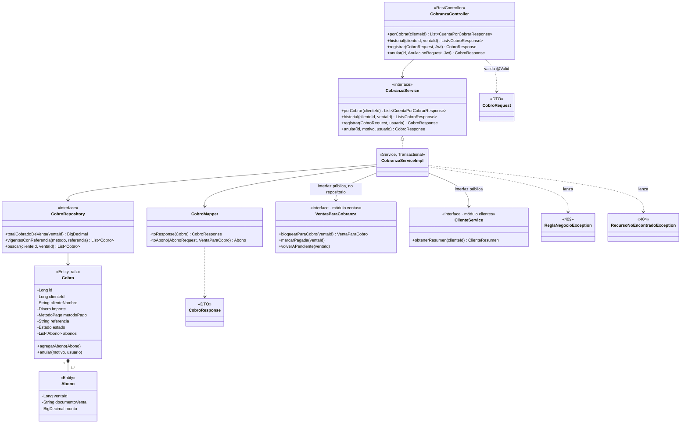
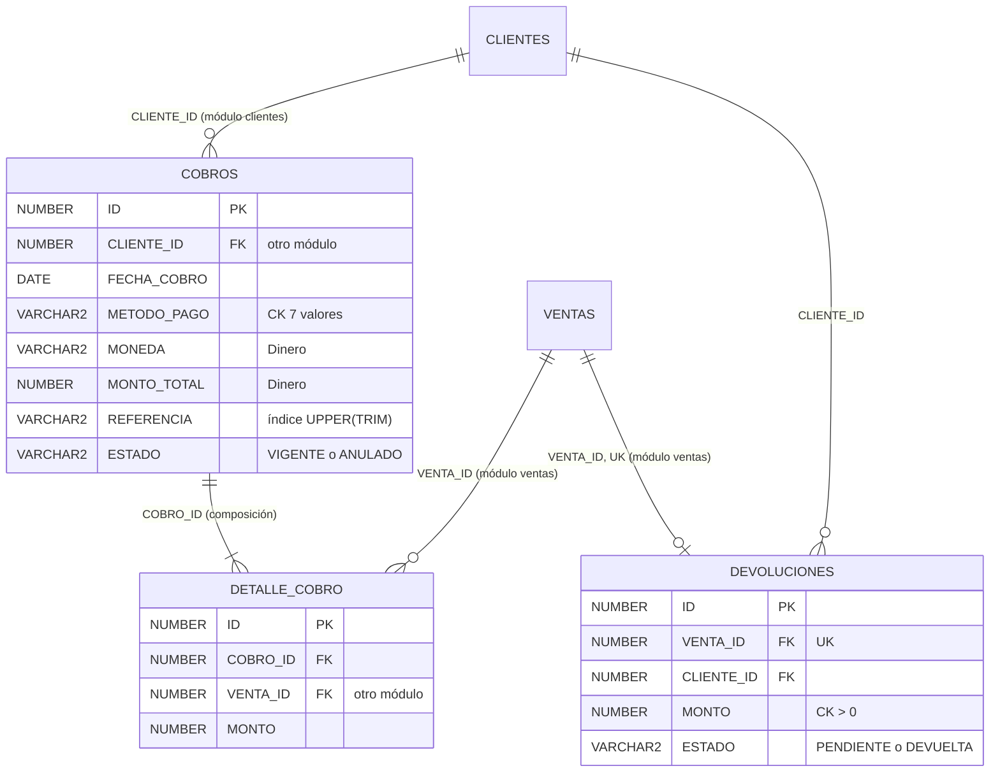

# ADS · S8 · Diseño por capas y transformación objeto-relacional: módulo `cobranza`

**SGE-JD · JD Refrigeración S.A.C. · Equipo CherryTree · Yoel Wagner Chambi Sirena · 10/11/2026**

Trabajo autónomo de la sesión 8 (*Diseño de clases avanzado y transformación objeto-relacional*). El diagrama de
clases de [S7](S07_diagrama_clases.md) se conserva sin cambios como **modelo de dominio**. Este documento es la
**segunda versión, de diseño**: lo que debería construirse, comparado con lo que hay hoy en el código.

**Por qué `cobranza`.** Cruza dos módulos (abona a ventas de `ventas` y pertenece a un cliente de `clientes`), y
es donde S6 y S7 encontraron que el código referencia otros módulos con la entidad completa
(`@ManyToOne Venta`) en lugar de su identificador. Es el módulo de Aron en el reparto del equipo. Lo elegí porque
su frontera con `ventas`, que es mi módulo, es la que hay que resolver.

## 1. Refinamiento: de clase de dominio a clase de diseño

| Clase de dominio (S7) | Clase de diseño | Decisiones |
|---|---|---|
| Cobro | `Cobro` (entidad, **raíz del agregado**) | `id: Long` (IDENTITY). `clienteId: Long`, **por identificador** (otro módulo), más una copia de `clienteNombre` para el recibo. `importe: Dinero`, embebido (`monto_total` + `moneda`). `metodoPago: MetodoPago` y `estado: Estado` como enumeraciones. `referencia` hasta 100 caracteres, normalizada con `UPPER(TRIM)` para la búsqueda (índice de BD2 S5). Lista `abonos` con cascada y eliminación de huérfanos (composición). Navegable solo de Cobro a DetalleCobro |
| DetalleCobro | `Abono` (entidad interna, sin repositorio) | `ventaId: Long`, **por identificador** (otro módulo), no `Venta`. Copia `documentoVenta` (por ejemplo F001-00000123) y `fechaVenta`, para mostrar el recibo sin consultar a `ventas`. `monto: BigDecimal`: la moneda es la del cobro, no se repite |
| Devolucion | `Devolucion` (entidad, raíz de **otro** agregado) | `ventaId` y `clienteId` por identificador; `importe: Dinero`; `estado` PENDIENTE o DEVUELTA. Nace por evento (`VentaAnuladaEvent`), no por el usuario |
| — (nuevo) | `VentasParaCobranza` (interfaz pública de `ventas`) | Lo único que cobranza sabe de ventas: `saldo`, `bloquearParaCobro`, `marcarPagada` y `volverAPendiente`. Es la interfaz por cliente que propuso [S3](S03_solid_modulo_ventas.md) |

## 2. Estructura de carpetas del sistema

```
src/main/java/com/bomerp/
├── BomerpApplication.java
├── config/                       # transversal: errores, paginación, Excel, tipo de cambio, datos de la empresa
├── seguridad/                    # transversal: Keycloak, permisos, topes, historial de cambios
│
├── catalogo/      categoria/  producto/                         {controller,dto,entity,mapper,repository,service}
├── clientes/      cliente/    sede*/                            *sede: hoy aparte; es parte del agregado Cliente
├── proveedores/   proveedor/
├── proformas/     proforma/                                     (itemproforma/ → dentro de proforma/entity)
├── ventas/        venta/                                        (detalleventa/ → dentro de venta/entity)
├── facturacion/   comprobante/  notacredito/  serie/  correo/
├── cobranza/      cobro/  devolucion/                            ← el módulo de esta sesión
├── compras/       compra/  pago/                                (detallecompra/ → dentro de compra/entity)
├── inventario/    ajuste/  kardex/
├── servicios/     orden/
├── postventa/     mantenimiento/  equipo/  contrato/
├── notificaciones/notificacion/
└── reportes/      (transitorio: sus consultas vuelven a cada módulo; ver README, sección 5)
```

Así quedan las siete reglas:

1. **Primer nivel, el módulo:** se cumple. Son 13 módulos más `config` y `seguridad`, verificados por
   `ModularityTests`.
2. **Segundo nivel, la raíz de agregado:** **no se cumple en tres lugares**. `ventas/detalleventa`,
   `compras/detallecompra` y `proformas/itemproforma` son paquetes propios, pero sus clases no son raíces: se
   acceden solo a través de su venta, compra o proforma (hallazgo 3).
3. **Tercer nivel, las mismas capas:** casi. Ningún agregado tiene `mapper/`: los DTO se arman con
   `desdeEntidad()`. Este diseño agrega `CobroMapper`.
4. **Lo transversal, fuera:** se cumple con `config` y `seguridad`.
5. **Solo la interfaz de servicio es pública:** se cumple parcialmente. `catalogo` publica
   `@NamedInterface`, pero `ventas` expone la clase `VentaService` completa (S3).
6. **Dependencias en un solo sentido:** cobranza usa ventas y clientes. Ventas no conoce a cobranza; le avisa
   por evento (`VentaAnuladaEvent` → `DevolucionService`).
7. **Un módulo previsto aparece cuando se necesita:** `reportes` es la excepción documentada.

## 3. Diagrama por capas del módulo `cobranza` (C4, nivel 4)



La regla de dependencia se lee de arriba hacia abajo:

- **El controlador** conoce solo la interfaz del servicio.
- **El servicio** es la única clase que junta el repositorio, el mapper y los dos módulos ajenos, y a estos
  los usa siempre por su interfaz pública.
- **Repositorios:** hay uno por raíz (`CobroRepository`). `Abono` no tiene repositorio.

`Devolucion` sigue el mismo patrón en su propio paquete, con su repositorio.

## 4. Reglas de negocio del módulo

| Regla | Enunciado | Error | Criterio de aceptación (Dado / Cuando / Entonces) |
|---|---|---|---|
| RN1 | Cada venta abonada existe, es del **mismo cliente** y de la **misma moneda** del cobro | 404 / 400 | Dado un cobro del cliente A, cuando abona a una venta del cliente B, entonces responde 400 y no se guarda nada |
| RN2 | El abono no supera el **saldo** de la venta (total menos lo ya cobrado vigente) | 409 | Dada una venta de 1 180 con 1 000 cobrados, cuando se abonan 200, entonces 409 y el saldo sigue en 180 |
| RN3 | El mismo voucher (método + N° de operación, sin distinguir mayúsculas ni espacios) no entra dos veces | 409 | Dado un cobro vigente "OP-123" por transferencia, cuando se registra " op-123 " por transferencia, entonces 409 indicando el cobro anterior |
| RN4 | Una venta no aparece dos veces en el mismo cobro | 400 | Dados dos abonos a la venta 15 en el mismo cobro, cuando se registra, entonces 400 |
| RN5 | La fecha del cobro no es futura ni anterior a la venta; si no se envía, es hoy | 400 | Dado un cobro con fecha de mañana, cuando se registra, entonces 400 |
| RN6 | Una detracción o retención exige el N° de constancia y no supera el monto de la deducción de esa venta | 400 | Dado un cobro con método DETRACCION sin referencia, cuando se registra, entonces 400 |
| RN7 | Si el saldo queda en 0, la venta pasa a PAGADO, en la **misma transacción** | — | Dada una venta con saldo 500, cuando se abonan 500, entonces la venta queda PAGADO; si algo falla, ni cobro ni cambio de estado |
| RN8 | Dos cobros simultáneos a la misma venta no pueden superar juntos el saldo | — | Dadas dos sesiones que abonan el saldo completo a la vez, cuando ambas confirman, entonces la segunda espera el bloqueo de la venta y recibe 409 |
| RN9 | Un cobro no se borra: se **anula** con motivo (5 caracteres o más) y quién; sus ventas pagadas vuelven a PENDIENTE | 409 si ya está anulado | Dado un cobro que pagó la venta 15, cuando se anula, entonces queda ANULADO y la venta 15 vuelve a PENDIENTE |
| RN10 | No se anula un cobro de una venta ya anulada: ese dinero se resuelve en Devoluciones | 409 | Dada la venta 15 ANULADA con un cobro, cuando se intenta anular el cobro, entonces 409 remitiendo a Devoluciones |

## 5. Permisos por operación

| Operación | ASISTENTE (Lucy) | ADMIN (Lisandro) | Mecanismo |
|---|---|---|---|
| `porCobrar`, `historial` | Sí | Sí | Usuario autenticado (`/api/v1/admin/**`) |
| `registrar` | Sí | Sí | Usuario autenticado; `registradoPor` sale del token |
| `anular` | Solo con el permiso `PERM_ANULAR_COBROS` | Sí | `hasAnyRole(conPermiso(Permiso.ANULAR_COBROS))` (`SecurityConfig:129`) |
| `registrarDevolucion` | Solo con `PERM_DEVOLUCIONES` | Sí | `hasAnyRole(conPermiso(Permiso.DEVOLUCIONES))` (`SecurityConfig:127`) |

Sin token, la respuesta es 401. Con un rol o permiso insuficiente, 403.

## 6. Fichas por clase

**`CobranzaController`**

| Método y ruta | Permiso | Validación de forma |
|---|---|---|
| `List<CuentaPorCobrarResponse> porCobrar(Long clienteId)`, `GET /api/v1/admin/cobranza/por-cobrar` | Autenticado | `clienteId` opcional |
| `List<CobroResponse> historial(Long clienteId, Long ventaId)`, `GET …/cobros` | Autenticado | Los dos opcionales |
| `CobroResponse registrar(CobroRequest, Jwt)`, `POST …/cobros` → **201** | Autenticado | `@Valid`: `metodoPago` obligatorio, `abonos` no vacío, cada `monto > 0`, `referencia` de 100 caracteres o menos |
| `CobroResponse anular(Long id, AnulacionRequest, Jwt)`, `POST …/cobros/{id}/anular` | `ANULAR_COBROS` | `@Valid`: `motivo` no vacío, 300 caracteres o menos |

El controlador no decide nada del negocio: valida la forma, saca el usuario del token y delega.

**`CobranzaService`**

| Operación | Permiso | Reglas | Errores |
|---|---|---|---|
| `List<CuentaPorCobrarResponse> porCobrar(Long clienteId)` | Autenticado | Saldo = total − cobrado vigente; deducción pendiente | 401 |
| `CobroResponse registrar(CobroRequest, String usuario)` | Autenticado | RN1 a RN8. Post: cobro VIGENTE con `importe = Σ abonos` | 400, 404, 409 |
| `CobroResponse anular(Long id, String motivo, String usuario)` | `ANULAR_COBROS` | RN9, RN10 | 400, 403, 404, 409 |

**`CobroRepository`** (uno solo, para la raíz `Cobro`)

| Consulta | Recibe → devuelve | Para qué regla |
|---|---|---|
| `totalCobradoDeVenta` | `ventaId` → `BigDecimal` (Σ abonos de cobros VIGENTES) | RN2 |
| `vigentesConReferencia` | `metodo, referencia` → `List<Cobro>`; compara `UPPER(TRIM(referencia))` (índice `IX_COBROS_REFERENCIA_NORM`, BD2 S5) | RN3 |
| `buscar` | `clienteId?, ventaId?` → `List<Cobro>` | Historial |

**`CobroMapper`**

| Operación | Recibe → devuelve | Nota |
|---|---|---|
| `toResponse` | `Cobro` → `CobroResponse` | Sin entrar a otro módulo: usa las copias `clienteNombre` y `documentoVenta` |
| `toAbono` | `AbonoRequest, VentaParaCobro` → `Abono` | Copia `documentoVenta` y `fechaVenta` en ese momento |

**Pseudocódigo de `registrar`** (operación de escritura):

```
registrar(request, usuario):                                   @Transactional
    cliente ← clientes.obtenerResumen(request.clienteId)          // 404 si no existe
    fecha ← request.fecha ?? hoy;  si fecha > hoy → 400           // RN5
    si metodoPago es deducción y referencia vacía → 400           // RN6
    si cobroRepository.vigentesConReferencia(metodo, referencia) no vacío → 409   // RN3
    ids ← ventaId de cada abono, sin repetir y ordenados
    si hay repetidos → 400                                        // RN4
    para cada id en ids: ventas.bloquearParaCobro(id)             // RN8: SELECT … FOR UPDATE, en orden
    cobro ← Cobro.nuevo(cliente, fecha, moneda, metodo, referencia, usuario)
    para cada abono:
        venta ← (la bloqueada)
        si venta.cliente ≠ cliente o venta.moneda ≠ moneda → 400  // RN1
        si fecha < venta.fecha → 400                              // RN5
        saldo ← venta.total − cobroRepository.totalCobradoDeVenta(venta.id)
        si abono.monto > saldo → 409                              // RN2
        cobro.agregarAbono(mapper.toAbono(abono, venta))
    guardar cobro                                                 // importe = Σ abonos (lo calcula el servidor)
    para cada venta con saldo final 0: ventas.marcarPagada(id)    // RN7, misma transacción
    devolver mapper.toResponse(cobro)                             // 201
```

## 7. DTO y contrato REST

| DTO | Campos | Lo decide el servidor (no viene en el Request) |
|---|---|---|
| `CobroRequest` | `clienteId`, `fecha?`, `metodoPago`, `referencia?`, `notas?`, `abonos[{ventaId, monto}]` | — |
| `CobroResponse` | `id`, `clienteId`, `clienteNombre`, `fecha`, `moneda`, `metodoPago`, `referencia`, `importe`, `abonos[{ventaId, documentoVenta, monto}]`, `estado`, `registradoPor`, `fechaAnulacion?`, `motivoAnulacion?`, `anuladoPor?` | `id`, **`moneda`** (la de las ventas), `importe`, `estado`, `registradoPor`, `fechaAnulacion`, `anuladoPor`, `clienteNombre`, `documentoVenta` |
| `AnulacionRequest` | `motivo` | — |
| `CuentaPorCobrarResponse` | `ventaId`, `comprobante`, `fechaVenta`, `fechaLimitePago`, `diasAtraso`, `total`, `cobrado`, `saldo`, `deduccionPendiente`, `netoPorCobrar` | Todos (es una consulta) |

| # | Operación | Entrada | Salida | Códigos |
|---|---|---|---|---|
| 1 | `GET /api/v1/admin/cobranza/por-cobrar?clienteId=` | — | `List<CuentaPorCobrarResponse>` | 200, 401 |
| 2 | `GET /api/v1/admin/cobranza/cobros?clienteId=&ventaId=` | — | `List<CobroResponse>` | 200, 401 |
| 3 | `POST /api/v1/admin/cobranza/cobros` | `CobroRequest` | `CobroResponse` | **201**, 400, 401, 404, 409 |
| 4 | `POST /api/v1/admin/cobranza/cobros/{id}/anular` | `AnulacionRequest` | `CobroResponse` | 200, 400, 401, 403, 404, 409 |
| 5 | `GET /api/v1/admin/cobranza/ventas/{ventaId}/pagado` | — | `PagadoDeVentaResponse` | 200, 401, 404 |
| 6 | `POST /api/v1/admin/cobranza/devoluciones/{id}/registrar` | `DevolucionRequest` | `DevolucionResponse` | 200, 400, 401, 403, 404, 409 |

## 8. Transformación objeto-relacional

**Correspondencia clase-tabla**

| Clase.atributo | Tabla.columna | Tipo Oracle | Clave o restricción |
|---|---|---|---|
| `Cobro.id` | `COBROS.ID` | `NUMBER(19)` IDENTITY | PK |
| `Cobro.clienteId` | `COBROS.CLIENTE_ID` | `NUMBER(19)` NOT NULL | FK → `CLIENTES.ID` (ver decisión de referencias) |
| `Cobro.importe` (Dinero) | `COBROS.MONTO_TOTAL` + `COBROS.MONEDA` | `NUMBER(12,2)` + `VARCHAR2(10)` | `CHECK (moneda IN ('SOLES','DOLARES'))`; **falta** `CHECK (monto_total > 0)` |
| `Cobro.fecha` | `COBROS.FECHA_COBRO` | `DATE` NOT NULL | — |
| `Cobro.metodoPago` | `COBROS.METODO_PAGO` | `VARCHAR2(20)` | `CK_COBRO_METODO` (7 valores) |
| `Cobro.referencia` | `COBROS.REFERENCIA` | `VARCHAR2(100)` | Índice por función `UPPER(TRIM(referencia))` (BD2 S5) |
| `Cobro.estado` + anulación | `ESTADO`, `FECHA_ANULACION`, `MOTIVO_ANULACION`, `ANULADO_POR` | `VARCHAR2` / `DATE` | `CK_COBRO_ESTADO`; `CK_COBRO_ANULADO` (anulado ⇒ fecha, motivo y quién) |
| `Cobro.registradoPor` | `COBROS.REGISTRADO_POR` | `VARCHAR2(100)` | — |
| `Abono.id` | `DETALLE_COBRO.ID` | `NUMBER(19)` IDENTITY | PK |
| (composición) | `DETALLE_COBRO.COBRO_ID` | `NUMBER(19)` NOT NULL | FK → `COBROS.ID`; **sin índice** |
| `Abono.ventaId` | `DETALLE_COBRO.VENTA_ID` | `NUMBER(19)` NOT NULL | FK → `VENTAS.ID`; **sin índice** |
| `Abono.monto` | `DETALLE_COBRO.MONTO` | `NUMBER(12,2)` NOT NULL | **falta** `CHECK (monto > 0)` |
| `Abono.documentoVenta`, `fechaVenta` | — | — | **No existen** (diseño nuevo) |
| `Devolucion.*` | `DEVOLUCIONES.*` | — | `UK_DEVOLUCION_VENTA` (una por venta), 5 CHECK con nombre |

**Referencias entre módulos: por identificador en el código, con FK en la base.** En el código, `Abono` guarda
`ventaId` y `Cobro` guarda `clienteId`, sin `@ManyToOne` hacia otro módulo. En Oracle **se mantienen las FK**
(`DETALLE_COBRO.VENTA_ID` → `VENTAS`, `COBROS.CLIENTE_ID` → `CLIENTES`). La guía de BomERP las quita porque sus
módulos viven en esquemas separados. SGE-JD usa **un solo esquema y una sola transacción** (ADR-S4-01), y ADS S4
mostró que la base fue la última defensa de la integridad: el índice único evitó 2 621 duplicados. **Alternativa
descartada:** quitar las FK. Se ganaría independencia para separar el módulo en otro esquema, cosa que no está
prevista, y se perdería la garantía de que un abono nunca apunta a una venta inexistente.

**Herencia de S7**

| Jerarquía | Estrategia elegida | Alternativa descartada |
|---|---|---|
| `Producto` → Material / Equipo / Servicio | **Tabla única** (`PRODUCTOS` con `SECTOR` como discriminador, como hoy). Las columnas propias de Material (`STOCK_ACTUAL`, `STOCK_MINIMO`) admiten nulo para los demás. Hay 39 productos y cada línea de venta lo lee | **Una tabla por subclase (JOINED):** cada línea de venta haría un JOIN más para saber si controla stock, y las subclases casi no tienen columnas propias |
| `DocumentoElectronico` → Comprobante / NotaCredito | **Superclase mapeada** (`@MappedSuperclass`): sigue habiendo dos tablas, `COMPROBANTES` y `NOTAS_CREDITO`, con las columnas comunes repetidas, y el código común se escribe una vez | **Tabla única:** mezclaría dos numeraciones con claves únicas distintas, y la nota no tiene receptor ni plazo. Nadie consulta "todos los documentos" juntos |

**Objeto de valor `Dinero`**: **embebido** (`@Embeddable`), con dos columnas en la tabla del dueño (`MONTO_TOTAL` y
`MONEDA`). En los abonos se guarda solo el `MONTO`, porque la moneda es la de su cobro (RN1).
**Alternativa descartada:** una tabla `DINERO`. Un objeto de valor no tiene identidad, y dos cobros de "100 soles"
no son la misma fila.

## 9. Modelo relacional del módulo



## 10. Matriz de trazabilidad dominio-clase-tabla-DTO

| Dominio (S6–S7) | Clase de diseño | Tabla | DTO | Estado |
|---|---|---|---|---|
| Cobro (raíz) | `Cobro` | `COBROS` | `CobroRequest` / `CobroResponse` | ✓ |
| Abono a una venta | `Abono` (hoy `DetalleCobro`) | `DETALLE_COBRO` | `abonos[]` | ⚠ Brecha B1: el código usa `@ManyToOne Venta`, no `ventaId` |
| Abono > 0 | `@DecimalMin` en `AbonoDTO` | `DETALLE_COBRO.MONTO` | `AbonoRequest.monto` | ⚠ Brecha B2: sin CHECK en Oracle |
| Moneda del cobro = la de sus ventas (RN1) | `Cobro.importe.moneda` | `COBROS.MONEDA` | Hoy en `CobroRequest` | ⚠ Brecha B3: la manda el cliente y el servidor solo la valida |
| Voucher único (RN3) | `CobroRepository.vigentesConReferencia` | `IX_COBROS_REFERENCIA_NORM` (BD2 S5) | `referencia` | ✓ (falta verificar el SQL de Hibernate, BD2 S5) |
| Anulación (RN9) | `Cobro.anular()` (hoy en el servicio) | `CK_COBRO_ANULADO` | `AnulacionRequest` | ✓ en la base; ⚠ B4: la regla vive en el servicio, no en la entidad |
| Devolución | `Devolucion` | `DEVOLUCIONES` | `DevolucionRequest` / `Response` | ✓ restricciones completas |
| Saldo de una venta | `VentasParaCobranza` (nuevo) | `VENTAS` + `DETALLE_COBRO` | `CuentaPorCobrarResponse` | ⚠ B5: hoy `CobranzaService` depende de la clase completa `VentaService` |

**Correcciones propuestas**:

- **B1:** `DetalleCobro.venta` → `ventaId` más copia de `documentoVenta`. La FK se mantiene.
- **B2:** `ALTER TABLE detalle_cobro ADD CONSTRAINT ck_detalle_cobro_monto CHECK (monto > 0)`, más índices en
  `COBRO_ID` y `VENTA_ID` (lección de BD2 S5). Antes hay que verificar que ningún dato lo rompa, como en BD2 S1.
- **B3:** quitar `moneda` del Request y tomarla de las ventas.
- **B4:** mover la anulación a `Cobro.anular()`.
- **B5:** crear la interfaz `VentasParaCobranza` (S3).

## 11. Error o hallazgo

**Hallazgo 1: un campo del Request que debía decidir el servidor.** `CobroRequestDTO` tiene
`@NotNull Venta.Moneda moneda`. Pero la moneda de un cobro **no es una elección**: es la de las ventas que paga.
Hoy el cliente la envía y el servidor la compara venta por venta (`validarAbono`: "misma moneda"). O sea, el
Request trae un dato que solo puede estar bien o dar error, nunca aportar información. En el diseño se quitó del
Request: el servidor la toma de la primera venta y exige que las demás coincidan (RN1). Lo mismo vale para
`clienteId`, que también se deduce de las ventas. Se deja por ahora, porque la pantalla de Lucy primero elige al
cliente y después sus ventas, y así el error es más claro.

**Hallazgo 2: una asociación entre módulos corregida a referencia por identificador.** `DetalleCobro` tiene
`@ManyToOne Venta venta`: cobranza carga la entidad completa de otro módulo. En `anular()`, eso permite leer
`detalle.getVenta().getEstado()` directamente, y nada impide que alguien escriba `detalle.getVenta().setEstado(…)`.
En el diseño pasa a `ventaId` (con copia del número de comprobante), y el estado se pregunta a
`VentasParaCobranza`. La FK en Oracle se queda (sección 8): la base garantiza la integridad, el código respeta el
límite del módulo.

**Hallazgo 3: la regla del árbol de carpetas que el proyecto no cumple.** `ventas/detalleventa`,
`compras/detallecompra` y `proformas/itemproforma` son paquetes propios, como si fueran agregados. Pero
`DetalleVenta` nunca se usa sin su `Venta`, y lo mismo pasa con las otras dos. `cobranza` sí lo hace bien:
`DetalleCobro` vive en `cobro/entity`. La corrección es mover esas tres clases al paquete `entity` de su raíz. El
cambio es mecánico (`ModularityTests` y las 215 pruebas lo cubren) y queda registrado.

**Brecha de la matriz (B2).** `DETALLE_COBRO` es de las primeras tablas que generó Hibernate: sus FK tienen
nombres automáticos (`FKI65UMBTK95KBR0M3CGXUICOBU`) y ninguna CHECK. `DEVOLUCIONES`, que vino después con una
migración escrita a mano, tiene cinco CHECK con nombre y una clave única. Para la misma clase de dato (un monto de
dinero), una tabla lo protege y la otra no.

## 12. Reflexión

¿Qué relación cruza dos módulos y por qué se persiste como referencia por identificador?

La relación es el abono de un cobro a una venta: `cobranza` → `ventas`. En el código se guarda `ventaId` y no la
`Venta`, porque cobranza no debe poder cambiar una venta. Solo puede pedírselo a ventas por su interfaz, y ventas
decide (por ejemplo, que pasa a PAGADO). La copia del número de comprobante existe para que un recibo de hace dos
años se siga mostrando igual aunque la venta cambie, y sin consultar a otro módulo. En la base, en cambio, la FK se
queda, porque en SGE-JD los dos módulos comparten esquema y transacción, y la base es la que impide abonar a una
venta que no existe. La referencia por identificador protege el **límite del módulo**. La FK protege la
**integridad del dato**. Son dos problemas distintos, y en este proyecto conviene resolver los dos.
