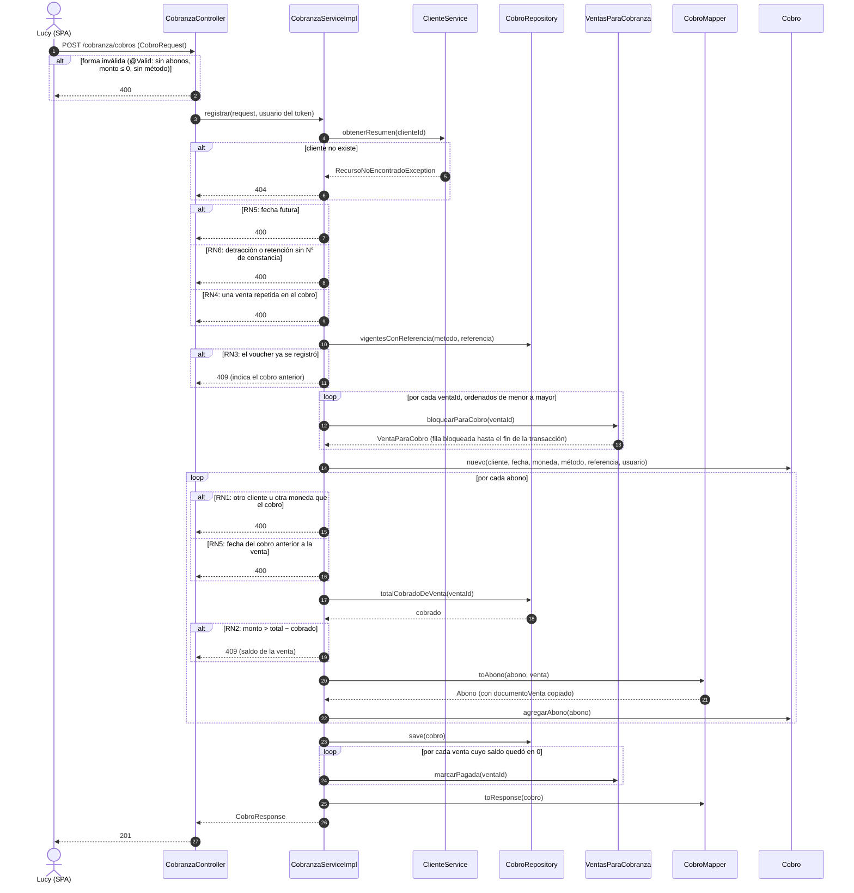
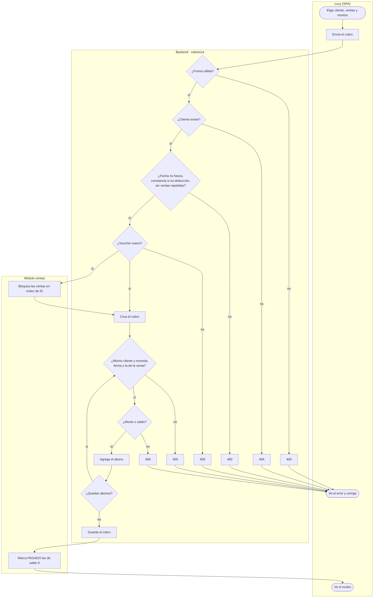
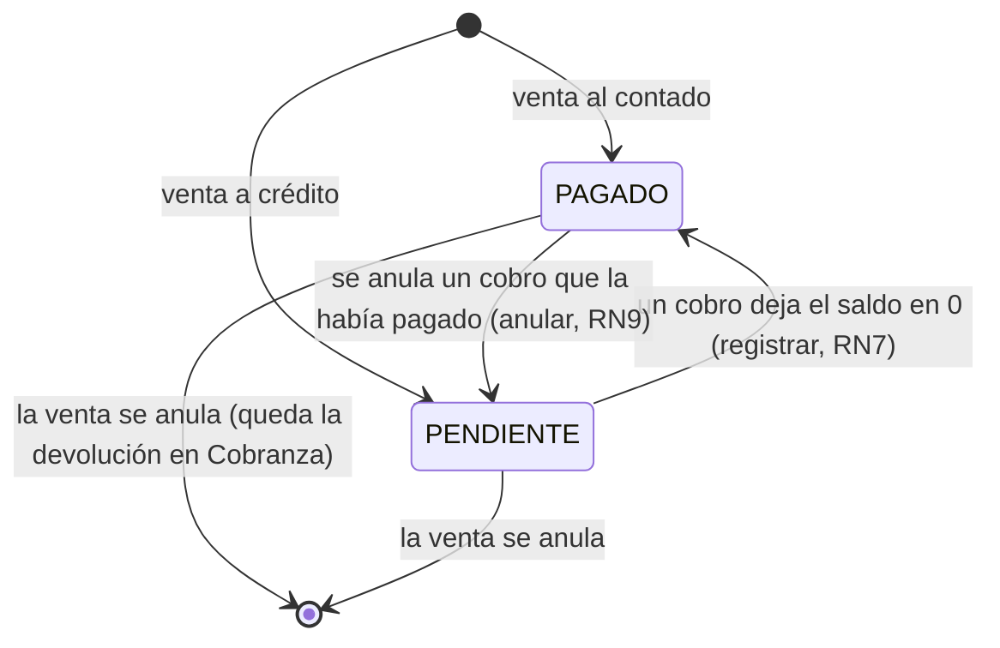
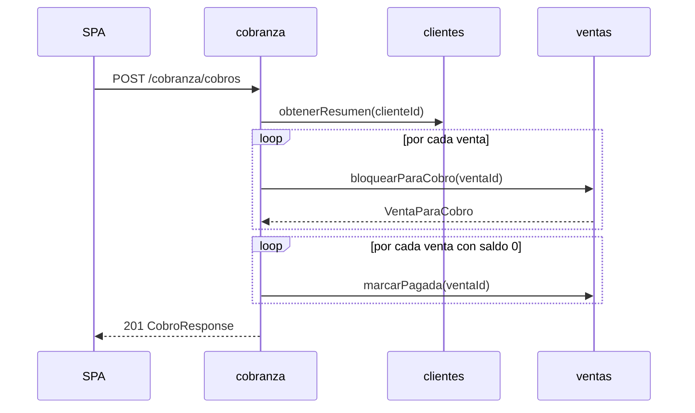
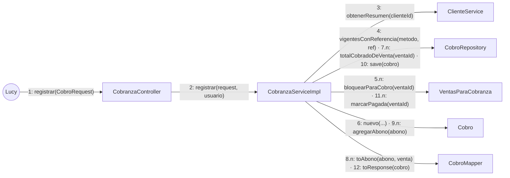

# ADS · S9 · Diagramas dinámicos del módulo `cobranza`

**SGE-JD · JD Refrigeración S.A.C. · Equipo CherryTree · Yoel Wagner Chambi Sirena · 10/11/2026**

Trabajo autónomo de la sesión 9 (*Diagramas dinámicos UML*). Se usa el módulo diseñado en
[S8](S08_diseno_cobranza.md), y **solo con las clases que existen en su diagrama**. Las dos que faltaban se
agregaron allá primero (hallazgo 1).

## 1. ¿Qué operación necesita un diagrama dinámico?

Las cuatro señales de la Tabla 2 de la guía, aplicadas a todas las operaciones del módulo:

| Operación | Bucle | Condiciones combinadas | Colaboración entre módulos | Transaccional | ¿Diagrama dinámico? |
|---|---|---|---|---|---|
| `porCobrar(clienteId)` | Sí (una fila por venta pendiente) | No | Sí (lee ventas) | No (solo lectura) | **No:** es una consulta; la ficha de S8 y el DTO `CuentaPorCobrarResponse` la describen completa |
| `historial(clienteId, ventaId)` | No | No | No | No | **No:** un filtro sobre el repositorio |
| `pagadoDeVenta(ventaId)` | No | No (un 404) | No | No | **No:** una suma y un error posible caben en una fila |
| **`registrar(request, usuario)`** | **Sí** (una vuelta por abono) | **Sí** (cliente, moneda, fecha, saldo, deducción, voucher) | **Sí** (clientes y ventas) | **Sí** (cobro y estado de las ventas, juntos) | **Sí: las cuatro señales y 8 reglas que pueden rechazarla** |
| `anular(id, motivo, usuario)` | Sí (una vuelta por abono) | Sí (ya anulado, motivo, venta anulada) | Sí (`volverAPendiente`) | Sí | Sí, también las cuatro. Se elige `registrar` porque tiene más reglas que fallan (8 frente a 3); `anular` se cubre con el ciclo de vida (sección 4) |
| `registrarDevolucion(id, request)` (otro agregado) | No | Sí (estado, método) | No | Sí | **No:** sus dos condiciones están en la ficha de S8 |

## 2. Diagrama de secuencia: registrar un cobro

Las clases son las de S8: `CobranzaController`, `CobranzaServiceImpl`, `ClienteService`, `CobroRepository`,
`VentasParaCobranza` (que devuelve `VentaParaCobro`), `CobroMapper` y `Cobro`. Hay un fragmento `alt` por cada
regla que puede rechazar la operación (RN1 a RN6 de S8).



**¿Hace falta `par`?** No. Dentro de un cobro no ocurre nada en paralelo: cada paso espera al anterior, y el
`save` y los `marcarPagada` están en la misma transacción. La concurrencia real está **entre dos cobros
distintos**. La resuelve el bloqueo ordenado de las ventas (RN8), y es un caso entre peticiones, no dentro de esta
secuencia. Eso sí, este diagrama dejó ver un hueco en esa concurrencia (hallazgo 2).

**Orden de los mensajes.** Todo lo que se puede rechazar sin tocar la base (forma, fecha, deducción, repetidas)
va **antes** del primer bloqueo. Rechazar después de bloquear las ventas haría esperar a otro usuario por una
petición que igual iba a fallar.

## 3. Diagrama de actividades, por carriles

Los rombos son los mismos `alt` de la secuencia.



| Rombo | `alt` de la secuencia | Regla |
|---|---|---|
| ¿Forma válida? | forma inválida | `@Valid` |
| ¿Cliente existe? | cliente no existe | 404 |
| ¿Fecha, constancia, repetidas? | RN5 / RN6 / RN4 | 400 |
| ¿Voucher nuevo? | RN3 | 409 |
| ¿Mismo cliente y moneda, fecha ≥ venta? | RN1 / RN5 | 400 |
| ¿Monto ≤ saldo? | RN2 | 409 |

## 4. ¿Necesita un diagrama de ciclo de vida?

**`Cobro`: no.** Tiene dos estados (VIGENTE y ANULADO) y una sola transición, que no se deshace. Su condición
(motivo de 5 caracteres o más, que la venta no esté anulada) ya está en la ficha de S8 y en `CK_COBRO_ANULADO`. Un
diagrama no diría nada que una fila de tabla no diga.

**`Venta.estadoPago`: sí.** Es el estado que cobranza **cambia en otro módulo**. Su continuidad depende de
operaciones que ocurren en momentos distintos (vender, cobrar, anular un cobro), y ninguna de ellas lo ve completo:



Se **quitó** una transición: el enum y la CHECK de Oracle admiten un tercer estado, **`ATRASADO`**, pero ninguna
línea del backend lo asigna (`grep ATRASADO` en `src/main`: solo aparece la declaración del enum). El atraso se
**calcula** cada vez a partir de `fechaLimitePago` (`diasAtraso` en `CuentaPorCobrarResponse`). Dibujar
`PENDIENTE → ATRASADO` habría sido modelar una regla que no existe (hallazgo 3).

## 5. Interacción entre componentes (nivel C3)

Solo módulos completos, y solo los mensajes que cruzan un límite:



Desaparecen `CobroRepository`, `CobroMapper` y `Cobro`: son internos de cobranza. Lo que queda es el contrato
entre módulos: dos operaciones de `VentasParaCobranza` y una de `ClienteService`. Si mañana `ventas` cambia por
dentro, este diagrama no cambia.

## 6. Diagrama de comunicación

La misma colaboración, con los mensajes numerados (los abonos se repiten por venta: `5.n`, `6.n`):



## 7. Matriz de consistencia

Cada mensaje se cruza con la ficha de su clase en S8, más las operaciones que quedaron sin diagrama.

| # | Mensaje | Clase (S8) | ¿Está en su ficha? | Observación |
|---|---|---|---|---|
| 1 | `registrar(CobroRequest)` | `CobranzaController` | ✓ | 201 y `@Valid` |
| 2 | `registrar(request, usuario)` | `CobranzaService` | ✓ | El usuario sale del token, no del Request |
| 3 | `obtenerResumen(clienteId)` | `ClienteService` | ✓ | |
| 4 | `vigentesConReferencia(metodo, ref)` | `CobroRepository` | ✓ | Ver hallazgo 2: sin bloqueo |
| 5 | `bloquearParaCobro(ventaId)` → `VentaParaCobro` | `VentasParaCobranza` | ✓ **después de corregir S8** | `VentaParaCobro` no estaba en el diagrama de S8 (hallazgo 1) |
| 6 | `nuevo(...)` | `Cobro` | ✓ | Constructor de fábrica |
| 7 | `totalCobradoDeVenta(ventaId)` | `CobroRepository` | ✓ | Base del saldo (RN2) |
| 8 | `toAbono(abono, venta)` | `CobroMapper` | ✓ | Copia `documentoVenta` |
| 9 | `agregarAbono(abono)` | `Cobro` | ✓ | |
| 10 | `save(cobro)` | `CobroRepository` | ✓ | Spring Data |
| 11 | `marcarPagada(ventaId)` | `VentasParaCobranza` | ✓ | RN7, misma transacción |
| 12 | `toResponse(cobro)` | `CobroMapper` | ✓ | |
| — | `saldo(ventaId)` | `VentasParaCobranza` (tabla de refinamiento de S8) | ✗ **inconsistencia** | Estaba en la tabla y no en el diagrama. **Resuelto:** el saldo lo calcula cobranza (mensajes 5 y 7); se quitó de la tabla de S8 |
| — | `porCobrar`, `historial`, `pagadoDeVenta` | `CobranzaService` | ✓ | Sin diagrama (sección 1): consultas |
| — | `anular(id, motivo, usuario)` | `CobranzaService` | ✓ | Sin secuencia; su efecto en otro módulo está en el ciclo de vida (`PAGADO → PENDIENTE`) |
| — | `volverAPendiente(ventaId)` | `VentasParaCobranza` | ✓ | Solo lo usa `anular` |
| — | `registrarDevolucion` | `DevolucionService` | ✓ | Otro agregado; sin diagrama |
| — | `EstadoPago.ATRASADO` | `Venta` (módulo ventas) | ✗ **inconsistencia** | Declarado y admitido por la CHECK, nunca asignado (hallazgo 3) |

## 8. Error o hallazgo

**Hallazgo 1: la secuencia necesitaba una clase que el diagrama de S8 no tenía.** Al dibujar el mensaje 5,
`bloquearParaCobro` tenía que devolver algo con el total, el cliente, la moneda y el estado de la venta. En S8 ese
tipo aparecía nombrado en la ficha del mapper (`toAbono(AbonoRequest, VentaParaCobro)`), pero **no como clase** en
el diagrama. Además, la tabla de refinamiento le atribuía a `VentasParaCobranza` una operación `saldo` que el
diagrama no tenía. Siguiendo la regla de la guía, no se inventó nada dentro de la secuencia: se volvió a S8, se
agregó el record `VentaParaCobro` y se corrigió la tabla. El saldo lo calcula cobranza, porque solo ella conoce los
abonos.

**Hallazgo 2: el orden de los mensajes dejó ver una condición de carrera.** El mensaje 4
(`vigentesConReferencia`) comprueba que el voucher no exista **con una consulta, sin bloqueo**, y el bloqueo
(mensaje 5) es sobre las **ventas**, no sobre el voucher. Si dos personas registran a la vez el mismo N° de
operación para **ventas distintas**, las dos consultas ven "no existe", ninguna espera a la otra, y entran dos cobros
con el mismo voucher. El código actual hace lo mismo (`CobranzaService.registrar`: primero la consulta y después el
bloqueo de las ventas). En la base no hay nada que lo impida: el índice de BD2 S5 sobre
`UPPER(TRIM(referencia))` no es único. **Corrección propuesta**, con el mismo patrón que ya protege a los
comprobantes (`UX_COMPROBANTE_VIGENTE_VENTA`):

```sql
CREATE UNIQUE INDEX ux_cobro_voucher_vigente ON cobros (
    CASE WHEN estado = 'VIGENTE' AND referencia IS NOT NULL THEN metodo_pago END,
    CASE WHEN estado = 'VIGENTE' AND referencia IS NOT NULL THEN UPPER(TRIM(referencia)) END);
```

La consulta del mensaje 4 se queda, para dar un mensaje claro al usuario. El índice garantiza la regla aunque dos
peticiones lleguen juntas. El diagrama de clases de S8 no podía mostrar esto, porque ahí la regla RN3 parecía
completa.

**Hallazgo 3: una transición sin regla real.** El primer borrador del ciclo de vida de `estadoPago` tenía
`PENDIENTE → ATRASADO` "cuando vence la fecha límite". Al buscar quién hace esa transición, no la hace nadie:
`ATRASADO` solo existe en la declaración del enum y en la CHECK de `VENTAS`. El atraso se calcula al consultar.
Se quitó del diagrama. Queda como inconsistencia en la matriz: o se elimina el valor, o se le da una regla y una
tarea que lo asigne.

## 9. Reflexión

¿Qué decisión de orden o de continuidad de estado no se veía en el diagrama de clases y apareció recién en la
secuencia o en el ciclo de vida? Relación con el caso del vehículo autónomo de Uber.

En el diagrama de clases de S8, la regla "el voucher no entra dos veces" parecía resuelta: una consulta en el
repositorio y un 409. Solo al poner los mensajes en orden se vio que esa comprobación ocurre antes del bloqueo y
sobre otra cosa (las ventas), y que dos peticiones simultáneas la pasan las dos. En el caso de Uber, el sistema
detectó el obstáculo varios segundos antes, pero cada vez que cambiaba de clasificación descartaba la historia de
lo que había visto, y la decisión de frenar llegó tarde. Cada componente estaba "bien" por separado: el problema
estaba en el orden y en la continuidad del estado entre un momento y el siguiente. Lo mismo pasa con `estadoPago`
de la venta: lo cambian tres operaciones en momentos distintos, y solo el diagrama de estados mostró que una de sus
transiciones, `ATRASADO`, no la ejecutaba nadie.
