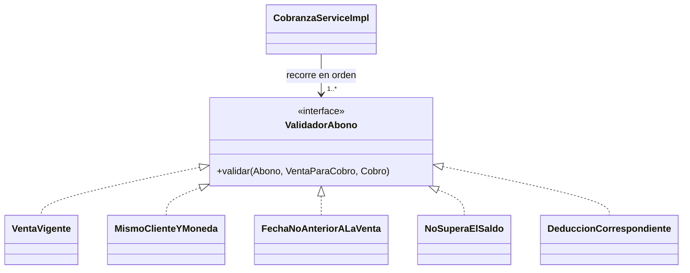

# ADS · S10 · Patrones GoF y GRASP en el módulo `cobranza`

**SGE-JD · JD Refrigeración S.A.C. · Equipo CherryTree · Yoel Wagner Chambi Sirena · 10/11/2026**

Trabajo autónomo de la sesión 10 (*Patrones de diseño GoF y GRASP*). Usa el módulo diseñado en
[S8](S08_diseno_cobranza.md) y animado en [S9](S09_diagramas_dinamicos.md). Cada patrón se marca como **real** (está
en el código de hoy, con su archivo), **hueco** (debería estar y no está) o **previsto** (diseñado, no
implementado). Este trabajo **diseña** los cambios: no modifica el código de LP2. Así se corrige lo que anuncié en S3,
donde dije que el refactor de `VentaService` "se aplica en S10". La guía pide diseñarlo, y aplicarlo queda para la
integración final, con las 217 pruebas como red.

## 1. Patrones GoF

| Patrón | Estado | Dónde, en cobranza | Justificación |
|---|---|---|---|
| **Factory Method / Creator** | **Hueco** | `CobranzaService.registrar` hace `cobro.agregarDetalle(new DetalleCobro(venta, monto))`: el **servicio** crea el abono y la entidad solo lo recibe | Quien contiene y registra los abonos es `Cobro`; él debería crearlos: `Cobro.abonar(venta, monto)` (sección 3) |
| **Facade** | Real (con defecto) | `VentaService` es la fachada de `ventas` para cobranza (`obtenerParaCobro`, `marcarComoPagada`, `volverAPendiente`); `ClienteService` la de `clientes` | Cobranza no toca repositorios ajenos (`ModularityTests`). Defecto: la fachada de ventas tiene 25 métodos (S3); el diseño de S8 la reduce a `VentasParaCobranza` |
| **Proxy** | **Real, de framework (no escrito por nadie del equipo)** | (1) `@Service @Transactional` en `CobranzaService` (líneas 37–38): Spring inyecta un proxy que abre y confirma la transacción alrededor de cada método. (2) `@ManyToOne(fetch = LAZY)` en `Cobro.cliente`, `DetalleCobro.cobro` y `DetalleCobro.venta`: Hibernate pone un proxy que carga la fila recién cuando se usa | Por el proxy transaccional, `registrar` es todo-o-nada (RN7 de S8). Por el proxy LAZY, el historial no carga cada venta completa |
| **Singleton** | Real, de framework | `CobranzaService`, `CobroRepository`, `DevolucionService`: un solo bean por contexto de Spring | Sin estado entre peticiones (S4: stateless), así que compartir una instancia es seguro |
| **Abstract Factory** | Real, de framework | `EntityManagerFactory` (JPA, configurado por Spring Boot) fabrica la familia `EntityManager`, `Transaction` y `Query` para Oracle | El código de cobranza no conoce a Hibernate ni a Oracle: pide un repositorio |
| **Adapter** | Real | `CobroResponseDTO.desdeEntidad(Cobro)` adapta la entidad a la forma que espera la SPA | En S8 se diseñó como `CobroMapper` (Pure Fabrication); hoy es un método estático en el DTO |
| **Bridge** | Previsto | El **recibo de cobro** en dos formatos (PDF para el cliente, Excel para el contador): `Recibo` (abstracción: qué se informa) × `FormatoSalida` (implementación: cómo se escribe) | Sin Bridge serían 2 × 2 clases (ReciboPdf, ReciboExcel, EstadoCuentaPdf…). Hoy hay `ExcelBuilder` en `config/exportacion`, que sería un lado del puente |
| **Strategy** | Real | `porCobrar` ordena con `Comparator.comparing(CuentaPorCobrarDTO::fechaLimitePago, nullsLast(naturalOrder()))` (línea 90): el criterio de orden es un objeto intercambiable | Ordenar por cliente o por monto es cambiar el `Comparator`, no el algoritmo |
| **Chain of Responsibility** | Real (framework) y previsto | **Real:** la cadena de filtros de Spring Security decide quién puede anular un cobro (`hasAnyRole(conPermiso(Permiso.ANULAR_COBROS))`, `SecurityConfig:129`): si falla un eslabón, 401 o 403 sin llegar al controlador. **Previsto:** las validaciones de un abono (sección 1.1) | Hoy las reglas del abono son una secuencia de `if` dentro de `validarAbono` y `validarDeduccion` |
| **Observer** | **Real** | `ventas` publica `VentaAnuladaEvent`; `DevolucionService.alAnularVenta` lo escucha (`@EventListener`, línea 46) y, si la venta ya estaba cobrada, crea la devolución pendiente | `ventas` no conoce a `cobranza`: si mañana otro módulo necesita enterarse, se suscribe sin tocar ventas. Se formaliza en S11 |
| **State** | **Descartado** | `Cobro.Estado` (VIGENTE, ANULADO) y `Devolucion.Estado` (PENDIENTE, DEVUELTA) | Tabla 7: **dos estados y una transición cada uno**, que no cambian seguido. Un enum con la validación en `anular()` alcanza. Una clase por estado sería sobreingeniería |

### 1.1 Chain of Responsibility previsto: validar un abono

Hoy, `registrar` mezcla siete reglas con `if` dentro de dos métodos privados. Diseño:



Spring inyecta la lista (`List<ValidadorAbono>`, ordenada con `@Order`) y el servicio la recorre. **¿Se justifica
hoy?** Solo a medias. Las reglas no cambian seguido y son siete, así que la secuencia de `if` se entiende bien.
Pasaría a valer la pena si JD agrega reglas por tipo de cliente, por ejemplo un tope de crédito. Se deja
**previsto**, no recomendado para ya.

## 2. GRASP: los nueve patrones

| Patrón GRASP | Clase o decisión en cobranza | Estado |
|---|---|---|
| **Information Expert** | `Venta.calcularTotal()` (la venta tiene sus líneas); el **saldo** lo calcula cobranza, que tiene los abonos (total − Σ abonos vigentes) | Real. Con huecos en `Cobro` (sección 3) |
| **Creator** | `Cobro` debería crear sus `DetalleCobro` (los contiene y los registra) | **Hueco**: hoy los crea el servicio |
| **Controller** | `CobranzaController`: recibe el evento del sistema "registrar cobro" y delega | Real |
| **Low Coupling** | DTO (`CobroRequestDTO`, `CobroResponseDTO`) en el borde; en el diseño de S8, `ventaId` en lugar de `Venta` | Parcial: hoy `DetalleCobro` tiene la entidad `Venta` (S8, B1) |
| **High Cohesion** | `CobroRepository`: solo consultas de cobros; `DevolucionService` separado de `CobranzaService` | Real. `CobranzaService` (326 líneas) mezcla registrar, anular, cuentas por cobrar y deducciones: es cohesivo, a diferencia de `VentaService` (S3) |
| **Polymorphism** | `MetodoPago` con comportamiento por constante (sección 4) | Previsto |
| **Pure Fabrication** | `CobroRepository` y `CobroMapper` (S8): no existen en el negocio, existen para que las entidades no sepan guardarse ni serializarse | Real (repositorio) / previsto (mapper) |
| **Indirection** | `VentaService` y `ClienteService` entre cobranza y los otros módulos | Real |
| **Protected Variations** | Interfaces estables frente a los cambios de otros módulos | **Hueco real** (sección 5): se depende de la clase concreta `FacturacionService` cuando ya existe la interfaz `ComprobantesDeVenta` |

## 3. Information Expert: ¿`Cobro` es anémica o rica?

`Cobro` hoy solo tiene `agregarDetalle(detalle)`, que agrega a la lista y fija la relación. Todo lo demás lo hace
el servicio con *setters*. Diagnóstico por operación:

| Operación | Información que necesita | ¿Quién la tiene? | Decisión |
|---|---|---|---|
| **Sumar el total del cobro** (`total = total.add(monto)` en el servicio, y después `cobro.setMontoTotal(total)`) | Los abonos del cobro | **`Cobro`** | **Mover a la entidad**: `abonar()` acumula el total, y `montoTotal` deja de tener *setter* |
| **Anular** (estado, fecha, motivo, quién) | El estado actual del cobro y el motivo | **`Cobro`** (más un dato de ventas: si alguna de sus ventas está anulada) | **Mover a la entidad**, recibiendo el dato externo como parámetro |
| **Calcular el saldo de una venta** | El total de la venta (ventas) y los abonos de **todos** los cobros vigentes (otros cobros) | Ningún `Cobro` solo | **Se queda en el servicio**: no es información de un cobro |
| **Validar cliente y moneda del abono** | El cliente y la moneda del cobro, y los de la venta | `Cobro` y `VentaParaCobro` | Puede ir en `abonar()`: el cobro conoce su cliente y su moneda |

**Refactor diseñado** (sin duplicar la lógica en el servicio):

```java
public class Cobro {
    // montoTotal sin setter: solo cambia al abonar
    public DetalleCobro abonar(VentaParaCobro venta, BigDecimal monto) {          // Creator + Information Expert
        if (!venta.clienteId().equals(this.clienteId) || venta.moneda() != this.moneda)
            throw new IllegalArgumentException("La venta #" + venta.id() + " no es de este cliente o está en otra moneda.");
        DetalleCobro abono = new DetalleCobro(this, venta.id(), venta.documento(), monto);
        detalles.add(abono);
        montoTotal = montoTotal.add(monto);
        return abono;
    }
    public void anular(String motivo, String usuario, boolean algunaVentaAnulada, LocalDate hoy) {
        if (estado == Estado.ANULADO) throw new ReglaNegocioException("El cobro #" + id + " ya fue anulado.");
        if (motivo == null || motivo.trim().length() < 5) throw new IllegalArgumentException("Indique el motivo (al menos 5 caracteres).");
        if (algunaVentaAnulada) throw new ReglaNegocioException("Una de sus ventas está anulada: se resuelve en Devoluciones.");
        estado = Estado.ANULADO; fechaAnulacion = hoy; motivoAnulacion = motivo.trim(); anuladoPor = usuario;
    }
}
// En el servicio, lo que NO es del cobro: saldo, bloqueo de las ventas, voucher, y avisar a ventas.
```

El servicio queda como orquestador: trae los datos de otros módulos y del repositorio, y le pide al cobro que
aplique **sus** reglas. La validación de cliente y moneda **sale** de `validarAbono` y vive solo en `abonar()`, sin
duplicarse.

## 4. Polymorphism: `MetodoPago`

Hoy el comportamiento por método de pago está repartido en `if`:

```java
// CobranzaService
if (dto.metodoPago().esDeduccion() && cobro.getReferencia() == null) { … "Indique el N° de la constancia…" : "…comprobante de retención." }
if (dto.metodoPago().esDeduccion()) validarDeduccion(venta, dto.metodoPago(), monto);
Venta.TipoDeduccion esperado = metodo == Cobro.MetodoPago.DETRACCION ? Venta.TipoDeduccion.DETRACCION : Venta.TipoDeduccion.RETENCION;
```

El mismo `DETRACCION ? … : …` se repite tres veces. Con métodos por constante del enum, cada método de pago sabe
lo suyo:

```java
public enum MetodoPago {
    EFECTIVO, TRANSFERENCIA, DEPOSITO, YAPE_PLIN, CHEQUE,
    DETRACCION { @Override public Optional<TipoDeduccion> deduccion() { return Optional.of(TipoDeduccion.DETRACCION); }
                 @Override public String documentoExigido() { return "N° de la constancia de depósito de la detracción"; } },
    RETENCION  { @Override public Optional<TipoDeduccion> deduccion() { return Optional.of(TipoDeduccion.RETENCION); }
                 @Override public String documentoExigido() { return "N° del comprobante de retención"; } };

    public Optional<TipoDeduccion> deduccion() { return Optional.empty(); }   // dinero que sí recibe JD
    public String documentoExigido() { return null; }
}
```

`esDeduccion()` pasa a ser `deduccion().isPresent()`, y desaparecen los tres `DETRACCION ? … : …`. Se elige un
enum con métodos y no una jerarquía de clases porque los métodos de pago son un conjunto cerrado que fija SUNAT.
Para la jerarquía real del dominio, `Producto` (S7), el polimorfismo reemplazaría los cuatro métodos con `if`
sobre `sector` por un método `controlaStock()` en cada subclase.

## 5. Dependency Injection, Indirection y Protected Variations, con el código real

```java
// cobranza/cobro/service/CobranzaService.java, líneas 47–53
public CobranzaService(CobroRepository cobroRepository, VentaService ventaService,
                       ClienteService clienteService, FacturacionService facturacionService) {
```

| Verificación | Resultado |
|---|---|
| **Dependency Injection** | ✓ Las cuatro dependencias llegan por el constructor, `final`; ningún `new` de servicios ni repositorios |
| **Indirection** | ✓ Cobranza llega a ventas, clientes y facturación por sus servicios públicos, nunca por sus repositorios (`ModularityTests`) |
| **Protected Variations** | ✗ **Hueco.** Las tres dependencias de otros módulos son **clases concretas**. La de facturación se usa para **un solo método**: `facturacionService.numeroComprobanteDeVenta(v.getId())` (línea 74). Ese método ya está en la interfaz `ComprobantesDeVenta`, que define `ventas` y que `VentaReporteService` ya usa así |

**Corrección**, de una línea: inyectar `ComprobantesDeVenta` en lugar de `FacturacionService`. Cobranza dejaría de
depender de los 24 métodos públicos y de las 10 dependencias de `FacturacionService`. Además, en una prueba se podría
reemplazar por una implementación falsa de dos métodos.

## 6. Error o hallazgo

**Hallazgo 1: un patrón catalogado mal al principio.** Puse `Strategy` en la validación de detracción y retención,
porque "cambia según el método de pago". Al revisarlo, no hay objetos intercambiables: hay un `if` con el mismo
`DETRACCION ? … : …` repetido tres veces. Es un caso de **Polymorphism** pendiente (sección 4), no una Strategy. La
Strategy real del módulo estaba en otro lado, en el `Comparator` que ordena las cuentas por cobrar, y no la había
notado porque es una línea de la API de Java.

**Hallazgo 2: Proxy de framework que no había visto.** `@Transactional` sobre la clase `CobranzaService` hace que
Spring entregue un **proxy** en lugar del objeto. Por eso, si un método llamara a otro de la misma clase, por ejemplo
`registrar` llamando a un método `@Transactional(readOnly = true)` de `CobranzaService`, esa segunda anotación
**no tendría efecto**: la llamada no pasa por el proxy. Hoy no ocurre en cobranza, pero explica por qué las
fachadas de otros módulos (`ventaService.marcarComoPagada`) sí se ejecutan dentro de la misma transacción.

**Hallazgo 3: Protected Variations roto con la solución a la vista** (sección 5). La interfaz correcta ya existía y
otro servicio la usaba, pero `CobranzaService` inyectaba la clase completa.

**Descartado con criterio:** el patrón State para `Cobro` y `Devolucion` (dos estados, una transición, reglas que no
cambian) y la Chain of Responsibility de validaciones *ahora* (siete reglas estables).

## 7. Reflexión

¿Qué patrón reconociste sin haberlo diseñado, y qué operación diagnosticaste con Information Expert? Relación con
Fowler.

Reconocí tres Proxy que nadie del equipo escribió:

- el de `@Transactional`, que hace que un cobro y el cambio de estado de sus ventas se confirmen juntos;
- los proxies LAZY de Hibernate, que evitan cargar cada venta completa en el historial;
- la cadena de filtros de Spring Security, que es una Chain of Responsibility.

Con Information Expert, el diagnóstico fue que `Cobro` es **anémica**: el servicio suma su total y la anula con
*setters*, aunque el cobro es quien tiene esa información. El refactor mueve `abonar()` y `anular()` a la entidad,
y deja en el servicio solo lo que no es del cobro: el saldo y el bloqueo de las ventas. Fowler llamó a esto el
*Anemic Domain Model*: objetos con nombres del negocio pero sin comportamiento, con la lógica en servicios que los
manipulan desde afuera. Su punto era que así se paga el costo de un modelo de objetos sin recibir su beneficio. En
SGE-JD se ve en una pregunta simple: hoy, para saber todas las reglas de un cobro, hay que leer `CobranzaService`
entero. Con el refactor, basta con mirar `Cobro`.
