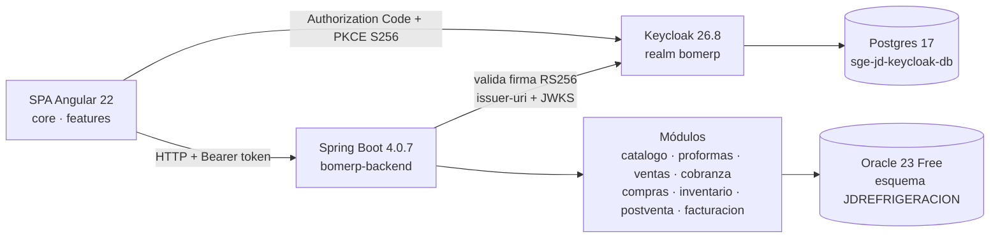

# LP2 - Producto de Unidad 2 · SGE-JD (JD Refrigeración S.A.C.)

> Producto de la Unidad II de LP2, con la estructura de la guía
> [lp2-demo.md del docente](https://262ciclo4.github.io/bomerp/proyecto-integrador/u2/lp2-demo/)
> y el contenido real de nuestro proyecto: el sistema de gestión de **JD Refrigeración S.A.C.**
> (RUC 20521632268, Breña, Lima), empresa que vende e instala equipos de refrigeración y
> aire acondicionado.

**Sobre la seguridad: Keycloak, no JWT propio.** En S10 construimos un módulo `seguridad` con
JWT propio como primer paso. En S10b lo **eliminamos** y lo reemplazamos por Keycloak 26.8
(realm `bomerp`). Hoy el backend solo acepta tokens que emite Keycloak, y la SPA inicia sesión
con Authorization Code + PKCE (S11). El código del JWT propio ya no existe en el repositorio.

## Producto

Una **sola SPA** Angular 22 (standalone, signals, zoneless), modular y segura, conectada al
**único backend** Spring Boot 4.0.7 (Java 21) sobre Oracle 23 Free. Cubre el ciclo comercial
de la empresa: catálogo, proformas, ventas, cobranza, compras, clientes, proveedores y
postventa, con control de acceso por rol.

| Pieza | Tecnología | Dirección local |
|---|---|---|
| SPA | Angular 22 | `http://localhost:4200` |
| Backend | Spring Boot 4.0.7 · OAuth2 Resource Server | `http://localhost:8080` (Swagger en `/swagger-ui.html`) |
| Identidad | Keycloak 26.8 + Postgres 17 | `http://localhost:38080` (realm `bomerp`) |
| Base de datos | Oracle 23 Free (contenedor `SGE-JD`) | `localhost:1522/FREEPDB1`, esquema `JDREFRIGERACION` |

## 1. Organización funcional

Figura 1. Organización real de la SPA (`bomerp-frontend/src/app`)

```text
src/app/
├── core/
│   ├── auth/             # AuthService (PKCE, callback, refresco, logout), pkce.ts, jwt.ts,
│   │                     #   auth-callback, authGuard, rolGuard
│   ├── interceptors/     # jwt-auth (Bearer + refresco único ante 401), trace-id (X-Trace-ID)
│   ├── layout/           # shell: menú por rol, sesión, menú hamburguesa responsivo
│   ├── inicio/           # página de inicio (pública)
│   ├── sin-permiso/      # destino de rolGuard ("Acceso denegado")
│   └── services/         # api-service, descarga (PDF/Excel), descuento, tipo de cambio SUNAT
└── features/
    ├── catalogo/         # categoria (CRUD independiente) · producto (CRUD dependiente, kardex)
    ├── proformas/        # cotizaciones con PDF y conversión a venta
    ├── ventas/           # Venta–DetalleVenta (cabecera-detalle), anulación, reportes
    ├── cobranza/         # Cobro–DetalleCobro de ventas a crédito
    ├── compras/          # Compra–DetalleCompra a proveedores (entrada de stock)
    ├── clientes/         # CRUD + historial + consulta RUC
    ├── proveedores/      # CRUD + historial
    └── postventa/        # mantenimientos programados (agenda)
```

- **No hay `features/seguridad/` ni pantalla de login propia.** La identidad vive en `core/auth`
  y el formulario de login es el de Keycloak.
- **Los guards viven en `core/auth/`** junto al `AuthService` que consultan. La guía del docente
  sugiere `core/guards/`; es solo otra ubicación.
- **Un solo shell (`core/layout`)** carga cada módulo con `loadComponent`, es decir, por carga
  diferida. Cada módulo tiene sus rutas, componentes, servicios HTTP y modelos propios.
- **No usamos `shared/`:** los estilos comunes están en `styles.css` y los servicios
  transversales en `core/services`.

Backend (paquetes por módulo de negocio): `catalogo`, `proformas`, `ventas`, `cobranza`, `compras`,
`inventario` (kardex), `clientes`, `proveedores`, `postventa`, `facturacion`, `reportes`,
`notificaciones` y `config` (seguridad, CORS, errores, empresa, descuentos).

## 2. Cómo se ejecuta

```bash
docker start SGE-JD                                                  # Oracle
docker compose up -d keycloak-db keycloak                            # Keycloak + Postgres
cd bomerp-backend  && mvn spring-boot:run                            # backend :8080
cd bomerp-frontend && npm start                                      # SPA :4200
```

Usuarios del realm `bomerp`: **`lisandro`** (ADMIN, dueño) y **`lucy`** (ASISTENTE). Las
contraseñas de desarrollo están en `bomerp-backend/keycloak/configurar_realm.py`; no se
publican aquí.

## 3. Evidencias del producto real

Tabla 1. Evidencias exigidas y dónde están en el código

| Elemento | Qué demuestra | Dónde está |
|---|---|---|
| **Login** | Authorization Code + PKCE S256 contra el realm `bomerp`. La SPA nunca ve la contraseña. El cliente `bomerp-frontend` es público, con PKCE obligatorio y *Direct access grants* desactivado | `core/auth/auth.service.ts` (`iniciarLogin`, `completarLogin`), `core/auth/pkce.ts`, `core/auth/auth-callback.ts` |
| **Guard** | `authGuard` envía a Keycloak a quien entra sin sesión y lo regresa a la ruta que pidió. `rolGuard('ADMIN')` envía a `/sin-permiso` a quien entra a crear o editar productos y categorías sin ser ADMIN | `core/auth/auth.guard.ts`, `core/auth/rol.guard.ts`, `app.routes.ts` |
| **Interceptor** | Pone `Authorization: Bearer` en cada petición al backend. Ante un **401** refresca **una sola vez** y reintenta; si fallan varias peticiones a la vez, comparten un único refresco. Ante un **403** no reintenta | `core/interceptors/jwt-auth.interceptor.ts`, `AuthService.refrescar()` |
| **Dónde vive el token** | En memoria (signal), con una copia en `sessionStorage` para sobrevivir un F5. **Nunca en `localStorage`** | `AuthService` (`CLAVE_SESION='sgejd_sesion'`) |
| **Navegación modular** | Un solo shell con menú, más de 20 rutas hijas, carga diferida por módulo y diseño responsivo (640/900/1280 px) | `core/layout/*`, `app.routes.ts` |
| **CRUD independiente** | Categoría completa: listar, crear, editar, eliminar | `features/catalogo/categoria/*` → `/api/v1/admin/categorias` |
| **CRUD dependiente** | Producto → Categoría: la lista desplegable se llena desde `CategoriaService`, la categoría es obligatoria (`Validators.required`) y el backend devuelve **404** si no existe | `features/catalogo/producto/producto-form.ts` |
| **Cabecera–detalle** | Venta–DetalleVenta con `FormArray` de líneas. Calcula en vivo subtotal, descuento, IGV y total. Valida al menos una línea (`minLength(1)`), que no se repitan productos, el tope de descuento por rol y la conversión de moneda con el tipo de cambio SUNAT. Muestra un mensaje distinto para cada error del backend: 0 (sin conexión), 400, 404 y 409 (stock insuficiente) | `features/ventas/venta/venta-form.ts` → `POST /api/v1/admin/ventas` |
| **Consultas y reportes** | Ventas filtradas por fecha, cliente y estado. Kardex por producto. Historial de clientes y proveedores. Exportación a PDF y Excel | `features/ventas/venta/venta-list.*`, `producto-kardex`, `*-historial` |
| **Control de acceso** | El menú y los botones dependen del rol: *+ Producto*, *Anular venta* y *Eliminar* solo aparecen al ADMIN. El backend aplica las mismas reglas y responde 403 si se saltan | `layout.html` (`auth.tieneRol('ADMIN')`), listas con `esAdmin()`, `SecurityConfig.java` |

Tabla 2. Reglas de autorización reales del backend (`SecurityConfig.java`)

| Recurso | ADMIN (lisandro) | ASISTENTE (lucy) | Sin token |
|---|---|---|---|
| `GET` productos / categorías | ✅ 200 | ✅ 200 | ❌ 401 |
| `POST`/`PUT`/`DELETE` productos / categorías | ✅ | ❌ 403 | ❌ 401 |
| `PATCH /ventas/{id}/anular` | ✅ | ❌ 403 | ❌ 401 |
| `DELETE` clientes / proveedores | ✅ | ❌ 403 | ❌ 401 |
| Resto de `/api/v1/admin/**` (registrar ventas, proformas, cobros, compras…) | ✅ | ✅ | ❌ 401 |
| `/api/v1/publico/**`, Swagger, `/docs` | ✅ | ✅ | ✅ |

La matriz completa (14 casos, con los dos usuarios) se probó con `pruebas-seguridad/01…05_*.ps1`.
El flujo PKCE se probó con `06_s11_pkce.ps1`.

## 4. Casos de prueba

Tabla 3. Casos de prueba de la SPA

| Caso | Acción | Resultado esperado | Resultado obtenido |
|---|---|---|---|
| Acceso sin sesión | Abrir `http://localhost:4200/ventas` sin sesión | `authGuard` envía a Keycloak y, tras el login, vuelve a `/ventas` | ✅ |
| Login válido | Iniciar sesión como `lucy` | Menú habilitado con "Lucy · ASISTENTE" | ✅ |
| Contraseña directa | `grant_type=password` contra `bomerp-frontend` | Keycloak responde 400 `unauthorized_client` | ✅ (script 06) |
| CRUD maestro | Crear, editar y eliminar una categoría (ADMIN) | La lista y Oracle quedan consistentes | ✅ |
| CRUD dependiente | Crear un producto sin elegir categoría | No se envía: el campo se marca como obligatorio. Por API, una `categoriaId` inexistente da 404 | ✅ |
| Crear venta | Cliente + 2 líneas válidas | Venta registrada con `vendedor_nombre = lucy` y stock descontado | ✅ |
| Validación | Cantidad mayor que el stock | 409 "Stock insuficiente…". Mensaje claro y nada persistido (transacción) | ✅ |
| Venta sin líneas | Eliminar todas las líneas | El formulario es inválido y no se envía | ✅ |
| Anular venta | ADMIN pulsa *Anular* | Estado ANULADA, stock repuesto en el kardex. Anular dos veces da 409 | ✅ |
| Permiso insuficiente | `lucy` abre `/catalogo/productos/nuevo` | `rolGuard` muestra "Acceso denegado". Por API daría 403 | ✅ |
| Token vencido | Esperar más de 6 min (token de 300 s + 60 s de tolerancia) y navegar | 401 → `POST /token` 200 → reintento 200, sin salir de la pantalla | ✅ |
| Logout | Pulsar *Salir* | Se cierra también la sesión SSO de Keycloak; la siguiente ruta protegida pide login | ✅ |

## 5. Integración

Figura 2. Integración real de SGE-JD



Tabla 4. Trazabilidad con ADS y BD2

| Pieza | Curso | Evidencia verificable |
|---|---|---|
| Venta–DetalleVenta, Cobro–DetalleCobro, Compra–DetalleCompra | ADS (diagrama de clases) | Entidades JPA en `ventas/`, `cobranza/`, `compras/` |
| Esquema `JDREFRIGERACION` en Oracle 23 Free | BD2 | `SELECT * FROM ventas ORDER BY id DESC` muestra la venta recién creada desde la SPA, con `vendedor_id` = `sub` de Keycloak |
| Restricciones y auditoría | BD2 | `migracion_auditoria_altos.sql` (actualiza los CHECK de estados, p. ej. `CONVERTIDA` en `PROFORMAS`) |
| Identidad | LP2 (S10b/S11) | Realm exportado en `keycloak/realm-bomerp.json` |

## 6. Decisiones y justificación

- **`vendedorId` es `String` (el `sub` del token) y no `Long`.** El usuario ya no es una fila
  de nuestra base, es una identidad de Keycloak. Se toma de `jwt.getSubject()` del token ya
  verificado (`VentaController`) y nunca de un campo del request, que el cliente podría
  falsificar.
- **Cambiar de proveedor de identidad cuesta poco.** Solo cambian `issuer-uri`, el convertidor
  de roles (`realm_access.roles`) en `SecurityConfig` y `environment.keycloak` en la SPA.
  `catalogo` y `ventas` no se tocan, porque solo leen claims estándar (`sub`, `preferred_username`).
- **El token vive en memoria y no en `localStorage`.** Un script inyectado (XSS) no puede leerlo
  de forma persistente. El precio es que la sesión no sobrevive a cerrar la pestaña, y es aceptable
  en un sistema interno de dos usuarios.
- **El access token dura 5 min.** Si se filtra, sirve poco tiempo; el refresh token lo renueva
  sin que el usuario lo note.
- **El menú por rol es solo comodidad visual.** La autorización real está en `SecurityConfig`:
  un 403 del backend la respalda aunque alguien edite el HTML.

## 7. Rúbrica de evaluación

Tabla 5. Rúbrica de la Unidad 2 (autoevaluación con evidencia)

| Criterio | Peso | Evidencia | Nivel esperado |
|---|---|---|---|
| 1. SPA con layout, menú, rutas, servicios HTTP y CRUD independiente | 16% | Shell único, más de 20 rutas, CRUD de Categoría contra el backend real | A |
| 2. CRUD dependiente con datos relacionados | 16% | Producto → Categoría con lista desplegable, `required` y 404 del backend | A |
| 3. Cabecera–detalle con cálculos, validaciones, consultas y reportes | 16% | Venta con `FormArray`, totales en vivo, 409 por stock, reportes y kardex | A |
| 4. Seguridad backend con Keycloak, roles efectivos | 16% | Resource Server con `issuer-uri`, matriz de 14 casos con 2 usuarios | A |
| 5. Login, guards, interceptor, menú por permisos, 401/403 | 16% | PKCE, token en memoria, `authGuard`/`rolGuard`, refresco único, 403 sin reintento | A |
| 6. Sustentación | 20% | En vivo | — |

Nota final = suma de (Peso × Puntos) / 100 × 20, con A=20, B=15, C=10, D=5.
